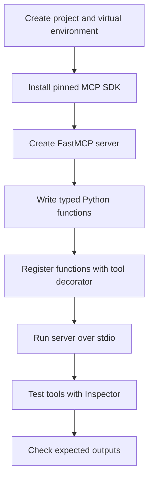

# 04 — Build Your First Python MCP Server

**Estimated time:** 30–45 minutes  
**Prerequisite:** Basic Python functions, [03 — Tools, resources, and prompts](03-tools-resources-prompts.md)

This lesson creates a tiny local server. It does not need a paid model or model API.

## 1. Set up a separate environment

Use a project directory so course dependencies do not accidentally affect other Python projects.

```bash
python -m venv .venv
```

**What it does:** creates a virtual environment named `.venv`.

Activate it in PowerShell:

```powershell
.\.venv\Scripts\Activate.ps1
```

**Expected sign:** the environment name often appears at the start of the shell prompt. If PowerShell blocks activation, you can use the environment's Python executable directly; do not change system-wide security settings blindly.

Install the SDK using the current official Python SDK instructions. For the v1 API shown in this lesson, constrain the dependency to v1:

```bash
python -m pip install "mcp[cli]>=1.0,<2"
```

**Meaning**
- `python -m pip` uses pip associated with the selected Python interpreter.
- `mcp[cli]` installs the MCP package and its command-line extras.
- `>=1.0,<2` keeps the example on the v1 major-version API instead of silently installing a future incompatible major version.

Check the installed version:

```bash
python -m pip show mcp
```

**Expected output:** package metadata including a `Version:` line. The exact version depends on what pip resolves at install time.

> SDK note: MCP SDK APIs evolve. These examples intentionally use the v1-style `FastMCP` API. Do not copy them into a project pinned to v2 without checking the official migration guide.

## 2. Create `server.py`

```python
from mcp.server.fastmcp import FastMCP

# Create a server and give it a human-readable name.
mcp = FastMCP("Study Docs MCP")

@mcp.tool()
def count_words(text: str) -> int:
    """Count whitespace-separated words in the supplied text."""
    return len(text.split())

@mcp.tool()
def multiply(a: float, b: float) -> float:
    """Multiply two numbers and return the product."""
    return a * b

if __name__ == "__main__":
    # Start the local MCP server over standard input/output.
    mcp.run(transport="stdio")
```

### Read the code deliberately

- `from mcp.server.fastmcp import FastMCP`: imports the server helper from the v1 SDK.
- `FastMCP("Study Docs MCP")`: creates a server identity.
- `@mcp.tool()`: registers the function as a discoverable callable capability.
- Type hints such as `text: str` and `a: float` help the SDK describe and validate inputs.
- The docstrings tell a client/model what each tool is for.
- `text.split()` splits text by whitespace; `len(...)` counts the pieces.
- `a * b` multiplies the input values.
- The `if __name__ == "__main__":` guard starts the server only when the file is executed directly.
- `transport="stdio"` uses standard input/output for local process communication. Do not print casual debugging text to stdout because it can interfere with protocol messages; use logging to stderr instead.

## 3. Try the server with the Inspector

The Inspector is a developer interface for exploring MCP server capabilities. In a separate shell with Node.js/npx available, use the official SDK command:

```bash
mcp dev server.py
```

This starts the development workflow and opens the Inspector URL printed in the terminal. Select the **Tools** area and try:
- `count_words` with `text = "MCP can connect AI applications"`
- `multiply` with `a = 6`, `b = 7`

Expected results:
- `count_words` returns `5`.
- `multiply` returns `42` (a numeric result; displayed formatting may vary).

If the command is not available, confirm the virtual environment is active and that the CLI extra was installed. Check the official SDK's current first-steps instructions if the command has changed.

## 4. Why this matters

You wrote ordinary Python functions and registered them. The SDK handles much of the protocol plumbing and derives tool input schemas from function type hints. The server still needs good validation, error handling, and permissions for real applications.

## Small exercise

Add a tool `is_even(number: int) -> bool` that returns whether the integer is even. Write a one-sentence docstring and test both an even and an odd value.

## Visual flowchart

This diagram summarizes the lesson. Follow the arrows from top to bottom; diamond nodes represent a decision.



## Video reference

- [Watch: Build MCP server Python SDK FastMCP tutorial — YouTube search](https://www.youtube.com/results?search_query=Build%20MCP%20server%20Python%20SDK%20FastMCP%20tutorial)
- **How to use it:** Watch only the parts related to this lesson, then return here and answer the checkpoint. Prefer recent tutorials that match the SDK major version used in the code. Video APIs can age; the written lesson and official docs remain the source of truth.

## Visual flowchart

This diagram summarizes the lesson. Follow the arrows; diamond nodes represent a decision.


## Video reference

- [Watch: Build MCP server Python SDK FastMCP tutorial — YouTube search](https://www.youtube.com/results?search_query=Build%20MCP%20server%20Python%20SDK%20FastMCP%20tutorial)
- **How to use it:** Watch only the parts related to this lesson, then return here and answer the checkpoint. Prefer recent tutorials matching the SDK major version in the code; the written lesson and official docs remain the source of truth.

## Checkpoint

1. Why does a server need a name?
2. What does `@mcp.tool()` do?
3. Why are type hints and docstrings useful?
4. What is the expected output of `multiply(6, 7)`?
5. Why should you avoid casual `print()` debugging on stdout for a stdio server?
