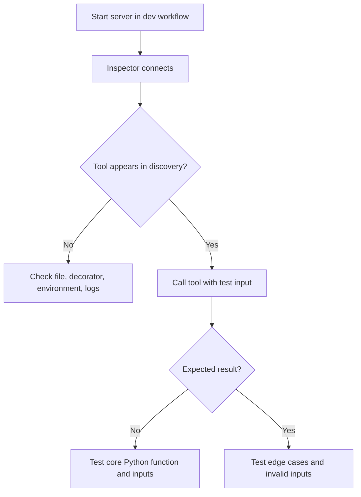

# 05 — Run, Inspect, and Debug

**Estimated time:** 20–30 minutes  
**Prerequisite:** [04 — First Python server](04-first-python-server.md)

Writing code is only half the task. A good developer verifies what the client discovers, sends valid inputs, and receives.

## 1. A reliable test loop

1. Start the server in the documented development workflow.
2. Open the MCP Inspector or equivalent client UI.
3. List the tools it discovers.
4. Call each tool with a valid input.
5. Try a boundary or invalid input.
6. Inspect errors and logs.
7. Change one thing at a time and repeat.

## 2. Tool discovery vs tool execution

- **Discovery:** “Which tools are available, what are they called, and what inputs do they need?”
- **Execution:** “Call this tool with these arguments.”

For the Lesson 04 server, discovery should show `count_words` and `multiply`. If a tool is missing, first confirm that it is registered on the server object and that the server process loaded the file you edited.

## 3. A quick manual test table

| Tool | Input | Expected result |
|---|---|---|
| `count_words` | `"hello world"` | `2` |
| `count_words` | `""` | `0` |
| `multiply` | `a=3, b=4` | `12` |
| `multiply` | `a=-2, b=5` | `-10` |

## 4. Troubleshooting checklist

**Import error**
- Check that the virtual environment you installed into is the one running the server.
- Check the installed SDK version and verify that the example's API matches it.

**Command not found**
- Check environment activation and whether the CLI extra is installed.
- Read the command shown by the current official SDK documentation.

**Tool is not listed**
- Confirm the decorator is present and the file being run is the right one.
- Restart the development process after edits.

**Noisy or broken stdio connection**
- Remove debug `print()` calls from stdout.
- Send diagnostic logs to stderr or the configured logger.

**Unexpected output**
- Test the underlying Python function independently first.
- Check the input type, edge cases, and returned value.
- Avoid assuming that a tool returning a result means the result is factually correct.

## 5. Test the function without MCP

A core function should be easy to test on its own:

```python
def count_words(text: str) -> int:
    return len(text.split())

assert count_words("hello world") == 2
assert count_words("") == 0
print("Function checks passed")
```

Expected output:

```text
Function checks passed
```

This checks the business logic independently of transport and protocol. Later, you can test the MCP boundary too.

## Visual flowchart

This diagram summarizes the lesson. Follow the arrows from top to bottom; diamond nodes represent a decision.



## Video reference

- [Watch: MCP Inspector test debug server tutorial — YouTube search](https://www.youtube.com/results?search_query=MCP%20Inspector%20test%20debug%20server%20tutorial)
- **How to use it:** Watch only the parts related to this lesson, then return here and answer the checkpoint. Prefer recent tutorials that match the SDK major version used in the code. Video APIs can age; the written lesson and official docs remain the source of truth.

## Checkpoint

1. What is the difference between listing a tool and calling it?
2. If a tool works as a normal Python function but is missing in the Inspector, where would you investigate first?
3. Why should a test include an empty string when appropriate?
