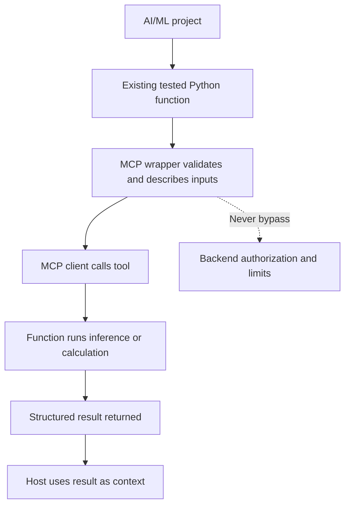
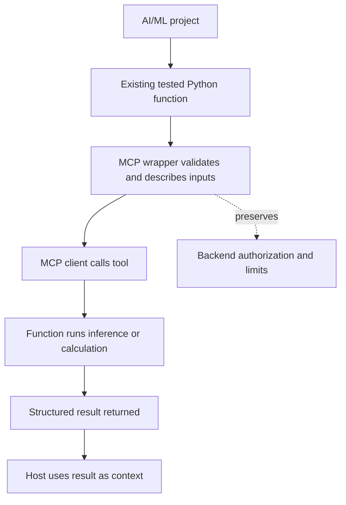

# 06 — MCP for AI/ML, NLP, RAG, and Backend

**Estimated time:** 30 minutes  
**Prerequisite:** [04 — First Python server](04-first-python-server.md)

The best first integration is a small, deterministic function you understand. Do not begin by exposing a full training pipeline or an entire local filesystem.

## 1. Pick a narrow capability

A useful beginner server could expose:
- text length or preprocessing checks;
- model metadata;
- evaluation metrics supplied as input;
- health/status information;
- a read-only project summary.

For real model inference, load the model once when the server starts or manage its lifecycle deliberately. Avoid loading a large model from disk on every tool call unless there is a reason.

## 2. Example: explain a classification report

This example uses no LLM API. It returns a simple explanation of metrics passed in by the caller. It does not calculate the metrics from raw predictions; that distinction is intentional.

```python
from mcp.server.fastmcp import FastMCP

mcp = FastMCP("ML Study Helper")

@mcp.tool()
def explain_classification_metrics(
    precision: float,
    recall: float,
    f1: float,
) -> str:
    """Explain supplied precision, recall, and F1 values in plain language."""
    values = {"precision": precision, "recall": recall, "f1": f1}
    if any(value < 0 or value > 1 for value in values.values()):
        raise ValueError("Metrics must be between 0 and 1.")

    return (
        f"Precision: {precision:.2f}; Recall: {recall:.2f}; "
        f"F1: {f1:.2f}. F1 balances precision and recall."
    )

if __name__ == "__main__":
    mcp.run(transport="stdio")
```

### Code meaning

- `FastMCP("ML Study Helper")` creates the named server.
- The decorator registers this function as a tool.
- The three inputs use `float`, allowing decimal metric values.
- The range check rejects values outside `[0, 1]`. In a production tool, report validation errors clearly and consistently.
- `:.2f` formats a value to two decimal places.
- The return value is text for the client to use or display.
- The main guard starts a local stdio server.

Example values `precision=0.90, recall=0.70, f1=0.79` produce a readable summary containing those values. The server is not claiming to independently verify that the three metrics are mathematically consistent.

## 3. How this connects to your stack

**NLP:** Wrap a pure text-cleaning or classification function. Clearly document language, maximum input length, and whether the model is local.

**Backend:** Wrap existing application services; preserve normal authentication and authorization. MCP should not bypass your backend's access rules.

**RAG:** A resource might expose a model card or collection description. A tool might retrieve approved passages. Keep retrieval boundaries and source information explicit.

**Open source:** A project server could expose read-only issue summaries or test information. Follow the project's license, configuration, authentication, and contribution guidelines.

## 4. Architecture to prefer

```text
MCP client
    |
    v
MCP tool wrapper (validate + describe)
    |
    v
Existing Python service/function
    |
    +--> local model / approved API / database
```

Keep the wrapper thin. Your model code should remain usable from a regular Python script or a FastAPI route. If you already have a FastAPI backend, adding MCP does not mean you must rewrite the whole API.

## 5. A scope limit

Avoid these beginner mistakes:
- allowing arbitrary SQL supplied by a model;
- letting tools read arbitrary file paths;
- exposing unrestricted shell execution;
- retraining a model as a side effect of a casual request;
- claiming that output is verified just because it came from a tool.

## Visual flowchart

This diagram summarizes the lesson. Follow the arrows from top to bottom; diamond nodes represent a decision.



## Video reference

- [Watch: MCP server Python AI ML integration tutorial — YouTube search](https://www.youtube.com/results?search_query=MCP%20server%20Python%20AI%20ML%20integration%20tutorial)
- **How to use it:** Watch only the parts related to this lesson, then return here and answer the checkpoint. Prefer recent tutorials that match the SDK major version used in the code. Video APIs can age; the written lesson and official docs remain the source of truth.

## Visual flowchart

This diagram summarizes the lesson. Follow the arrows; diamond nodes represent a decision.



## Video reference

- [Watch: MCP server Python AI ML integration tutorial — YouTube search](https://www.youtube.com/results?search_query=MCP%20server%20Python%20AI%20ML%20integration%20tutorial)
- **How to use it:** Watch only the parts related to this lesson, then return here and answer the checkpoint. Prefer recent tutorials matching the SDK major version in the code; the written lesson and official docs remain the source of truth.

## Checkpoint

1. Why should the MCP wrapper call existing application logic rather than contain every business rule itself?
2. Does the example independently calculate precision, recall, and F1?
3. Name one read-only capability and one potentially risky capability for an ML project.
