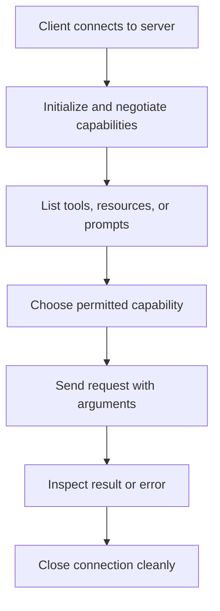

# 07 — MCP Client Basics

**Estimated time:** 25–35 minutes  
**Prerequisite:** [04 — First Python server](04-first-python-server.md)

A server offers capabilities; a client discovers and requests them. This lesson explains the workflow before adding more code.

## 1. The basic client workflow

1. Establish a connection to an MCP server.
2. Negotiate the protocol/session capabilities supported by both sides.
3. Ask which tools, resources, or prompts are available.
4. Call a tool or request a resource/prompt.
5. Handle the result, errors, and connection lifecycle.

The SDK handles the low-level message framing for you. You should still understand what operation your client is asking for and how to handle failure.

## 2. Example of the workflow in pseudocode

```python
async with connect_to_server(server_configuration) as client:
    available = await client.list_tools()
    result = await client.call_tool("count_words", {"text": "hello world"})
```

**This is conceptual pseudocode**, not a copy-paste runnable program: `connect_to_server` stands for a transport-specific connection setup. Exact client classes and methods depend on the installed SDK version. Use the official SDK's client tutorial when implementing it.

What the lines mean:
- `async with` scopes the connection's lifetime and helps ensure cleanup.
- `list_tools()` discovers tool definitions.
- `call_tool(...)` requests execution by tool name and arguments.
- The returned result should be inspected; do not assume every call is successful just because the request was sent.

## 3. Why async appears

Network and process communication can wait for data. `async`/`await` lets Python manage that waiting without requiring a separate thread for every operation. You do not have to master advanced concurrency to understand the client lifecycle.

## 4. Version caution

The official Python SDK has changed across major versions. Some documentation online describes different client APIs and protocol revisions. Before coding:
- check the version pinned in your environment;
- follow docs for that same major version;
- do not mix snippets from two SDK versions;
- use the SDK's official client quickstart to confirm imports and method signatures.

Official reference: [Python SDK client docs](https://py.sdk.modelcontextprotocol.io/).

## Visual flowchart

This diagram summarizes the lesson. Follow the arrows from top to bottom; diamond nodes represent a decision.



## Video reference

- [Watch: Python MCP client tutorial list tools call tool — YouTube search](https://www.youtube.com/results?search_query=Python%20MCP%20client%20tutorial%20list%20tools%20call%20tool)
- **How to use it:** Watch only the parts related to this lesson, then return here and answer the checkpoint. Prefer recent tutorials that match the SDK major version used in the code. Video APIs can age; the written lesson and official docs remain the source of truth.

## Visual flowchart

This diagram summarizes the lesson. Follow the arrows; diamond nodes represent a decision.


## Video reference

- [Watch: Python MCP client tutorial list tools call tool — YouTube search](https://www.youtube.com/results?search_query=Python%20MCP%20client%20tutorial%20list%20tools%20call%20tool)
- **How to use it:** Watch only the parts related to this lesson, then return here and answer the checkpoint. Prefer recent tutorials matching the SDK major version in the code; the written lesson and official docs remain the source of truth.

## Checkpoint

1. Why does a client list tools before it calls one?
2. What is the job of the client in the host/client/server architecture?
3. Why is the code above labeled pseudocode rather than a runnable script?
