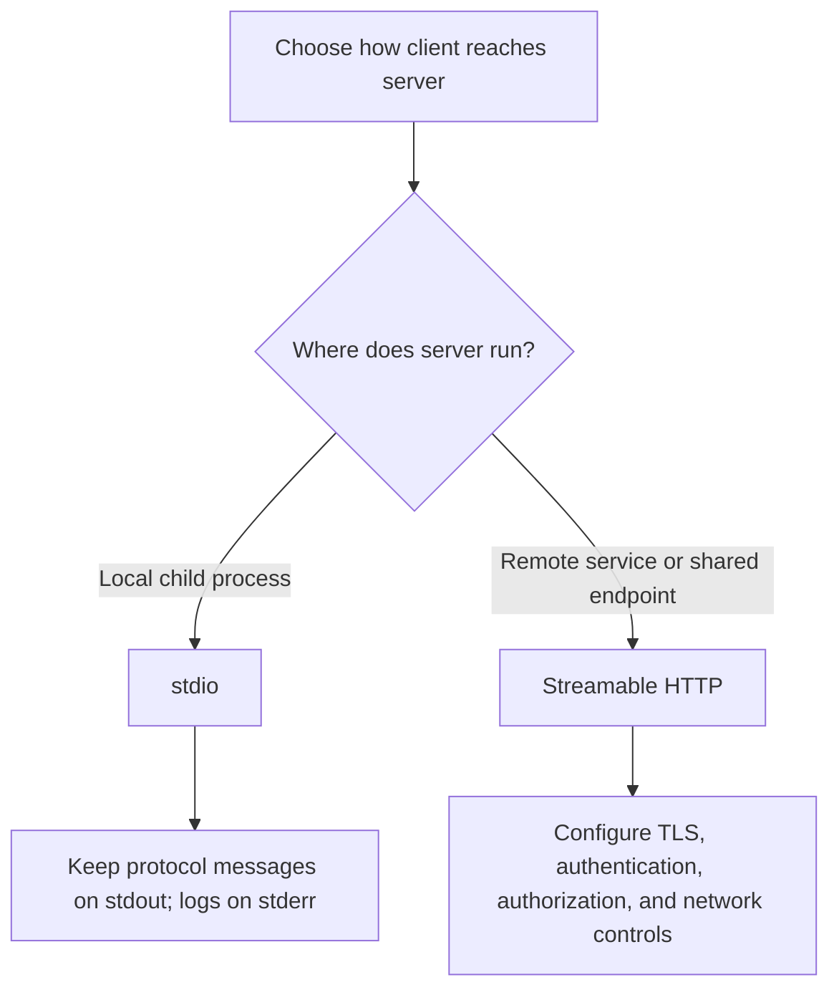
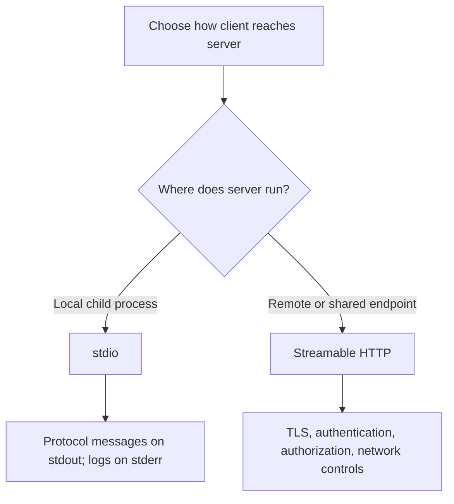

# 08 — Transports: stdio and Streamable HTTP

**Estimated time:** 20–30 minutes  
**Prerequisite:** [02 — Host, client, and server](02-host-client-server.md)

A transport is how the client and server exchange protocol messages. It is not the tool's business logic.

## 1. stdio — local process communication

With stdio, the host launches a local server process and communicates through its standard input and output streams.

**Good fit:** a tool installed on the developer's machine, such as a repository helper.

**Mental model:** one program starts another and exchanges structured messages through the process streams.

**Practical caution:** stdout belongs to protocol communication. Send diagnostic logs to stderr or a proper logger.

## 2. Streamable HTTP — communication over HTTP

Streamable HTTP allows a client to communicate with a server at an HTTP endpoint. It suits services intended to be accessed remotely or by multiple clients, depending on the deployment design.

**Good fit:** a shared internal service deployed behind an appropriately configured endpoint.

Remote deployments need explicit authentication, authorization, TLS, rate limits, monitoring, and careful exposure of capabilities. A reachable URL is not a secure service by itself.

## 3. Comparison

| Question | stdio | Streamable HTTP |
|---|---|---|
| Typical use | Local process integration | Remote service integration |
| Who starts the server? | Often the host launches it | Service is deployed and runs independently |
| Network exposure | Usually none for the MCP connection | HTTP endpoint is reachable according to deployment/network rules |
| Main extra concerns | Correct process configuration and clean stdout | Authentication, authorization, transport security, network controls |
| First learning example | Recommended | Learn after the local server works |

Older examples may mention HTTP+SSE. Transport support can vary by protocol/SDK version, so check the current specification and your SDK's supported transports before choosing one.

## 4. Decision examples

- A personal local helper that exposes a safe function: start with stdio.
- A team service shared by remote users: evaluate Streamable HTTP and design the security boundary before deploying.

Do not deploy a local development server publicly just because the tool works on your machine.

## Visual flowchart

This diagram summarizes the lesson. Follow the arrows from top to bottom; diamond nodes represent a decision.

## Video reference

- [Watch: MCP stdio vs Streamable HTTP transport explained — YouTube search](https://www.youtube.com/results?search_query=MCP%20stdio%20vs%20Streamable%20HTTP%20transport%20explained)
- **How to use it:** Watch only the parts related to this lesson, then return here and answer the checkpoint. Prefer recent tutorials that match the SDK major version used in the code. Video APIs can age; the written lesson and official docs remain the source of truth.

## Visual flowchart

This diagram summarizes the lesson. Follow the arrows; diamond nodes represent a decision.

## Video reference

- [Watch: MCP stdio vs Streamable HTTP transport explained — YouTube search](https://www.youtube.com/results?search_query=MCP%20stdio%20vs%20Streamable%20HTTP%20transport%20explained)
- **How to use it:** Watch only the parts related to this lesson, then return here and answer the checkpoint. Prefer recent tutorials matching the SDK major version in the code; the written lesson and official docs remain the source of truth.

## Checkpoint

1. Is stdio or HTTP a type of business logic?
2. Which transport is a sensible first choice for a local learning tool?
3. Name three security concerns for a remotely reachable MCP server.
