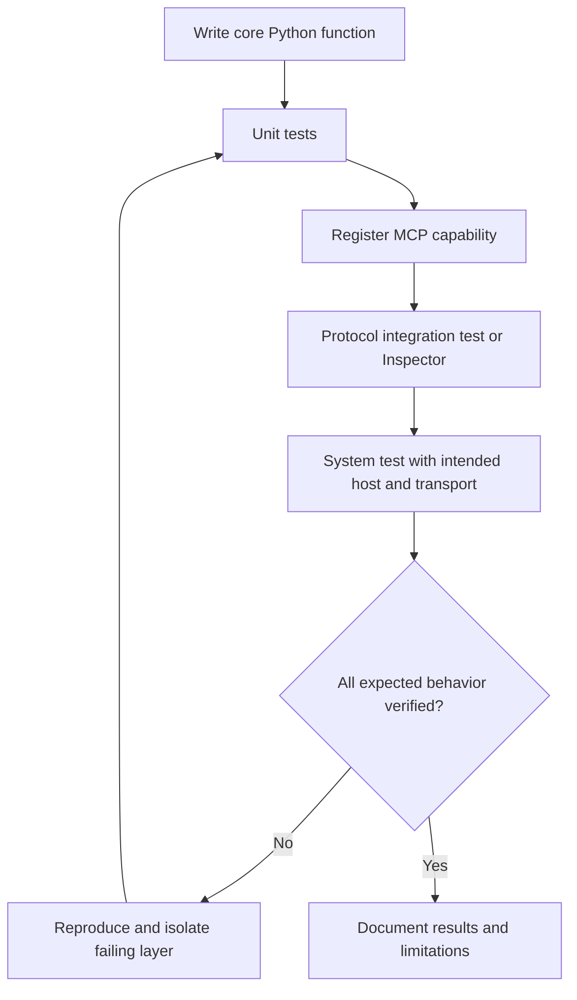
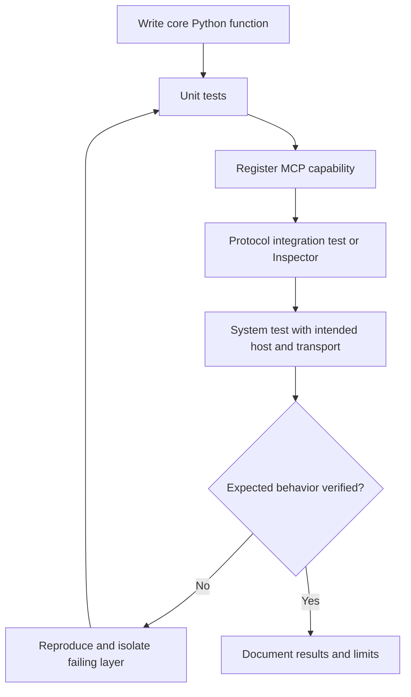

# 10 — Testing MCP Tools

**Estimated time:** 25 minutes  
**Prerequisite:** [05 — Run, inspect, and debug](05-run-inspect-debug.md)

Test the normal function first, then the MCP boundary, then any real integration. This separation makes failures easier to diagnose.

## 1. Three layers of testing

**Unit test:** tests the Python function's logic without starting MCP or loading external services.

**MCP integration test:** verifies that the registered tool is discoverable, accepts the expected arguments, and returns a result through the SDK/client interface.

**System test:** verifies behavior with the actual host, transport, permissions, model, or external service that matters in your deployment.

Do not call a successful unit test proof that MCP configuration works. It tests a different layer.

## 2. Unit test example

For a simple function:

```python
def count_words(text: str) -> int:
    return len(text.split())

def test_count_words():
    assert count_words("MCP connects AI") == 3
    assert count_words("") == 0
    assert count_words("  a   b  ") == 2
```

**Meaning:** `assert` fails the test if the actual result differs from the expected result. Include normal, empty, whitespace, and invalid-input cases as relevant.

With pytest installed, run:

```bash
python -m pytest -q
```

**Expected output on success:** a short summary reporting passing tests. Exact formatting depends on the pytest version and project configuration.

## 3. What to verify at the MCP boundary

- The tool appears in discovery.
- Its name and description are meaningful.
- The input schema matches the intended contract.
- Valid input returns the expected result.
- Invalid input fails clearly and safely.
- Errors do not leak secrets or sensitive internal details.
- A transport disconnect or server exception does not leave the host assuming the action succeeded.

## 4. Test matrix for a text tool

| Test | Example | Expected behavior |
|---|---|---|
| Normal | `"hello world"` | Count is 2 |
| Empty | `""` | Count is 0 |
| Whitespace | `"  hello   world "` | Count is 2 |
| Wrong type | `None` passed directly to the Python function | Clear type error or explicitly defined behavior |
| Large input | Above documented limit | Rejected or handled within configured limits |

## Visual flowchart

This diagram summarizes the lesson. Follow the arrows from top to bottom; diamond nodes represent a decision.



## Video reference

- [Watch: MCP server testing Python Inspector integration tests tutorial — YouTube search](https://www.youtube.com/results?search_query=MCP%20server%20testing%20Python%20Inspector%20integration%20tests%20tutorial)
- **How to use it:** Watch only the parts related to this lesson, then return here and answer the checkpoint. Prefer recent tutorials that match the SDK major version used in the code. Video APIs can age; the written lesson and official docs remain the source of truth.

## Visual flowchart

This diagram summarizes the lesson. Follow the arrows; diamond nodes represent a decision.



## Video reference

- [Watch: MCP server testing Python Inspector integration tests tutorial — YouTube search](https://www.youtube.com/results?search_query=MCP%20server%20testing%20Python%20Inspector%20integration%20tests%20tutorial)
- **How to use it:** Watch only the parts related to this lesson, then return here and answer the checkpoint. Prefer recent tutorials matching the SDK major version in the code; the written lesson and official docs remain the source of truth.

## Checkpoint

1. What does a unit test verify that a protocol test does not?
2. Why should invalid inputs be part of the test suite?
3. If a tool appears in the Inspector but returns the wrong count, which layer should you inspect first?
