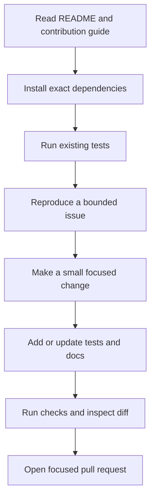

# 11 — MCP for Open-Source Development

**Estimated time:** 30 minutes  
**Prerequisite:** Basic Git/GitHub workflow and [04 — First Python server](04-first-python-server.md)

The goal here is not to pick a random issue or rewrite a project. It is to understand a repository well enough to make a small, correct change.

## 1. Learn a repository in this order

1. Read the README and identify purpose, supported Python/Node versions, and installation method.
2. Read contribution guidelines, license, and code of conduct.
3. Find the package layout and the example server/client.
4. Read tests for the behavior you plan to change.
5. Check dependency pins and the SDK major version.
6. Reproduce an existing example before modifying anything.
7. Select one small issue with clear acceptance criteria.

## 2. What to search for in an MCP project

Look for:
- tool registration and clear docstrings;
- resource/prompt definitions where relevant;
- input validation and output shape;
- tests that use an in-memory client or the project's recommended test harness;
- transport and configuration handling;
- security controls around files, commands, credentials, and external systems;
- dependency and protocol-version migration notes.

## 3. Good beginner contribution types

Examples of bounded contributions:
- fix an inaccurate tool description;
- add a missing test for an edge case;
- improve a documented setup instruction after reproducing it;
- correct a type hint or validation message;
- add a minimal example that follows the current project style.

Avoid claiming that a bug exists before reproducing it. Avoid large architectural changes before understanding the maintainers' goals.

## 4. Contribution workflow

```text
Read docs → Install exact dependencies → Run tests
    → Reproduce issue → Make narrow change
    → Add/update test → Run checks → Open focused PR
```

A useful pull request states the problem, the minimal change, how it was tested, and known limitations.

## 5. Questions before opening a PR

- Does the change address the issue's acceptance criteria?
- Did I preserve the project's supported SDK/protocol versions?
- Is the behavior covered by a test?
- Did I avoid adding secrets, generated files, or unrelated formatting changes?
- Can a maintainer understand the diff quickly?

## Visual flowchart

This diagram summarizes the lesson. Follow the arrows; diamond nodes represent a decision.



## Video reference

- [Watch: MCP open source contribution GitHub issues tests tutorial — YouTube search](https://www.youtube.com/results?search_query=MCP%20open%20source%20contribution%20GitHub%20issues%20tests%20tutorial)
- **How to use it:** Watch only the parts related to this lesson, then return here and answer the checkpoint. Prefer recent tutorials matching the SDK major version in the code; the written lesson and official docs remain the source of truth.

## Checkpoint

1. Why should you read existing tests before editing a tool?
2. Why is a small test/documentation fix often a good first contribution?
3. What can go wrong if you copy an example from a different SDK major version?
