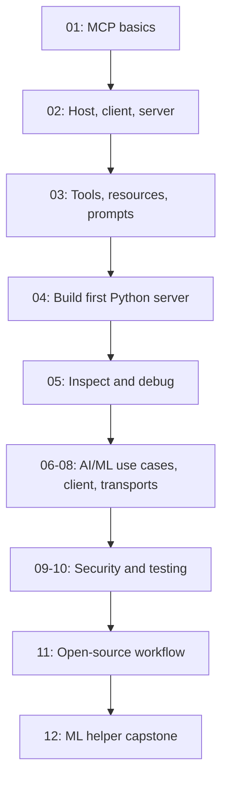

# Model Context Protocol (MCP) — Guided Learning Track

**Goal:** Understand MCP from first principles and use it to connect AI applications to tools, data, and reusable workflows. Focus: AI/ML, NLP, backend engineering, and open-source contribution.

**Approach:** small lessons → intuition → terminology → annotated code → run it → checkpoint questions. Learn one lesson at a time; do not jump ahead until the current idea is clear.

> MCP is a protocol for connecting an AI application to external capabilities. It is not an LLM, an agent framework, or a replacement for your backend.

## Start here

1. [00 — Learning roadmap and progress](00-roadmap.md)
2. [01 — What MCP is (and is not)](01-what-is-mcp.md)
3. [02 — The host, client, and server](02-host-client-server.md)
4. [03 — Tools, resources, and prompts](03-tools-resources-prompts.md)
5. [04 — Your first Python MCP server](04-first-python-server.md)
6. [05 — Run, inspect, and debug](05-run-inspect-debug.md)
7. [06 — Build a useful AI/ML server](06-ai-ml-use-case.md)
8. [07 — Connect an MCP client](07-client-basics.md)
9. [08 — Transport: stdio and Streamable HTTP](08-transports.md)
10. [09 — Security and safe tool design](09-security.md)
11. [10 — Testing and troubleshooting](10-testing.md)
12. [11 — Open-source project reading and contribution](11-open-source.md)
13. [12 — Mini capstone: ML model helper](12-capstone-ml-helper.md)
14. [Glossary and quick revision](glossary.md)

## Learning map

## Video learning support

Each numbered lesson now includes a **topic-specific YouTube search link** and a Mermaid flowchart. The links open current search results rather than pinning the course to one creator's video that may become outdated.

- [Beginner overview: MCP explained, tools, resources and prompts](https://www.youtube.com/results?search_query=Model+Context+Protocol+MCP+beginner+tools+resources+prompts)
- [Python MCP server and Inspector walkthrough](https://www.youtube.com/results?search_query=Python+MCP+server+FastMCP+Inspector+tutorial)
- [MCP security and safe tool design](https://www.youtube.com/results?search_query=MCP+server+security+prompt+injection+tool+permissions)

**Video rule:** use the video to build intuition, then follow the written lesson and official docs for code. Check SDK version compatibility before copying code from a video.

## The scope: only what you need

### Core — learn first
- Why MCP exists; what it does and does not do
- Host vs client vs server
- Tools vs resources vs prompts
- A minimal Python server and how to run/test it
- Input schemas, return values, errors, and logs
- Local stdio vs remote Streamable HTTP
- Permissions, untrusted input, and side effects
- Reading an existing MCP repository and making a small contribution

### Apply to your goals
- Wrap an existing Python function or ML inference pipeline as an MCP tool
- Make dataset/model documentation available as a resource
- Expose a reusable workflow prompt
- Keep business logic independent of MCP so FastAPI or a normal CLI can still use it

### Not in the first pass
Do not start with protocol internals, custom transports, advanced authentication servers, elicitation, sampling, complex agent orchestration, or a giant multi-server architecture. We will only add these when a real project needs them.

## Course rules
- Every lesson answers: **What is it? Why do we need it? How does it work? When would I use it?**
- Every code block explains the meaningful lines and expected result.
- Prefer a small runnable example over theory-heavy pages.
- Answer the checkpoint questions before moving on. Keep wrong answers in the progress notes and revisit the concept.
- Use free/local examples by default; no paid LLM API is required to learn MCP.
- SDK APIs change. Follow the version pinned in the lesson and verify current official docs before copying an example into a real project.

## Official references
- [MCP architecture overview](https://modelcontextprotocol.io/docs/learn/architecture)
- [Official Python SDK documentation](https://py.sdk.modelcontextprotocol.io/)
- [Official Python SDK — first steps](https://py.sdk.modelcontextprotocol.io/get-started/first-steps/)
- [MCP specification](https://modelcontextprotocol.io/specification)

## Progress
- [ ] 00 — Roadmap and learning setup
- [ ] 01 — What MCP is (and is not)
- [ ] 02 — Host, client, and server
- [ ] 03 — Tools, resources, and prompts
- [ ] 04 — First Python server
- [ ] 05 — Run, inspect, and debug
- [ ] 06 — AI/ML use case
- [ ] 07 — Client basics
- [ ] 08 — Transports
- [ ] 09 — Security
- [ ] 10 — Testing
- [ ] 11 — Open-source contribution
- [ ] 12 — Mini capstone

**Current lesson:** 01 — What MCP is (and is not). Start there; one concept at a time.
