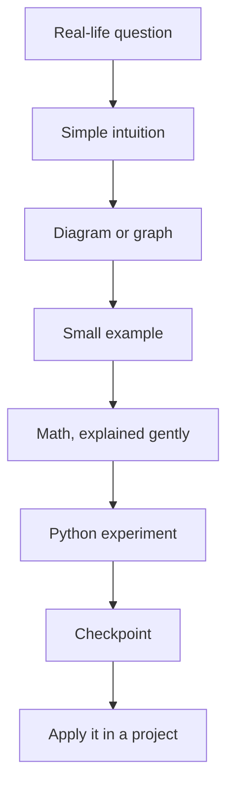

# Machine Learning Course — Start Here

Welcome! This course starts from the basics and gradually moves toward practical ML engineering and open-source work.

**Course language:** English  
**Teaching style:** visual-first, simple explanations, small examples, and hands-on practice.  
**Core rule:** understand the idea before memorising the formula or using a library.

## How each lesson works

Not every lesson needs an animation. We will use a graph, flowchart, or interactive demo when it makes an idea easier to understand.

## How to study

1. Read one lesson at a time, in order.
2. Run the code yourself instead of only reading it.
3. Change one value and predict what will happen before running it.
4. Answer the checkpoint without looking at the explanation.
5. Keep a short learning log: **What I understood / What confused me / What I tried**.
6. Do not mark a topic complete just because you watched a video.

## Course tracks

- **Learn:** intuition, maths, code, and experiments.
- **Build:** small exercises first, then useful projects.
- **Share:** tests, clear documentation, GitHub workflow, and beginner-friendly open-source contributions.

## Start the course

1. [Course map](00-course-map.md)
2. [Module 1 — Introduction to Machine Learning](01-foundations/README.md)
3. [Lesson 1 — What is Machine Learning?](01-foundations/01-what-is-machine-learning.md)

## Tools

We will prefer free tools: Python, Jupyter, NumPy, pandas, Matplotlib, scikit-learn, Git, and GitHub. Paid APIs are not required for the core course.

## A note on pace

We will build foundations properly, but we will not repeat topics you already understand in unnecessary detail. If a prerequisite is weak, we will revisit it with a short lesson and an example.
