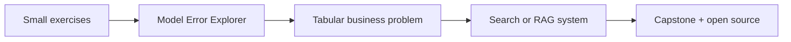

# Machine Learning Course Map

This is the sequence for the full course. Each topic and important subtopic will have its own file, linked from its module index. We will unlock deeper modules as prerequisites are covered instead of dumping every lesson at once.

## Course sequence

| Module | Topic | Main outcome |
|---|---|---|
| 00 | Start here | Know how to use the course |
| 01 | ML foundations | Explain what ML is and when it is useful |
| 02 | Python and working environment | Run, organise, and debug experiments |
| 03 | Maths for ML | Understand the maths used by models |
| 04 | Data handling and visualisation | Inspect and prepare datasets |
| 05 | First ML model | Build and evaluate a simple regression model |
| 06 | Regression and feature engineering | Improve tabular predictions carefully |
| 07 | Classification | Predict categories and understand mistakes |
| 08 | Model evaluation | Choose reliable metrics and avoid leakage |
| 09 | Trees and ensemble methods | Learn flexible models and compare baselines |
| 10 | Unsupervised learning | Explore groups, dimensions, and unusual cases |
| 11 | Practical ML projects | Build end-to-end, reproducible projects |
| 12 | Deep learning foundations | Understand neural networks and train them |
| 13 | Choose a specialisation | NLP, computer vision, time series, or recommendation |
| 14 | Modern AI systems | Embeddings, transformers, and retrieval-augmented generation |
| 15 | ML engineering | Package, test, serve, and monitor models |
| 16 | Open-source practice | Contribute to existing projects through issues and PRs |
| 17 | Capstone | Build one useful system and explain its trade-offs |

## The project path

Projects will be introduced when the required skills are ready. We will not jump into advanced projects before learning how to inspect data and evaluate a baseline.

## What every topic file should contain

- A simple explanation and a real-life example
- A diagram, flowchart, graph, or animation when useful
- A small worked example
- Maths with symbols explained in plain English
- Runnable code where appropriate
- Common mistakes
- A short checkpoint
- Links to the next lesson and useful references

## Progress rule

A topic is complete when you can explain it simply, run or work through the example, interpret the result, and answer the checkpoint. The course is a path, not a race.
