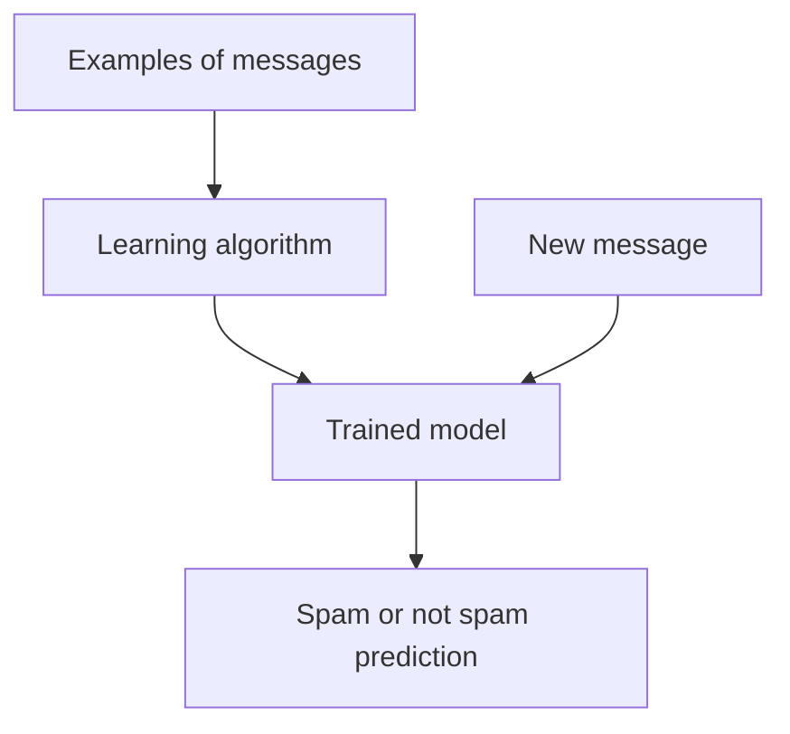

# 01 — What Is Machine Learning?

**Estimated time:** 15–20 minutes  
**Prerequisites:** None  
**Goal:** explain machine learning in simple words and recognise a few everyday examples.

## 1. Start with a real-life question

Imagine you want your phone to recognise spam messages.

You could write hundreds of rules such as:
- If a message contains a suspicious link, mark it as spam.
- If it contains a certain phrase, mark it as spam.
- If the sender looks unusual, mark it as spam.

But people who send spam can change their wording. Rules that worked yesterday may fail tomorrow.

What if, instead, we show a computer many examples of messages that people have labelled **spam** or **not spam**, and let it learn patterns from those examples?

That is the basic idea behind machine learning.

## 2. The simple definition

**Machine learning (ML) is a way to make computers learn patterns from data so they can make predictions or decisions on new examples.**

The computer does not magically understand everything. It learns from the examples and feedback we give it. If those examples are incomplete or misleading, its predictions can also be wrong.

## 3. See the process

Think of the **algorithm** as the learning method and the **model** as the result produced after learning from data.

## 4. An everyday example

Suppose we give a model these examples:

| Message | Human label |
|---|---|
| "Your parcel is arriving today" | Not spam |
| "Win a free phone now!!!" | Spam |
| "Meeting moved to 3 PM" | Not spam |
| "Claim your prize — click here" | Spam |
| "Can we study together tomorrow?" | Not spam |

The model looks for patterns in the examples. It might learn that some combinations of words, links, or message features are associated with spam.

Now it receives a message it has never seen before:

> "Congratulations! Click here to claim your free gift."

It predicts a label. The prediction might be correct or incorrect; we need to test it on many examples the model did not learn from.

**Important:** this tiny table teaches the idea. It is not enough data to build a dependable spam filter.

## 5. The key words

- **Data:** the examples we give the computer.
- **Feature:** a piece of information about an example, such as message length or whether it contains a link.
- **Label:** the correct answer supplied for a training example, such as “spam”.
- **Algorithm:** the method used to learn patterns.
- **Model:** the learned result used to make predictions.
- **Prediction:** the model's output for a new example.
- **Training:** the process of learning from examples.

Do not try to memorise every word now. You will see them again in later lessons.

## 6. A model learns from examples — but not like a human

A model finds mathematical patterns in the data it receives. It does not automatically know what is fair, true, or sensible. It can learn accidental patterns too.

For example, if every spam example in our training set contains the word “prize”, the model might over-rely on that word and mark a legitimate prize announcement as spam.

This is why data quality and testing matter.

## 7. Where ML is used

- **Maps:** estimate travel time from route and traffic patterns.
- **Shopping:** recommend items that may interest a user.
- **Banking:** flag transactions that may need fraud review.
- **Healthcare research:** help analyse patterns in medical data, with careful validation and human oversight.
- **Factories:** detect unusual sensor readings that may indicate equipment problems.

ML is not always the best answer. If a clear, stable rule solves the problem safely, a rule may be simpler and easier to maintain.

## 8. Quick checkpoint

Try answering before opening the answers.

1. In your own words, what is machine learning?
2. In the spam example, what is the data?
3. What is the difference between an algorithm and a trained model?
4. Why should we test a model on messages it has not seen during training?
5. Give one situation where a simple rule may be better than ML.

Answers — check after trying

1. ML learns patterns from examples to make predictions or decisions on new cases.
2. The example messages and their relevant information; in supervised training, the labels are included too.
3. The algorithm is the learning method; the model is what we get after training.
4. To check whether it can generalise beyond memorised training examples.
5. For example, checking whether a number is positive: a direct rule is enough.

## 9. Tiny activity

Think of a real problem around you that involves repeated examples. Write down:
- What would one example look like?
- What would you want the computer to predict?
- How could you check whether its prediction was correct?

Do not train a model yet. We are learning how to frame the problem first.

## Next lesson

[02 — AI vs Machine Learning vs Deep Learning](02-ai-vs-ml-vs-deep-learning.md)

## Further learning

- [Google Machine Learning Crash Course](https://developers.google.com/machine-learning/crash-course)
- [StatQuest on YouTube](https://www.youtube.com/@statquest)

Use these as extra explanations, not as a replacement for the example and checkpoint above.
