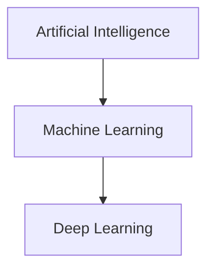
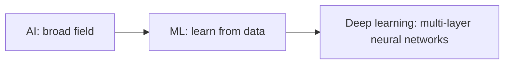

# 02 — AI vs Machine Learning vs Deep Learning

**Estimated time:** 10–15 minutes  
**Prerequisites:** [What Is Machine Learning?](01-what-is-machine-learning.md)  
**Goal:** understand how the three terms relate to one another.

## The big picture

This is a useful simplified picture: machine learning is one approach within AI, and deep learning is one family of machine-learning methods. Not every AI system learns from data, and not every ML model uses deep learning.

## A simple analogy

Imagine building a system that plays chess:

- **AI:** the broad goal of making a system perform a task that appears intelligent.
- **Machine learning:** one approach is to learn useful patterns from games and outcomes.
- **Deep learning:** one ML approach uses neural networks with many layers to learn complex patterns.

A chess program built from hand-written search rules can be AI without using ML. A model that learns from many games can use ML.

## Quick comparison

| Term | Simple meaning | Example |
|---|---|---|
| Artificial Intelligence (AI) | The broad field of building systems that perform intelligent tasks | A rule-based chess engine |
| Machine Learning (ML) | Systems learn patterns from data | A model predicting house prices from past sales |
| Deep Learning (DL) | ML methods based on multi-layer neural networks | A neural network recognising objects in images |

## Remember it visually

## Common confusion

- AI and ML are not exact synonyms.
- Deep learning is not the only kind of ML.
- A system can combine rules, search, databases, and ML models.
- A larger or newer model is not automatically better for every problem.

## Quick checkpoint

1. Which term is the broadest: AI, ML, or deep learning?
2. Can a rule-based chess engine be AI without ML?
3. What makes deep learning different from many traditional ML methods?

Answers

1. AI.
2. Yes. It can use hand-written rules and search.
3. It uses neural networks with multiple layers to learn representations and patterns.

## Next lesson

[03 — Traditional Programming vs Machine Learning](03-traditional-programming-vs-ml.md)
