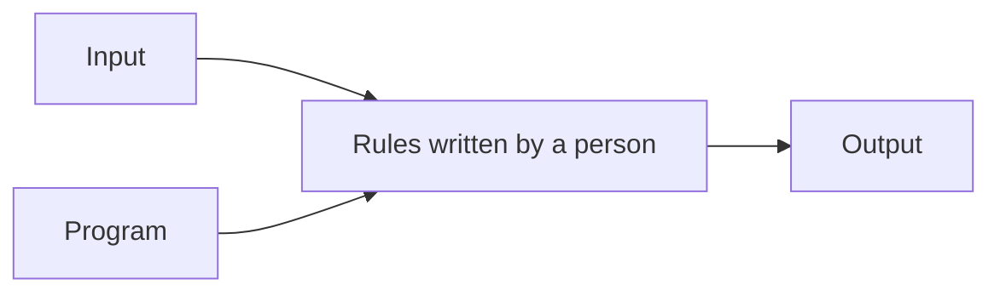
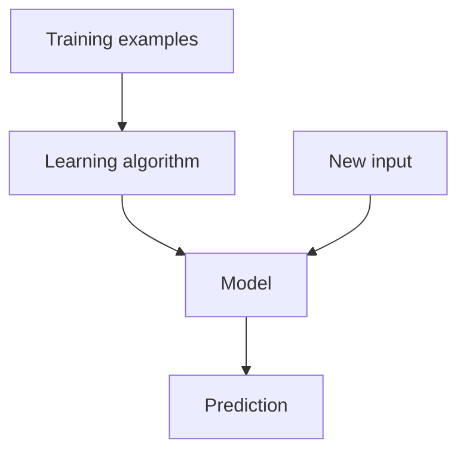

# 03 — Traditional Programming vs Machine Learning

**Estimated time:** 15 minutes  
**Prerequisites:** Lessons 01 and 02  
**Goal:** recognise when rules are enough and when learning from examples may help.

## Two ways to build a solution

### Traditional programming

A programmer writes the rules. The computer applies them to the input.

Example: calculate a discount of 10% for every order above ₹1,000. The rule is clear, stable, and easy to write.

### Machine learning

We provide examples, and a learning algorithm builds a model that can make predictions on new cases.

Example: estimate a house's sale price from its size, location, age, and past sale prices. Writing an exact rule for every combination would be difficult.

## Side-by-side comparison

| Question | Traditional programming | Machine learning |
|---|---|---|
| Where do the rules come from? | People write them | The model learns patterns from examples |
| Best fit | Clear, stable rules | Patterns are hard to specify exactly |
| What can go wrong? | Rules may be incomplete or outdated | Data may be biased, noisy, or unlike future cases |
| How do we check it? | Test expected behaviour | Test code and evaluate predictions on unseen data |

## A practical rule of thumb

Use a normal program when the rule is clear and dependable. Consider ML when examples contain patterns that are difficult to express as fixed rules and you have suitable data to learn from.

ML adds new responsibilities: collecting data, checking its quality, measuring errors, and monitoring whether future data changes.

## Quick checkpoint

1. For calculating GST using a known formula, do you need ML?
2. Why might predicting house prices benefit from ML?
3. Does ML remove the need for normal programming and testing?

Answers

1. Usually no; a normal program using the known rule is appropriate.
2. Many factors interact, and past examples can help estimate the relationship.
3. No. ML systems still need ordinary software, tests, data checks, and evaluation.

## Next lesson

[04 — Types of Machine Learning](04-types-of-machine-learning.md)
