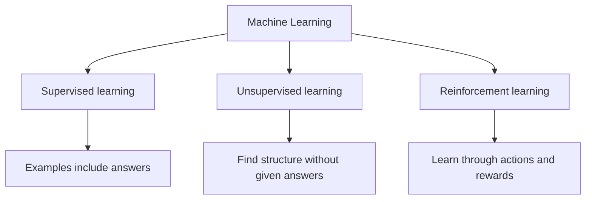
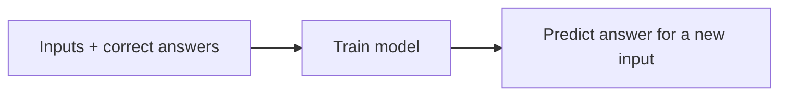
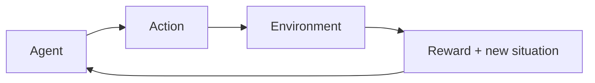

# 04 — Types of Machine Learning

**Estimated time:** 15–20 minutes  
**Prerequisites:** Lessons 01–03  
**Goal:** recognise the main learning setups and what feedback each one uses.

## The overview

These are three important categories. There are other setups too, but we will start with these.

## 1. Supervised learning — examples with answers

Imagine practising with questions that already have answer keys. The model sees examples and the correct answer for each example.

- **Classification:** predict a category, such as spam or not spam.
- **Regression:** predict a number, such as a house price.

## 2. Unsupervised learning — find patterns

Imagine receiving a box of mixed photos without labels and grouping similar ones together.

The model receives data without a target answer and tries to find structure, such as groups or unusual examples.

Example: grouping customers by similar behaviour. The groups still need interpretation; a cluster is not automatically meaningful.

## 3. Reinforcement learning — learn from rewards

Imagine learning a game through repeated attempts. Actions lead to outcomes, and feedback rewards some behaviour more than others.

The goal is to learn a strategy that earns good rewards over time. It is used in some robotics, games, and decision-making research.

## Quick comparison

| Type | What feedback is available? | Example |
|---|---|---|
| Supervised | Correct answers for training examples | Predict a sale price |
| Unsupervised | No supplied target answer | Group similar products |
| Reinforcement | Rewards or penalties from actions | Learn a game strategy |

## Quick checkpoint

1. Predicting whether an email is spam: which type?
2. Grouping customers without pre-defined group labels: which type?
3. Learning to play a game using rewards: which type?
4. Predicting tomorrow's temperature as a number: classification or regression?

Answers

1. Supervised classification, if labelled examples are available.
2. Unsupervised learning.
3. Reinforcement learning.
4. Regression.

## Next lesson

[05 — The ML Project Lifecycle](05-ml-project-lifecycle.md)
