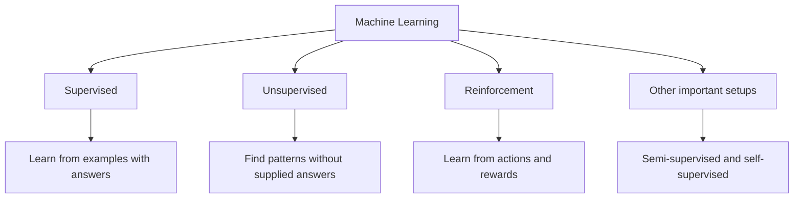
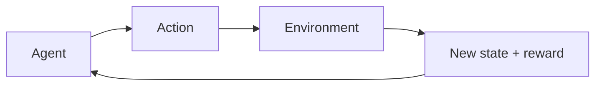

# 04 — Types of Machine Learning

**Estimated time:** 25–35 minutes  
**Prerequisites:** Lessons 01–03  
**Goal:** understand the main learning types and recognise common algorithms used in each.

You do **not** need to memorise every algorithm now. Use this page as a map; we will study algorithms properly in later modules.

## The big picture

## 1. Supervised learning — learn from examples with answers

Training data contains inputs and the correct answers (called **labels**). Two common tasks are **regression** (predict a number) and **classification** (predict a category).

### A. Regression algorithms

| Algorithm | Short introduction | Example |
|---|---|---|
| **Linear Regression** | Fits a straight-line relationship between input features and a numeric target. | Estimate a house price from its size. |
| **Polynomial Regression** | Adds powers of features so a linear model can fit a curved relationship. | Model how plant growth changes with temperature over a limited range. |
| **Ridge Regression (L2)** | Linear regression with a penalty that discourages very large coefficients. | Predict house prices when many features overlap. |
| **Lasso Regression (L1)** | Adds a penalty that can push some feature coefficients to zero. | Build a simpler price model from many candidate features. |
| **Elastic Net** | Combines Ridge and Lasso penalties. | Predict sales when several input features are strongly related. |
| **Decision Tree Regressor** | Splits data into groups using feature-based questions, then predicts a number in each group. | Estimate delivery time from distance and order details. |
| **Random Forest Regressor** | Combines many decision trees to make a more stable prediction. | Estimate used-car prices. |
| **Gradient Boosting Regressor** | Builds small models in sequence, each correcting some earlier errors. | Predict daily demand. |
| **Support Vector Regression (SVR)** | Fits a prediction function while allowing a chosen tolerance for errors. | Estimate a numeric property in a small or medium-sized dataset. |
| **k-Nearest Neighbours (KNN) Regressor** | Predicts from the target values of similar examples nearby in feature space. | Estimate a home's price from similar nearby listings. |
| **Neural Network / MLP Regressor** | Learns more complex relationships through layers of connected units. | Predict equipment energy use from sensor readings. |
| **Gaussian Process Regression** | Predicts a value and can estimate uncertainty; often useful for smaller datasets. | Model a smooth physical measurement with uncertainty. |

### B. Classification algorithms

| Algorithm | Short introduction | Example |
|---|---|---|
| **Logistic Regression** | Estimates the probability of a class; despite its name, it is commonly used for classification. | Predict whether a customer may leave a service. |
| **k-Nearest Neighbours (KNN)** | Uses the labels of the most similar training examples. | Classify a flower using its measurements. |
| **Naive Bayes** | Uses probability and a simplifying assumption about features. It is fast and often useful for text. | Classify messages as spam or not spam. |
| **Decision Tree** | Makes a prediction through a sequence of feature-based questions. | Predict whether a loan application needs further review. |
| **Random Forest** | Combines many trees to reduce dependence on one tree's decisions. | Classify transactions for fraud review. |
| **Support Vector Machine (SVM)** | Finds a boundary that separates classes; kernels can model more complex boundaries. | Classify text or image features in a moderate-sized dataset. |
| **Linear / Quadratic Discriminant Analysis (LDA/QDA)** | Models class distributions to separate categories; the two methods make different assumptions about class spread. | Classify samples using measured properties. |
| **AdaBoost** | Combines weak learners while focusing more on examples earlier learners handled poorly. | Classify tabular records. |
| **Gradient Boosting** | Adds models sequentially to improve predictions. | Predict which customers may respond to an offer. |
| **XGBoost / LightGBM / CatBoost** | Popular, efficient implementations of gradient-boosted decision trees, with different engineering strengths. | Predict churn or rank risk on tabular business data. |
| **Extra Trees** | Trains a collection of trees using extra randomness in how splits are chosen. | Build a fast tabular classification baseline. |
| **Neural Network / MLP Classifier** | Learns complex patterns through layers of connected units. | Classify handwritten digits or structured records. |
| **Stochastic Gradient Descent (SGD) Classifier** | Trains linear classifiers using small, repeated updates; useful for large sparse datasets. | Classify a large collection of text documents. |
| **Gaussian Process Classifier** | A probabilistic approach that can represent uncertainty, usually for smaller datasets. | Classify a small scientific dataset. |

**Remember:** no algorithm is automatically best. Start with a simple baseline, then compare using a suitable evaluation method.

## 2. Unsupervised learning — find patterns without supplied answers

The dataset has no given target labels for the task. Algorithms may group similar examples, simplify data, find unusual records, or discover co-occurring items.

### A. Clustering — group similar examples

| Algorithm | Short introduction | Example |
|---|---|---|
| **K-Means** | Groups points into a chosen number of clusters around their centres. | Group customers by purchasing patterns. |
| **K-Medoids** | Similar to K-Means, but each cluster centre is an actual data point. | Group locations when a representative real location is useful. |
| **Hierarchical Clustering** | Builds a tree of nested groups that can be inspected at different levels. | Explore similarities between products. |
| **DBSCAN** | Finds dense groups and can label isolated points as noise; no cluster count is required in advance. | Group geographic points and identify isolated locations. |
| **HDBSCAN** | Extends density-based clustering to handle groups with varying density more flexibly. | Find clusters in messy location or embedding data. |
| **Gaussian Mixture Model (GMM)** | Models data as a mixture of probability distributions and gives soft cluster memberships. | Find overlapping customer segments. |
| **Spectral Clustering** | Uses relationships between points to find groups that simple distance-based methods may miss. | Group data with non-round cluster shapes. |
| **Mean Shift** | Looks for dense regions in the data to identify clusters. | Group points around dense areas when the number of groups is unknown. |

### B. Dimensionality reduction — simplify data

| Algorithm | Short introduction | Example |
|---|---|---|
| **Principal Component Analysis (PCA)** | Creates fewer combined features that preserve as much variation as possible. | Compress many measurements into two dimensions for exploration. |
| **Singular Value Decomposition (SVD)** | Factorises a data matrix; truncated SVD can make large sparse data more compact. | Reduce the dimensions of a document-term matrix. |
| **t-SNE** | Creates a low-dimensional visualisation that tries to keep nearby points close. | Visualise groups of high-dimensional image embeddings. |
| **UMAP** | Creates a low-dimensional representation that often preserves useful local structure. | Explore clusters in text embeddings. |
| **Independent Component Analysis (ICA)** | Tries to separate statistically independent signals mixed together. | Separate overlapping audio sources in a suitable signal-processing setup. |
| **Autoencoder** | A neural network learns to compress data and reconstruct it. | Learn compact representations of images or sensor data. |

**Important:** a 2D visualisation can suggest patterns, but it does not prove that meaningful groups exist.

### C. Anomaly detection — find unusual examples

| Algorithm | Short introduction | Example |
|---|---|---|
| **Isolation Forest** | Flags points that are easier to isolate from the rest of the data. | Find unusual sensor readings for investigation. |
| **Local Outlier Factor (LOF)** | Compares how locally isolated a point is relative to its neighbours. | Spot unusual records in a dense dataset. |
| **One-Class SVM** | Learns a boundary around examples treated as normal. | Flag unusual machine behaviour when mostly normal examples are available. |

An anomaly is not automatically fraud or a fault; it is a signal to investigate.

### D. Association rules — find items that occur together

| Algorithm | Short introduction | Example |
|---|---|---|
| **Apriori** | Finds item combinations that occur frequently, then can form association rules. | Discover products often bought together. |
| **FP-Growth** | Finds frequent item combinations using a compact tree structure, often avoiding Apriori's candidate-generation cost. | Analyse shopping baskets for common combinations. |

Association does not prove that one item causes another.

## 3. Reinforcement learning — learn through actions and rewards

An **agent** takes actions in an **environment** and receives rewards or penalties. The aim is to learn a strategy that earns good rewards over time.

| Algorithm / family | Short introduction | Example |
|---|---|---|
| **Q-Learning** | Learns how useful actions are in different states, without needing to follow the current policy's actions. | Learn a route through a small grid-world. |
| **SARSA** | Learns action values from the actions actually taken by the current policy. | Learn a safer route in a small simulated environment. |
| **Deep Q-Network (DQN)** | Uses a neural network to estimate action values when there are too many states for a simple table. | Learn to play a simple video game. |
| **Policy Gradient / REINFORCE** | Directly adjusts a policy — the rule for choosing actions — using reward feedback. | Learn a simple control strategy in simulation. |
| **Actor-Critic** | Combines a policy learner (actor) with a value estimator (critic). | Train an agent to control a simulated system. |
| **Proximal Policy Optimization (PPO)** | A widely used policy-optimisation method designed to make training updates more stable. | Train a game-playing or simulated robotics agent. |
| **Deep Deterministic Policy Gradient (DDPG)** | Learns continuous actions using actor-critic methods. | Control a simulated robot joint. |
| **Twin Delayed DDPG (TD3)** | Improves on DDPG with techniques that reduce overestimation and unstable updates. | Learn continuous control in simulation. |
| **Soft Actor-Critic (SAC)** | Learns a continuous-action policy while encouraging exploration. | Learn a simulated robot-control task. |
| **Model-based RL / planning** | Learns or uses a model of how the environment changes to plan actions. | Plan moves in a simulated environment with known or learned rules. |

These methods can be expensive or difficult to train. We will begin with a tiny environment before considering deep reinforcement learning.

## 4. Other important learning setups

These are not simply extra algorithms; they describe **how the training signal is obtained**. Many algorithms above can be used in larger systems that combine learning setups.

| Setup | What it means | Example / common methods |
|---|---|---|
| **Semi-supervised learning** | Learn from a small labelled dataset plus a larger unlabelled dataset. | Pseudo-labeling or consistency-based methods for image classification when labels are costly. |
| **Self-supervised learning** | Create a learning task from the data itself instead of relying on human-provided labels for every example. | Masked-language modelling used to train language models; contrastive learning for image representations. |
| **Transfer learning** | Start from a model trained on another task or dataset, then adapt it to a new task. | Fine-tune a pretrained image model to recognise a small set of plant diseases. |
| **Online learning** | Update a model as new examples arrive, when the algorithm and use case support it. | Update a demand model as new labelled sales data arrives. |

## Quick memory guide

- **Supervised:** “Here are examples and their answers.”
- **Unsupervised:** “Find useful patterns in these examples.”
- **Reinforcement:** “Try actions and learn from rewards.”
- **Semi-supervised:** “A few examples have answers; many do not.”
- **Self-supervised:** “Create a training signal from the data itself.”

## Quick checkpoint

1. Which algorithm would you try first for a basic house-price prediction?
2. Which clustering algorithm can identify dense groups and mark some points as noise?
3. Which algorithm is commonly used to visualise high-dimensional data in two dimensions: PCA, t-SNE, or both?
4. Why does an anomaly detector not automatically prove that a transaction is fraudulent?
5. What is the main difference between Q-Learning and a supervised classifier?

Answers — check after trying

1. Linear Regression is a good simple baseline.
2. DBSCAN is one option.
3. Both can reduce data to two dimensions, but they work differently and the visualisations should be interpreted carefully.
4. It flags unusual patterns; unusual does not necessarily mean fraudulent.
5. A supervised classifier learns from labelled examples; Q-Learning learns action values from rewards and interactions with an environment.

## What to remember

This is a **map of major, commonly used algorithms**, not literally every algorithm ever published. Many methods have variants, and some can be used in more than one setting. We will study each family in the right sequence later, with intuition, visuals, maths, code, and projects.

## Next lesson

[05 — The ML Project Lifecycle](05-ml-project-lifecycle.md)
