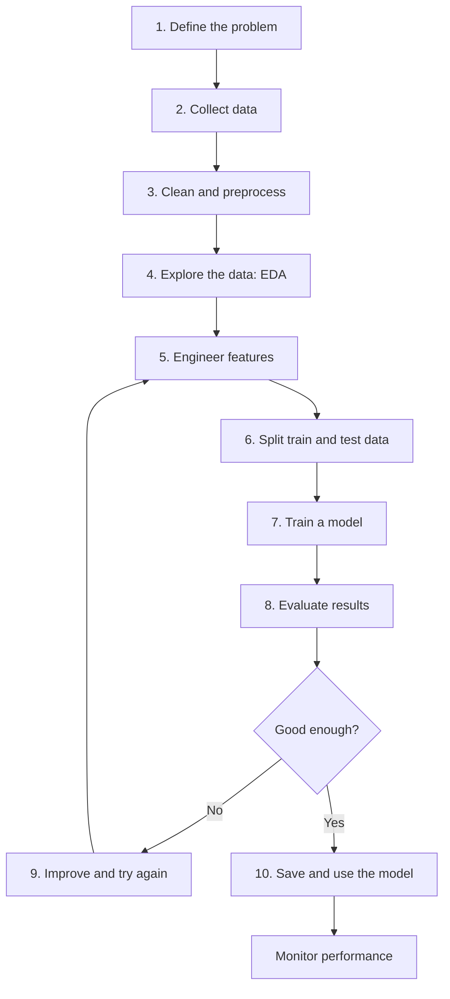

# 05 — The Machine Learning Project Lifecycle

**Estimated time:** 15–20 minutes  
**Prerequisites:** Lessons 01–04  
**Goal:** understand that building an ML model is only one part of an ML project.

## One ML model workflow

Example: predict a student's final marks using study habits.

### The 10 steps

1. **Problem definition:** decide what to predict. Example: predict final marks; aim for an average error of about 5 marks.
2. **Data collection:** gather study hours, attendance, and marks from a survey or dataset.
3. **Cleaning and preprocessing:** handle missing values, duplicates, incorrect values, and data formats.
4. **EDA:** use summaries and plots to understand distributions and relationships.
5. **Feature engineering:** choose useful inputs or create new ones from existing data.
6. **Train/test split:** keep some data aside for a fair final evaluation. Split before fitting preprocessing steps.
7. **Model selection and training:** start with a simple baseline such as linear regression.
8. **Evaluation:** use MAE, RMSE, and R² for regression; compare training and test performance.
9. **Improvement:** inspect errors, improve features or data, or try another model. Repeat the relevant steps.
10. **Save and use:** save the model, connect it to an app or API if needed, and monitor predictions over time.

**Remember:** this workflow is a loop, not a straight line. Use only information that would be available when making a real prediction, and never use the test set to repeatedly tune the model.

## Quick checkpoint

1. Why build a baseline before a complicated model?
2. Why should evaluation use data that was not used for training?
3. If the model fails, must we always choose a more complex algorithm?
4. What should we monitor after deployment?

Answers

1. It gives a simple reference point to beat.
2. To estimate how well the model may work on new cases.
3. No. The issue may be data quality, the target, the split, or the choice of metric.
4. For example, input-data changes, prediction quality when labels become available, errors, latency, and service failures.

## Next lesson

[06 — Where ML Helps, and Where It Does Not](06-when-ml-is-useful.md)
