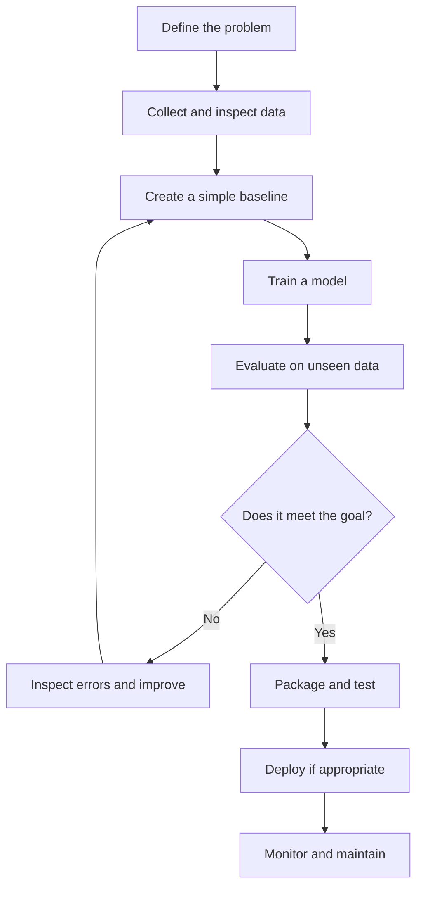
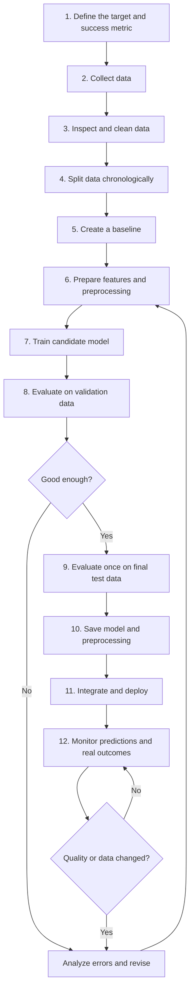
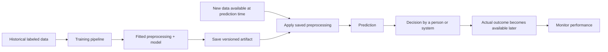

# 05 — The Machine Learning Project Lifecycle

**Estimated time:** 15–20 minutes  
**Prerequisites:** Lessons 01–04  
**Goal:** understand that building an ML model is only one part of an ML project.

## The full picture



The process is a loop, not a straight line. If the model fails, we may need better data, a clearer target, a simpler approach, or even a different problem definition.

## What each step means

1. **Define the problem:** decide what prediction is needed and how success will be measured.
2. **Inspect the data:** understand what each row means, check missing values, and look for mistakes.
3. **Build a baseline:** start with a simple rule or model so we have something to compare against.
4. **Train:** let the chosen algorithm learn patterns from the training examples.
5. **Evaluate:** test predictions on examples not used to fit the model.
6. **Inspect errors:** find where and why the model fails.
7. **Package and test:** make the code reliable and easy for someone else to run.
8. **Deploy and monitor:** if people will use it, watch for failures and changes in the data.

## A concrete example: canteen demand

Suppose a canteen wants to estimate how many lunches to prepare.

- **Problem:** predict the number of lunches needed tomorrow.
- **Data:** past daily sales, weekday, and known events.
- **Baseline:** predict the average for that weekday.
- **Model:** try a regression model.
- **Evaluation:** test on later dates the model did not train on.
- **Errors:** check whether it misses special-event days.
- **Use:** show a forecast with uncertainty to the staff.
- **Monitor:** compare predictions with actual sales over time.

We should not claim that the model reduces waste until a real evaluation supports that claim.


## End-to-end workflow: build one ML model

Let's walk through a practical workflow using the canteen-demand example. The goal is to predict how many lunches will be sold tomorrow from historical daily records.

### Workflow at a glance



### Each step, in practical terms

| Step | What you do | Why it matters |
|---|---|---|
| 1. Define the problem | Specify the prediction target, who uses it, and a measurable success metric. | A model cannot be judged without a clear goal. |
| 2. Collect data | Gather past daily lunch counts and relevant features such as weekday and event status. Record the source and permissions. | The model can only learn from available, relevant evidence. |
| 3. Inspect and clean | Check row meaning, data types, missing values, duplicates, outliers, and suspicious labels. | Errors in the input data can become errors in predictions. |
| 4. Split data | For time-based demand, train on earlier dates, validate on later dates, and reserve the latest period for the final test. | Random splitting can accidentally let future information influence a past prediction. |
| 5. Build a baseline | Predict a simple historical average, or the average for that weekday. | This is the minimum benchmark a more advanced model should beat. |
| 6. Prepare features | Select information available at prediction time; fit imputers, encoders, and scaling only on the training set. | Prevents data leakage and keeps training/inference consistent. |
| 7. Train candidates | Fit a simple model first, then compare other suitable algorithms. | Complexity should be earned by measurable improvement. |
| 8. Validate and analyze | Use an appropriate metric such as MAE; inspect errors by weekday and event type. | A single average score can hide important failure cases. |
| 9. Final test | After decisions are finished, evaluate the selected approach on the untouched test period. | Gives a less biased estimate of performance on unseen cases. |
| 10. Package | Save the fitted model and preprocessing steps together; record feature names, version, and training data reference. | The same transformations must be applied when making future predictions. |
| 11. Deploy | Expose predictions through a batch job, application, or API, with input validation and error handling. | A trained model is not usable until it fits into a real workflow. |
| 12. Monitor | Compare forecasts with actual lunch counts when available; track error, missing/changed inputs, latency, and failures. | Real-world data and conditions can change over time. |

### Tiny example: what goes into the pipeline?

A single historical row might look like this:

```text
date        weekday   special_event   lunches_sold
2026-10-12  Monday    no              142
2026-10-13  Tuesday   yes             196
2026-10-14  Wednesday no              151
```

Here, `weekday` and `special_event` are input features, while `lunches_sold` is the target the model learns to predict. For tomorrow's forecast, only information known before tomorrow's sales happen can be used. Tomorrow's actual lunch count must never be used as an input to predict itself.

### Training is not the same as inference



- **Training:** uses historical examples with known answers to fit the model.
- **Inference:** uses the saved model to predict for new examples whose answer is not yet known.
- **Monitoring:** compares predictions with real outcomes later, where possible, to check whether quality is holding up.

### Important rules to remember

- Never fit preprocessing on the full dataset before splitting it.
- Keep the final test set untouched while selecting features, tuning settings, and comparing models.
- For time-dependent problems, respect chronological order and use only information available at prediction time.
- Compare against a baseline; do not report a score without explaining the metric and test setup.
- Save the preprocessing and model as one reproducible pipeline where possible.
- Do not deploy automatically just because a model runs. Check performance, risks, costs, and whether a human review is needed.
- Monitor the system after release. Deployment is not the end of the project.

## Quick checkpoint

1. Why build a baseline before a complicated model?
2. Why should evaluation use data that was not used for training?
3. If the model fails, must we always choose a more complex algorithm?
4. What should we monitor after deployment?

<details>
<summary>Answers</summary>

1. It gives a simple reference point to beat.
2. To estimate how well the model may work on new cases.
3. No. The issue may be data quality, the target, the split, or the choice of metric.
4. For example, input-data changes, prediction quality when labels become available, errors, latency, and service failures.
</details>

## Next lesson

[06 — Where ML Helps, and Where It Does Not](06-when-ml-is-useful.md)
