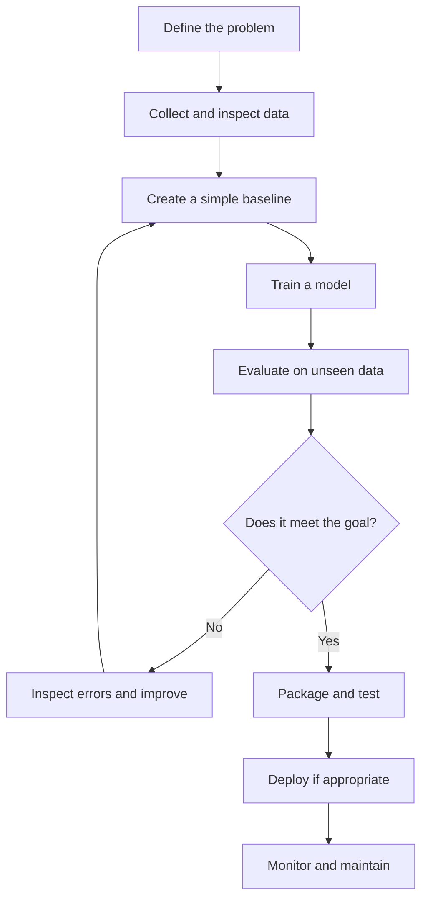
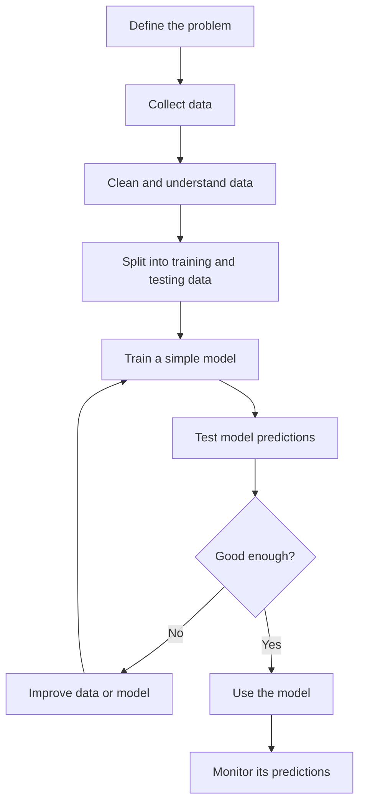

# 05 — The Machine Learning Project Lifecycle

**Estimated time:** 15–20 minutes  
**Prerequisites:** Lessons 01–04  
**Goal:** understand that building an ML model is only one part of an ML project.

## The full picture

The process is a loop, not a straight line. If the model fails, we may need better data, a clearer target, a simpler approach, or even a different problem definition.

## What each step means

1. **Define the problem:** decide what prediction is needed and how success will be measured.
2. **Inspect the data:** understand what each row means, check missing values, and look for mistakes.
3. **Build a baseline:** start with a simple rule or model so we have something to compare against.
4. **Train:** let the chosen algorithm learn patterns from the training examples.
5. **Evaluate:** test predictions on examples not used to fit the model.
6. **Inspect errors:** find where and why the model fails.
7. **Package and test:** make the code reliable and easy for someone else to run.
8. **Deploy and monitor:** if people will use it, watch for failures and changes in the data.

## A concrete example: canteen demand

Suppose a canteen wants to estimate how many lunches to prepare.

- **Problem:** predict the number of lunches needed tomorrow.
- **Data:** past daily sales, weekday, and known events.
- **Baseline:** predict the average for that weekday.
- **Model:** try a regression model.
- **Evaluation:** test on later dates the model did not train on.
- **Errors:** check whether it misses special-event days.
- **Use:** show a forecast with uncertainty to the staff.
- **Monitor:** compare predictions with actual sales over time.

We should not claim that the model reduces waste until a real evaluation supports that claim.

## Simple ML model workflow

Example: predict how many lunches a canteen will sell tomorrow.

1. **Define the problem:** decide what you want the model to predict.
2. **Collect data:** gather relevant past examples.
3. **Clean the data:** check missing values and mistakes.
4. **Split the data:** keep some examples aside to test the model fairly.
5. **Train:** let the algorithm learn patterns from the training data.
6. **Evaluate:** check predictions on data the model has not trained on.
7. **Improve:** if results are poor, inspect errors and try changes.
8. **Use and monitor:** use the model only if it is useful, then check its performance over time.

**Remember:** training teaches the model from past examples; prediction uses the trained model on new data. Always compare its performance with a simple baseline.

## Quick checkpoint

1. Why build a baseline before a complicated model?
2. Why should evaluation use data that was not used for training?
3. If the model fails, must we always choose a more complex algorithm?
4. What should we monitor after deployment?

Answers

1. It gives a simple reference point to beat.
2. To estimate how well the model may work on new cases.
3. No. The issue may be data quality, the target, the split, or the choice of metric.
4. For example, input-data changes, prediction quality when labels become available, errors, latency, and service failures.

## Next lesson

[06 — Where ML Helps, and Where It Does Not](06-when-ml-is-useful.md)
