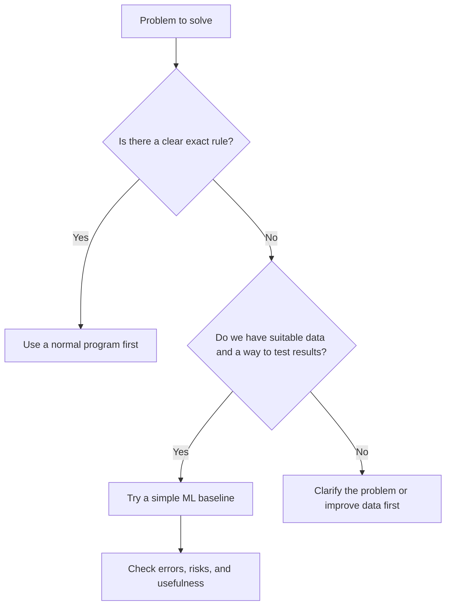

# 06 — Where ML Helps, and Where It Does Not

**Estimated time:** 10–15 minutes  
**Prerequisites:** Lessons 01–05  
**Goal:** decide whether a problem is a sensible fit for ML.

## Use ML when...

- The task involves patterns that are hard to describe with fixed rules.
- You have enough relevant examples or a sensible way to obtain them.
- You can define what a good result looks like.
- You can test mistakes and handle the risk of wrong predictions.

Examples include estimating demand, ranking search results, detecting unusual transactions for review, and recognising objects in images.

## A normal rule may be better when...

- The rule is clear and stable.
- The answer must be exact and can be calculated directly.
- You do not have suitable data.
- The cost or risk of a wrong prediction is too high for the available evidence.

For example, calculating the total price from item prices and tax rates usually needs ordinary code, not ML.

## A simple decision guide

## Quick checkpoint

A team wants to automatically label every expense as “reimbursable” or “not reimbursable.” The policy is written clearly as a set of exact rules.

- Would you start with ML or a rule-based program?
- What might make ML worth exploring later?

Answers

Start with the rule-based program because the policy is explicit. ML might be worth exploring if inputs are messy, the rules cannot cover all cases, and there is enough reliable labelled data to evaluate it safely.

## Module 1 complete

Before moving on, try explaining the difference between AI and ML, supervised and unsupervised learning, and the stages of an ML project in your own words.

[Return to the Module 1 index](README.md) · [Open the course map](../00-course-map.md)
