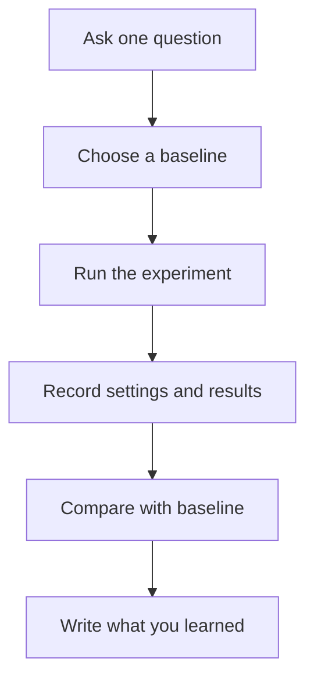

# 02 — Run and Organise an ML Experiment

**Estimated time:** 20 minutes  
**Goal:** run a small experiment and keep track of what you changed and what happened.

## Why organise experiments?

Suppose you train a model three times with different settings. If you do not record the settings and results, it is easy to forget which run performed best.

An experiment should answer one clear question, such as: **Does adding attendance improve student-marks predictions?**

## A simple workflow



## Keep notebooks and Python files organised

- **Notebook:** useful for exploration, plots, and trying ideas step by step.
- **Python script:** useful for code you want to run repeatedly, such as a training pipeline.
- **README:** explains the project, dataset, setup, and how to run it.
- **Experiment log:** records what changed and what result you got.

A simple log can be a Markdown table:

| Run | Change | Metric | Observation |
|---|---|---|---|
| 1 | Baseline features | MAE = ... | Reference result |
| 2 | Added attendance | MAE = ... | Did it improve? |

The values above are placeholders. Fill them with results from your own runs; never invent results.

## Reproducibility basics

1. Keep the dataset source and version documented.
2. Record the features, model, settings, and evaluation metric.
3. If the algorithm uses randomness, set and record a random seed where supported.
4. Keep the train/test split consistent when comparing experiments.
5. Change one main thing at a time so you can interpret the result.
6. Do not repeatedly tune your model based on the final test set. Use validation data for experimentation.

## Tiny Python example

```python
from sklearn.model_selection import train_test_split
from sklearn.linear_model import LinearRegression
from sklearn.metrics import mean_absolute_error

# X contains input features; y contains the target marks.
# Replace these example variable names with your dataset columns.
X_train, X_test, y_train, y_test = train_test_split(
    X, y, test_size=0.2, random_state=42
)

model = LinearRegression()
model.fit(X_train, y_train)

predictions = model.predict(X_test)
mae = mean_absolute_error(y_test, predictions)

print(f"Test MAE: {mae:.2f}")
```

This snippet assumes that `X` and `y` have already been created from a cleaned dataset. It demonstrates the experiment structure; it is not a complete runnable notebook on its own.

## Checkpoint

1. When is a notebook useful, and when might a Python script be better?
2. Why record a baseline result?
3. Why change one main thing at a time?
4. What is the difference between validation data and the final test set?

<details>
<summary>Answers</summary>

1. Notebooks are useful for exploration; scripts are useful for repeatable runs.
2. It gives you a reference to compare improvements against.
3. So you can better understand which change caused a result.
4. Validation data helps choose and improve a model; the final test set is held back for the final evaluation.

</details>

## Next lesson

Continue to [Module 03 — Maths for ML](../00-course-map.md), beginning with the mathematical ideas that appear in common ML models.
