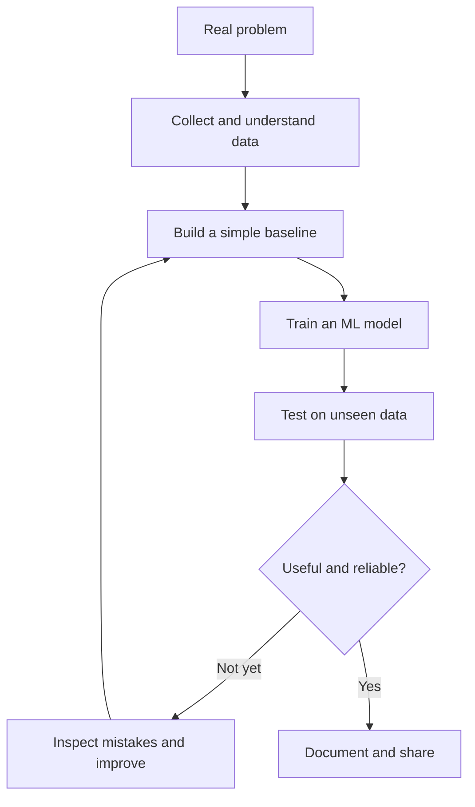

# Machine Learning — Complete Learning & Engineering Roadmap

> A long-term, evidence-driven path to learn machine learning from first principles to advanced research-informed practice and production engineering. This is a living handbook: concepts, mathematics, code, experiments, datasets, tools, videos, papers, open-source contributions, and industry-style projects belong together.

## The mission

Build the knowledge and practical judgment needed to independently understand, implement, evaluate, debug, deploy, and improve machine-learning systems. The goal is not to memorize APIs or collect certificates. Every important idea should connect **intuition → mathematics → implementation → experiment → evaluation → real-world trade-offs**.

No document can guarantee that a beginner will outperform a senior ML engineer. Senior-level work also depends on experience with ambiguous requirements, data failures, production incidents, collaboration, and business constraints. This roadmap is designed to help develop those capabilities systematically through real practice and feedback.

## How to use this folder

- Learn in order when a topic depends on earlier foundations; use the index to revisit topics later.
- For each concept, first explain it in plain language, then derive the mathematics, implement a small version, compare it with a trusted library, and test it on a realistic dataset.
- Keep experiments reproducible: record dataset source/version, split strategy, random seeds, baseline, metrics, environment, observations, and limitations.
- Never treat training score alone as proof of a good model. Check leakage, generalization, subgroup behavior, calibration where appropriate, and the cost of errors.
- Keep a progress log and mark a topic complete only after explaining it, coding it, solving a checkpoint, and interpreting the result.

## The learning loop

1. **Question:** What real problem are we solving, and what would success mean?
2. **Concept:** Build intuition with diagrams and a real-life example.
3. **Math:** Understand the assumptions, notation, objective, and derivation.
4. **From scratch:** Implement the core idea using NumPy where useful.
5. **Library version:** Rebuild using scikit-learn, PyTorch, or the appropriate maintained framework.
6. **Experiment:** Change one factor at a time; compare against a simple baseline.
7. **Evaluation:** Choose metrics that match the task and error costs; inspect failure cases.
8. **Engineering:** Package, test, document, version, and expose the model when appropriate.
9. **Reflection:** Record what failed, what changed, and what remains uncertain.

## Roadmap at a glance

| Phase | Focus | Exit evidence |
|---|---|---|
| 0 | Python, Git, environments, notebooks, debugging | Clean, reproducible Python project with tests |
| 1 | Math for ML: linear algebra, calculus, probability, statistics, optimization | Explain key formulas and implement small numerical examples |
| 2 | Data work: NumPy, pandas, visualization, SQL, data quality | Reproducible EDA report with data-quality checks |
| 3 | Classical supervised ML | Compare baselines, avoid leakage, interpret error metrics |
| 4 | Unsupervised learning and representation | Evaluate clusters and dimensionality-reduction trade-offs |
| 5 | Model selection and reliable evaluation | Leakage-resistant validation, tuning, uncertainty and error analysis |
| 6 | Feature engineering and tabular ML | End-to-end project with a strong baseline and honest test results |
| 7 | Deep learning foundations | Train, debug and explain neural networks with PyTorch |
| 8 | Specialized ML: NLP, vision, time series, recommender systems | Domain-specific project with suitable metrics and baselines |
| 9 | Modern ML: transformers, embeddings, retrieval, fine-tuning, multimodal | Reproduce a small paper or benchmark and document limitations |
| 10 | ML engineering and MLOps | Tested API/batch pipeline, reproducible runs, monitoring plan |
| 11 | Research and open-source practice | Read papers critically, reproduce results, contribute useful code/docs/tests |
| 12 | Advanced specialization | Evidence-backed work in one chosen domain, not shallow coverage of everything |

## Core curriculum

### 1. Prerequisites and practical computing
- Python fluency: functions, classes, iterators, exceptions, typing, modules, packaging, logging and testing.
- NumPy arrays, shapes, broadcasting, vectorization and numerical stability.
- pandas: joins, groupby, missing data, datetime, categorical data and efficient workflows.
- Visualization with Matplotlib/Seaborn; SQL for extraction and validation.
- Git/GitHub, virtual environments, Jupyter, command line, dependency management and basic Linux.
- Data ethics, privacy, licensing, reproducibility and responsible dataset use.

### 2. Mathematics for ML
- **Linear algebra:** vectors, matrices, dot products, norms, projections, rank, linear systems, eigenvalues/eigenvectors, SVD and PCA connections.
- **Calculus:** functions, derivatives, partial derivatives, chain rule, gradients, Jacobians and computational graphs.
- **Probability:** events, conditional probability, Bayes' theorem, random variables, expectation, variance, common distributions and independence.
- **Statistics:** sampling, estimators, bias/variance, confidence intervals, hypothesis testing, correlation, experimental design and bootstrap intuition.
- **Optimization:** loss functions, convexity intuition, gradient descent, stochastic/minibatch updates, learning rates, conditioning, regularization and stopping criteria.
- **Information theory:** entropy, cross-entropy, KL divergence and mutual information where relevant.

For every mathematical topic, include: notation glossary, visual intuition, derivation, a tiny numeric example, NumPy implementation, common mistakes, and the ML use case.

### 3. Data understanding and preparation
- Problem framing, target definition, data dictionaries and unit-of-analysis checks.
- Missingness, duplicates, outliers, inconsistent labels, class imbalance, distribution shift and data leakage.
- Train/validation/test splits; stratified, grouped, and time-based splits when appropriate.
- Exploratory data analysis, visual summaries, feature types, transformations and domain-informed features.
- Reusable preprocessing pipelines, fit-on-train-only discipline, and dataset/version tracking.

### 4. Classical supervised learning
- Linear regression: assumptions, loss, normal equation, gradient descent, residual diagnostics and multiple regression.
- Regularization: Ridge/L2, Lasso/L1, Elastic Net, shrinkage and feature-selection trade-offs.
- Logistic regression: sigmoid, log-odds, likelihood, log loss, decision thresholds, multiclass methods and calibration.
- k-nearest neighbors, Naive Bayes, decision trees, random forests, bagging, boosting, gradient boosting, XGBoost/LightGBM/CatBoost when suitable.
- Support vector machines, kernels, discriminative vs generative approaches, and probabilistic predictions.
- Explain assumptions, decision boundaries, interpretability, computational cost, and failure modes—not only API syntax.

### 5. Evaluation and model selection
- Regression: MAE, MSE, RMSE, R² and residual analysis.
- Classification: confusion matrix, precision, recall, specificity, F1, ROC-AUC, PR-AUC, log loss and threshold selection.
- Ranking/recommendation metrics where relevant; class-specific and subgroup analysis.
- Baselines, cross-validation, hyperparameter search, nested validation when warranted, confidence intervals and paired comparisons.
- Imbalanced data, probability calibration, cost-sensitive learning, data leakage, overfitting and underfitting.
- Do not choose a metric just because it is popular: tie metrics and thresholds to the actual decision and error cost.

### 6. Unsupervised learning and representation
- Clustering: k-means, hierarchical methods, DBSCAN, density-based methods and cluster validation limitations.
- Dimensionality reduction: PCA, SVD, t-SNE and UMAP; distinguish visualization from evidence of meaningful clusters.
- Anomaly detection, embeddings, distance/similarity measures and representation learning.

### 7. Deep learning
- Perceptrons, multilayer networks, activations, forward pass, backpropagation and computational graphs.
- Initialization, normalization, optimizers, batch size, learning-rate schedules, regularization, dropout and early stopping.
- PyTorch tensors, autograd, Dataset/DataLoader, training loops, checkpoints, GPU use and experiment tracking.
- CNNs and vision foundations; sequence models and attention; transformers and modern pretrained models.
- Debugging training runs with learning curves, gradient checks, small-batch overfit tests and controlled ablations.

### 8. Modern and domain-specific ML
- **NLP:** tokenization, sparse representations, embeddings, text classification, transformers, retrieval, reranking, evaluation and multilingual concerns.
- **Computer vision:** image preprocessing, augmentation, transfer learning, detection/segmentation basics and dataset shift.
- **Time series:** temporal validation, leakage-safe features, forecasting baselines, seasonality and uncertainty.
- **Recommenders/search:** candidate generation, ranking, implicit feedback, offline/online evaluation and feedback loops.
- **Generative and multimodal ML:** transformers, diffusion concepts, embeddings, retrieval-augmented generation, fine-tuning/parameter-efficient methods, tool use and grounded evaluation. Keep classic ML fundamentals in scope; use new methods when they solve a defined problem.
- **Advanced topics:** self-supervised learning, graph ML, reinforcement learning, causal inference, Bayesian methods and federated/privacy-aware learning as optional specializations.

### 9. ML engineering and MLOps
- Project structure, configuration, type hints, tests, linting, data/model contracts and robust error handling.
- Reproducibility: seeds, environment lockfiles, data/model versioning, experiment tracking and artifact provenance.
- Batch inference and APIs with FastAPI; Docker, CI, deployment and resource constraints.
- Data and model monitoring, drift signals, performance feedback, retraining decisions, rollback, observability and incident response.
- Latency, throughput, memory, cost, security, privacy, fairness and maintainability trade-offs.
- Design model cards, dataset documentation, limitations, intended use and misuse considerations.

### 10. Research literacy and open source
- Read papers by identifying the problem, claimed contribution, assumptions, method, data, baselines, metrics, ablations, limitations and reproducibility artifacts.
- Reproduce one result at a manageable scale before extending it.
- Explore established libraries and datasets, read contribution guides, reproduce a bug, add a regression test, and submit small evidence-backed pull requests.
- Check issue relevance, maintainer activity, project conventions, licenses, tests, and whether the proposed contribution is welcome.

## Standard format for every concept note

Each topic should follow this compact but complete structure:

1. **Why it matters:** problem, use cases and limits.
2. **Intuition:** plain-language explanation, analogy, diagram or flow.
3. **Prerequisites and vocabulary:** explain each new symbol/term.
4. **Mathematics:** equation, variable meanings, derivation and a worked example.
5. **Code from scratch:** readable Python/NumPy implementation with comments.
6. **Library implementation:** idiomatic use of a trusted library and API documentation.
7. **Dataset and experiment:** source, license, target, split, baseline and controlled comparisons.
8. **Evaluation:** metric choice, result interpretation, error analysis and leakage checks.
9. **Industry connection:** where used, constraints, failure modes and design trade-offs.
10. **Practice:** a quick checkpoint, a coding task and an extension challenge.
11. **Resources:** selected videos, official documentation, a textbook/paper and useful repositories.
12. **Summary and status:** key takeaways, prerequisites for the next topic and progress checklist.

## Project ladder

Build projects as a progression. Every project should have a clear README, reproducible environment, data provenance, baseline, validation strategy, metrics, error analysis, tests, limitations and a demo where useful.

1. **Exploratory data analysis:** real public dataset, data-quality report and useful visualizations.
2. **Regression:** house/laptop price prediction with leakage-safe preprocessing, baseline comparisons and residual analysis.
3. **Classification:** imbalanced fraud, churn, or risk-style dataset with threshold and cost analysis; clearly explain dataset limitations.
4. **End-to-end tabular ML:** preprocessing pipeline, experiment tracking, FastAPI/batch inference, tests and Docker.
5. **Unsupervised learning:** compare cluster stability and explain why the clusters are or are not useful.
6. **NLP classifier:** compare TF-IDF + linear baseline against a pretrained transformer on a documented dataset.
7. **Computer vision:** transfer-learning baseline with class-wise error analysis and responsible data use.
8. **Retrieval system:** evaluate retrieval separately from answer generation; use real citations and a defined test set.
9. **Production-minded capstone:** versioned pipeline, monitoring plan, latency/cost benchmarks, model card and failure analysis.
10. **Paper reproduction/open-source extension:** reproduce a small finding, write the experiment log, then propose a justified improvement.

Projects must not fabricate labels, silently leak test data, hide failed experiments, or claim production readiness without evidence.

## Dataset policy

Use trustworthy public datasets from sources such as [UCI Machine Learning Repository](https://archive.ics.uci.edu/), [OpenML](https://www.openml.org/), [Kaggle Datasets](https://www.kaggle.com/datasets), [Hugging Face Datasets](https://huggingface.co/datasets), [Google Dataset Search](https://datasetsearch.research.google.com/), and official domain repositories. These are discovery sources, not automatic guarantees of quality.

Before using a dataset, record its creator/source, license and usage limits, collection date if relevant, target definition, sampling process, known biases, missingness, duplicate rows, leakage risks and intended split. Respect privacy and do not upload sensitive data to third-party services without authorization. Synthetic data may be useful for software tests or controlled demonstrations, but must not be presented as real-world evidence or silently substituted for real training/evaluation data.

## Tools and resource policy

Prefer free/open-source tools and official documentation first: Python, NumPy, pandas, Matplotlib, scikit-learn, PyTorch, Jupyter, Git, pytest, Ruff, FastAPI, Docker, and PostgreSQL/SQL where appropriate. Tool choices may change; each page should state versions or link official docs rather than rely on stale installation instructions.

Video resources should be selected for the exact concept and checked for quality and availability. Pair videos with written documentation, coding, and experiments. A video watched is not a completed skill.

Suggested reference libraries:
- [scikit-learn User Guide](https://scikit-learn.org/stable/user_guide.html)
- [PyTorch Tutorials](https://pytorch.org/tutorials/)
- [NumPy documentation](https://numpy.org/doc/stable/)
- [pandas documentation](https://pandas.pydata.org/docs/)
- [Matplotlib tutorials](https://matplotlib.org/stable/tutorials/)
- [Dive into Deep Learning](https://d2l.ai/)
- [An Introduction to Statistical Learning](https://www.statlearning.com/)
- [Google Machine Learning Crash Course](https://developers.google.com/machine-learning/crash-course)
- [Papers with Code](https://paperswithcode.com/) for papers and benchmark context; verify the original paper and data protocol.

## Experiment log template

For each experiment, record:

- **Question / hypothesis:**
- **Dataset and license:**
- **Target and split strategy:**
- **Baseline:**
- **Change tested:**
- **Metric(s) and why:**
- **Results:**
- **Error analysis:**
- **Leakage / bias / reproducibility checks:**
- **Compute, latency or cost:**
- **Conclusion:**
- **Next experiment:**

## Progress checklist

- [ ] Foundations and tooling
- [ ] Mathematics for ML
- [ ] Data preparation and EDA
- [ ] Linear regression and regularization
- [ ] Logistic regression and classification metrics
- [ ] Tree-based methods and ensembles
- [ ] Validation, model selection and leakage prevention
- [ ] Unsupervised learning
- [ ] Deep learning with PyTorch
- [ ] One domain specialization
- [ ] ML engineering and deployment
- [ ] Paper reproduction or open-source contribution
- [ ] Capstone with tests, documentation and error analysis

## Existing notes

- [Logistic Regression](logistic_reg.md) — current detailed notes; extend them using the standard concept-note format without rewriting useful material.

## Maintenance rules

- Keep the main README as an index and detailed concepts in their own files.
- Add new topics only after identifying prerequisites and where they fit in the roadmap.
- Prefer tested code, cited sources, explicit assumptions and transparent limitations over inflated claims.
- Re-check links, package versions, model availability, dataset licenses and best practices periodically.
- Track progress honestly: **read** is not the same as **understood**, **implemented**, **evaluated**, or **productionized**.

## Curated learning resources

- [Videos, courses, and math references](resources.md) — includes the two recommended YouTube videos, StatQuest, Krish Naik, CampusX, 3Blue1Brown, MIT OCW, Stanford, and official docs.
- [Real-world ML projects and open-source workflow](projects.md) — problem-first projects, skills mapped to each, data/privacy cautions, and a repeatable implementation process.

## Build useful things, not tutorial clones

Use the [project ladder](projects.md) to connect each topic to a real problem. Start with a simple baseline, measure errors, document limitations, and make the project reproducible before adding complexity. For math, use [resources.md](resources.md) to select one explanation and then work through derivations and code. The two YouTube links are included as supplied; verify their titles and topic coverage before assigning them to a specific lesson.

## Teaching style: visual-first, simple, and practical

**Main rule: show the idea before explaining it in paragraphs.** These notes are for learning, not for sounding academic. Keep explanations friendly, short, and jargon-light.

### Preferred order for each topic

1. **One picture or real-life analogy** to show what the idea means.
2. **A flowchart or step-by-step visual** to show how it works.
3. **A tiny example** with real numbers or a small dataset.
4. **A graph or animation** when it helps reveal what changes and why.
5. **A short explanation** in plain language.
6. **The formula**, with every symbol explained beside it.
7. **A small code example** and its output.
8. **One real-world use** and a quick checkpoint.

### Visuals to use

- Flowcharts for pipelines, model training, prediction, and decision-making.
- Graphs for loss curves, decision boundaries, residuals, class imbalance, and model comparisons.
- Tables only when comparing a few things is genuinely clearer than a diagram.
- Small animations or interactive sliders when they help explain moving parts such as gradient descent, sigmoid, decision boundaries, or neural-network updates.
- Before/after examples for preprocessing and feature engineering.
- Mermaid diagrams or simple text diagrams when a visual asset is unnecessary. Keep diagrams readable on mobile.

### Keep the writing light

- Explain new technical words the first time they appear.
- Prefer short paragraphs and concrete examples over long textbook-style sections.
- Do not add advanced maths or jargon just to make a topic look difficult. Introduce depth gradually when it becomes useful.
- Keep optional advanced details in a clearly labelled **“Want to go deeper?”** section.
- Use free resources and tools wherever possible; do not require paid APIs or paid software for the core learning path.

### Example: the ML learning loop

### Definition of done for a lesson

A learner should be able to **explain the idea simply, read the visual, run the code, interpret the result, and solve one small problem**. Finishing a video or reading a long page alone does not count as understanding.

## Start the course in order

1. [Start Here — how to use this course](00-START-HERE.md)
2. [Complete Course Map](00-course-map.md)
3. [Module 01 — Foundations](01-foundations/README.md)
4. [Lesson 01 — What Is Machine Learning?](01-foundations/01-what-is-machine-learning.md)

Lessons are being split into small, numbered files so topics stay easy to find and the course can be followed in sequence. The course itself is written in English and uses simple explanations, visuals, small examples, code, and checkpoints.
