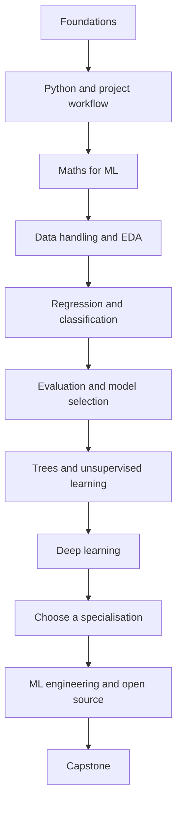

# Machine Learning — Learn, Build, Evaluate

A practical, visual-first ML course that takes you from fundamentals to real projects, deep learning, and ML engineering.

**The approach:** intuition → maths → code → experiment → evaluation → project.

No paid APIs are required. The roadmap prioritises free learning resources, honest evaluation, reproducible experiments and useful projects over collecting libraries or certificates.

## Start here

- **[Full Roadmap: Basics to Advanced](roadmap.md)** — maths, theory, code, projects and curated resources in sequence.
- [Course Start Guide](00-START-HERE.md) — how to study this course.
- [Course Map](00-course-map.md) — module sequence.
- [Current Module: Introduction to Machine Learning](01-foundations/README.md)
- [Project Tracks](projects.md) — skill drills, industry projects and capstones.
- [Resources Library](resources.md) — books, courses, videos and official documentation.

## Learning path

## Course principles

- Understand the idea before memorising formulas or APIs.
- Compare every useful model against a simple baseline.
- Keep the final test set separate from model tuning.
- Record dataset source, licence, split, metrics, environment and limitations.
- Build projects that solve a clear problem and explain their failure cases.
- Move from basics to advanced topics in order; the roadmap is comprehensive, not a checklist to rush through.

## Folder guide

| File/folder | Purpose |
|---|---|
| [roadmap.md](roadmap.md) | Full curriculum with resources, maths, code and projects |
| [00-START-HERE.md](00-START-HERE.md) | How to use the course |
| [00-course-map.md](00-course-map.md) | Compact module index |
| [01-foundations/](01-foundations/README.md) | Introduction to ML |
| [02-python-environment/](02-python-environment/README.md) | Python environment and experiment workflow |
| [projects.md](projects.md) | Project briefs and project ladder |
| [resources.md](resources.md) | Resource directory |

## Progress rule

A topic is complete when you can explain it simply, run or work through the example, interpret the result, and answer the checkpoint. Build understanding one step at a time.
