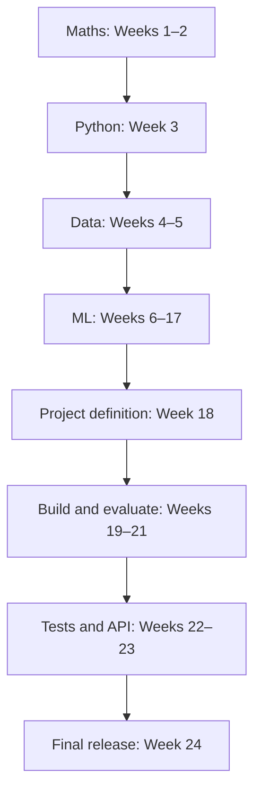

# Machine Learning — Learn, Build, Evaluate
A structured learning system with the required **Maths → Python → Data → ML → Projects** sequence, 24-week schedule, assigned video chapters, coding deliverables, checkpoints, progress tracking and a real-world capstone.

**Time:** 24 weeks × 10 hours/week = 240 hours. **Cost:** free-first; no paid APIs required.

## Start here — follow this order
1. [Start guide](00-START-HERE.md)
2. [24-week master roadmap: exact weekly sequence](roadmap.md)
3. [Course map](00-course-map.md)
4. [Progress tracker](progress.md)
5. [Topic-wise resource library](resources.md)
6. [CampusFix real-world capstone](projects/campusfix/README.md)

## Learning flow

## Detailed phase guides
- [Phase 1 — Maths](phases/01-maths.md)
- [Phase 2 — Python](phases/02-python.md)
- [Phase 3 — Data](phases/03-data.md)
- [Phase 4 — Machine Learning](phases/04-machine-learning.md)
- [Phase 5 — Projects and Engineering](phases/05-projects-engineering.md)

## Existing notes
- [Introduction to ML](01-foundations/README.md)
- [Python environment](02-python-environment/README.md)
- [Project ladder](projects.md)
- [Logistic Regression notes](logistic_reg.md)
- [CampusX Laptop Price Predictor notes](campusx-laptop-price-predictor.md)

## Rules
Use assigned videos in order and skip known material only after a diagnostic. Every week includes coding. Compare against baselines, inspect errors, prevent leakage, keep the final test set untouched until final evaluation, and document sources/licences/limitations. CampusFix is a proposed prototype; never claim deployment or impact without permission, stakeholder involvement and measurements.
