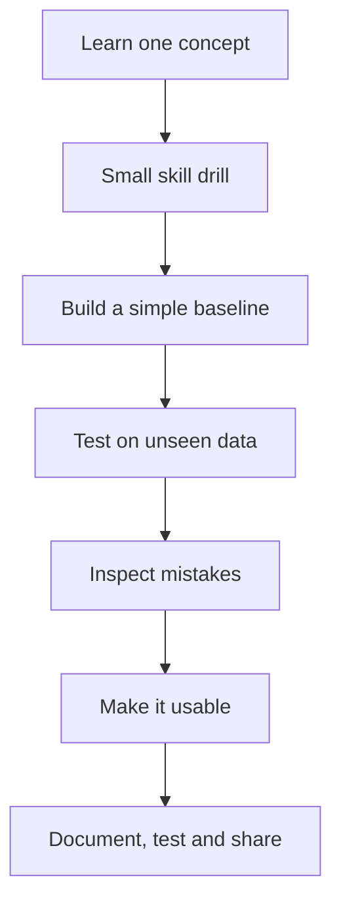
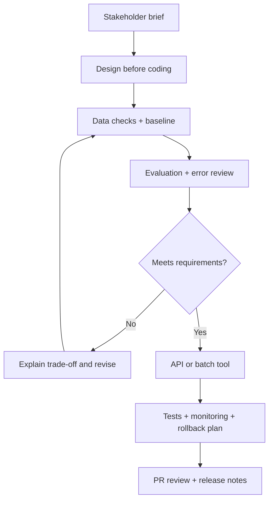

# ML Projects — Learn the Skill, Then Build Something Useful

We will **build a few projects properly**, not copy 15 tutorials. Each project should teach a new skill and show how ML work happens in a real team.

## Three project tracks

| Track | Purpose | What belongs here |
|---|---|---|
| **A. Skill drills** | Learn one method at a time | EDA, leakage checks, metrics, Model Error Explorer |
| **B. Industry projects** | Practice common business problems | Churn, fraud/risk, demand/pricing, ranking, search/RAG |
| **C. Capstones** | Explore an open-ended problem you care about | Campus Intelligence, public-notice helper, disaster triage, claim evidence, air-quality explorer |

We will use small, well-understood datasets for guided drills. Projects involving sensitive data, unclear labels, or changing public sources stay optional until their risks and evaluation method are clear.

---

## Track A — Skill drills

### A1. Model Error Explorer (first project)

**Problem:** A model can get a good overall score and still make costly mistakes.

**Build:** A small tool that takes actual labels and model predictions, shows a confusion matrix, per-class scores, false positives and false negatives, and lets us compare decision thresholds.

**Learn:** pandas, visualisation, classification metrics, testing, and readable Python package design.

**Why first?** It teaches us how to judge a model before we build more complicated ones. No large model or paid API is required.

### A2. EDA and data-leakage drill

**Problem:** A model may appear brilliant because the dataset accidentally gives it clues it would not have in real use.

**Build:** Inspect a fixed, documented dataset. Find missing values, duplicates, suspicious columns, and a bad split; compare results before and after fixing the issue.

**Learn:** pandas, charts, train/test splits, data validation, and how to explain a misleading result.

**Deliverable:** A notebook plus a short visual report: “What fooled us, and how we caught it?”

---

## Track B — Industry projects

Each project starts with a **provided stakeholder brief** so we can practise without needing to interview a company. We will use public, appropriately licensed data or a clearly labelled teaching dataset.

### B1. Customer Churn and Retention

**Business question:** Which customers may leave, and where could the business focus its retention effort?

**Build:** A simple churn baseline, then a model. Estimate the cost of missed churners versus unnecessary retention offers. Discuss the difference between predicting who leaves and proving who will respond to an offer.

**Learn:** Tabular data, feature engineering, class imbalance, precision/recall, business cost, and the basics of intervention testing.

**Visual to include:** Churn rates by customer group, a confusion matrix, and a cost-vs-threshold chart.

### B2. Fraud / Risk Detection

**Business question:** How can a review team spot suspicious activity without overwhelming itself with false alarms?

**Build:** A model that ranks or flags suspicious transactions using a documented dataset. Compare a simple rule with an ML baseline and evaluate it at a realistic review capacity.

**Learn:** Rare-event classification, precision-recall curves, threshold choice, changing patterns, and model explanations.

**Safety note:** This is a learning prototype, not a real credit decision or fraud-blocking service. Do not use its predictions on real people or financial accounts.

**Visual to include:** Precision-recall curve, missed cases vs false alarms, and the number of cases sent for review.

### B3. Demand Forecasting and Pricing Decisions

**Business question:** How much stock might be needed next week, and what happens when the forecast is wrong?

**Build:** Forecast demand with a simple baseline first. Add date, weekday, and suitable event features; test on later dates, not random rows. Show uncertainty and discuss the cost of overstocking versus running out.

**Learn:** Time-based validation, feature engineering, MAE/RMSE, forecast error, and monitoring.

**Visual to include:** Actual vs forecast over time, forecast errors, and a stock-shortage/leftover trade-off.

### B4. Recommendation and Ranking

**Business question:** Given many possible items, which should appear first for a user?

**Build:** A resource, course, or product recommender. Start with popularity or keyword matching, then try a better ranking method and compare the lists.

**Learn:** Search, ranking, implicit feedback, train/test design, and metrics such as Precision@K, MRR, or nDCG (we will explain each when needed).

**Visual to include:** Candidate list → ranking → top results, plus a before/after comparison.

**Important:** Offline metrics are useful clues, but they do not prove that users will behave better. A real product would need a carefully designed online experiment.

### B5. Search + RAG Assistant

**Business question:** How can a user find an answer in a collection of documents and check where it came from?

**Build:** A small document assistant that retrieves relevant passages and answers using only that evidence. Show citations and say when evidence is missing. Evaluate retrieval separately from answer quality.

**Learn:** Search, text embeddings, retrieval, answer grounding, evaluation, and API design.

**Visual to include:** Question → retrieved passages → answer with citations → checks.

**Constraints:** Start with local/open models and free tools where feasible. Record response time and memory use. Do not depend on a paid API for the core exercise.

---

## Track C — Optional capstones

These are good ways to work on a personally meaningful or local problem, but they are not required to prove every core ML skill.

- **Campus Issue Intelligence:** group and classify Wi-Fi, water, lift, or classroom complaints. Keep a human in charge of priorities and protect private student information.
- **Public Notice Explainer:** extract deadlines and key statements from public documents, with a source reference beside each one. Never invent legal or eligibility advice.
- **Disaster Report Triage:** group duplicate reports and surface potentially urgent reports for human review. Never present predictions as verified ground truth.
- **Claim Evidence Explorer:** show evidence for and against claims with working source links. Never fabricate citations or use an automatic verdict without evaluation.
- **Air-Quality Pattern Explorer:** show trends and missing data from a public measurement source. Clearly separate observed values from predictions and avoid medical claims.

Keep one text-heavy capstone at most until the earlier projects are complete. These projects overlap in some NLP skills, so we should not build all of them just for project count.

---

## Make projects feel like real engineering

We will add a few simple documents to each main project. Think of these as the work a team wants to see before it trusts a model.

Every main project should include:

1. **Stakeholder brief:** who uses it, what decision it supports, the main success measure, and the cost of mistakes.
2. **Small design doc:** data in, prediction out, baseline, model choice, how it will run, and what can fail.
3. **Realistic limits:** for example, a response-time target, limited memory, a fixed review capacity, or a small compute budget. We will label these as teaching constraints, not claim they came from a real company.
4. **Data and evaluation notes:** data source and licence, split strategy, baseline, metrics, mistakes, and limitations.
5. **Monitoring plan:** what could change, what we would measure, when to investigate or retrain, and how we would turn the service off safely.
6. **Team simulation:** create a focused issue, work on a branch, open a PR, write a review comment, update the changelog, and respond to feedback. Later, practise contributing to an existing open-source project.
7. **“When not to ship” section:** explain what result or risk would make the model not ready.

### A simple project quality checklist

- [ ] Another person can set it up from the README.
- [ ] Dependencies and configuration are recorded; random seeds are fixed where useful.
- [ ] Tests run and CI checks them.
- [ ] A simple baseline is included.
- [ ] Evaluation avoids data leakage and explains the chosen metrics.
- [ ] Latency, memory, or cost is measured when relevant.
- [ ] Failure cases and limitations are shown honestly.
- [ ] Dataset source, licence, and privacy choices are documented.
- [ ] At least one issue/PR/review workflow is demonstrated for a main project.

## What we will build first

**Start with Model Error Explorer → EDA/leakage drill → Churn or Demand Forecasting → Search/RAG.** This order moves from understanding model mistakes, to handling data correctly, to a familiar business problem, then to a modern text system.

We will not build all projects at once. Finish each stage, explain the visuals, and be able to defend the design choices before moving on.

The project list is a learning plan, not a job guarantee. One deeply understood, tested project with honest results and a useful open-source contribution is worth more than many copied demos.
