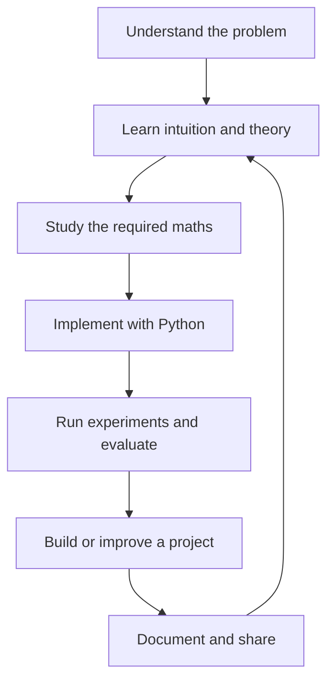

# Machine Learning Roadmap — Basics to Advanced

A structured, free-first path from ML fundamentals to building, evaluating, deploying, and contributing to real ML systems.

**How to use this roadmap:** follow phases in order, but do not study every resource at once. For each topic, learn the intuition, understand the maths, implement code, run an experiment, and finish with a project or checkpoint.

## The learning loop

## Phase 0 — Tools and Python workflow

**Learn**
- Python fluency: functions, classes, modules, exceptions, files, virtual environments, debugging.
- NumPy arrays, shapes, broadcasting and vectorisation.
- pandas: filtering, grouping, joins, missing data, dates and categories.
- Matplotlib/Seaborn for plots; Jupyter for exploration.
- Git/GitHub, command line, dependency files, README writing and basic testing.

**Maths:** arithmetic, fractions, percentages, equations, functions, coordinates, reading graphs, mean and median.

**Code practice**
- Load a CSV, inspect its shape/types, find missing values and plot distributions.
- Write a small reusable Python script and document how to run it.

**Project:** Exploratory Data Analysis (EDA) report on a public, appropriately licensed dataset.

**Resources**
- [Python - CampusX playlist (31 videos)](https://youtube.com/playlist?list=PLxvLUL96MOO4saKDW4nHTCe1cDbDMTR5X) — Python fundamentals and revision; Sessions 1–12 cover core Python topics.
- [NumPy - CampusX playlist sessions](https://youtube.com/playlist?list=PLxvLUL96MOO4saKDW4nHTCe1cDbDMTR5X) — Sessions 13–15 cover NumPy fundamentals, advanced NumPy, and tricks.
- [pandas - CampusX playlist sessions](https://youtube.com/playlist?list=PLxvLUL96MOO4saKDW4nHTCe1cDbDMTR5X) — Session 16 onward covers Series, DataFrames, and data manipulation topics.
- [Official Python Tutorial](https://docs.python.org/3/tutorial/)
- [Official NumPy Learn](https://numpy.org/learn/)
- [Official pandas Getting Started](https://pandas.pydata.org/docs/getting_started/index.html)
- [Matplotlib Tutorials](https://matplotlib.org/stable/tutorials/)
- [GitHub Skills](https://skills.github.com/)

**Exit check:** you can set up a project, load and inspect data, make plots, and explain your findings.

## Phase 1 — ML foundations and problem framing

**Theory**
- What ML is; AI vs ML vs deep learning.
- Traditional programming vs learning from examples.
- Supervised, unsupervised, semi-supervised, self-supervised and reinforcement learning.
- Regression vs classification; features vs target.
- Dataset rows, labels, generalisation, overfitting, underfitting, baseline and leakage.
- ML project lifecycle, ethics, privacy, data licences and when not to use ML.

**Maths:** functions, variables, equations, graphs, summations and basic probability intuition.

**Code practice:** inspect a tiny dataset and identify the target, inputs, and possible leakage.

**Project:** define a student-marks prediction task in a one-page problem brief before training a model.

**Resources**
- [Google ML Crash Course](https://developers.google.com/machine-learning/crash-course/)
- [Google ML foundational courses](https://developers.google.com/machine-learning/foundational-courses)

**Exit check:** you can explain the prediction goal, the available data, a simple baseline, and how success should be measured.

## Phase 2 — Mathematics for ML

Learn these alongside models rather than postponing all ML until every maths topic is complete.

### 2A. Linear algebra
- Scalars, vectors, matrices, tensors, shapes and matrix multiplication.
- Dot product, norms, distance, projections and linear systems.
- Linear independence, rank, eigenvalues/eigenvectors and singular value decomposition (SVD).
- Why these matter: linear models, embeddings, PCA and neural networks.

### 2B. Calculus and optimisation
- Functions, slopes, derivatives and partial derivatives.
- Chain rule, gradients and computational graphs.
- Loss functions, gradient descent, learning rate, stochastic and mini-batch updates.
- Why these matter: fitting model parameters and training neural networks.

### 2C. Probability and statistics
- Random variables, distributions, conditional probability and Bayes' theorem.
- Expectation, variance, standard deviation, covariance and correlation.
- Sampling, estimation, confidence intervals, hypothesis tests and bootstrap intuition.
- Likelihood, maximum likelihood, entropy and cross-entropy.
- Why these matter: uncertainty, classification, evaluation and statistical reasoning.

**Code practice:** implement vector operations, gradient descent for a simple function, simulate distributions, and calculate descriptive statistics with NumPy.

**Project:** a visual maths notebook showing gradient descent converging and how changing the learning rate affects it.

**Resources**
- [Mathematics for Machine Learning — free companion book](https://mml-book.github.io/)
- [3Blue1Brown: Essence of Linear Algebra](https://www.3blue1brown.com/topics/linear-algebra)
- [3Blue1Brown: Calculus](https://www.3blue1brown.com/topics/calculus)
- [Khan Academy](https://www.khanacademy.org/math)
- [StatQuest](https://statquest.org/)

**Exit check:** you can explain the meaning of a vector, gradient, probability, variance and loss in a model context.

## Phase 3 — Data preparation and exploratory analysis

**Theory**
- Data types, data dictionaries, unit of analysis and data provenance.
- Missingness, duplicates, inconsistent values, outliers and label quality.
- Numerical and categorical features; encoding and scaling.
- EDA, distributions, relationships, correlation and subgroup analysis.
- Train/validation/test splits; stratified, grouped and time-based splits.
- Data leakage, preprocessing pipelines and fitting transformations on training data only.

**Code practice:** use pandas and visualisation libraries to investigate a real dataset; build reusable preprocessing with scikit-learn.

**Project:** EDA and data-quality report with a clear problem statement, data limitations and a reproducible cleaning pipeline.

**Resources**
- [pandas user guide](https://pandas.pydata.org/docs/user_guide/)
- [scikit-learn: common pitfalls and recommended practices](https://scikit-learn.org/stable/common_pitfalls.html)
- [Kaggle Learn](https://www.kaggle.com/learn)

**Exit check:** you can justify your split strategy and explain how your preprocessing avoids leakage.

## Phase 4 — First models and regression

**Theory**
- Baselines and prediction errors.
- Simple and multiple linear regression.
- Least squares, residuals and model assumptions.
- Polynomial features and nonlinear relationships.
- Regularisation: Ridge/L2, Lasso/L1 and Elastic Net.
- Feature engineering, multicollinearity and residual analysis.

**Maths:** linear equations, squared error, derivatives and gradient descent.

**Code practice**
- Implement simple linear regression from scratch with NumPy.
- Fit models with scikit-learn.
- Compare baseline vs linear vs regularised models.

**Project:** student-marks prediction, then a more realistic housing or demand-prediction dataset. Report MAE/RMSE/R² and limitations; avoid claiming causation from correlation.

**Resources**
- [Google ML Crash Course: linear regression](https://developers.google.com/machine-learning/crash-course/linear-regression)
- [scikit-learn getting started](https://scikit-learn.org/stable/getting_started.html)
- [StatQuest](https://statquest.org/)

**Exit check:** you can explain what a fitted line means, calculate errors, compare against a baseline and diagnose obvious failures.

## Phase 5 — Classification

**Theory and algorithms**
- Logistic regression, sigmoid, logits and decision thresholds.
- k-nearest neighbours, Naive Bayes, decision trees and support vector machines.
- Random forests and introductory boosting.
- Binary vs multiclass classification; class imbalance and probability calibration.

**Maths:** probability, log-odds, likelihood, logarithms and cross-entropy.

**Code practice:** train classifiers, inspect predicted probabilities, change thresholds and compare error types.

**Project:** spam detection or a carefully scoped customer-churn classifier. Include a simple baseline and inspect false positives and false negatives.

**Resources**
- [Google ML Crash Course](https://developers.google.com/machine-learning/crash-course/)
- [scikit-learn supervised learning](https://scikit-learn.org/stable/supervised_learning.html)

**Exit check:** you can explain what the model predicts, what a threshold changes and why accuracy alone may mislead.

## Phase 6 — Evaluation, model selection and trustworthy results

**Theory**
- MAE, MSE, RMSE, R² and residual analysis.
- Confusion matrix, precision, recall, specificity, F1, ROC-AUC, PR-AUC and log loss.
- Overfitting, underfitting, bias/variance intuition and cross-validation.
- Hyperparameter search, threshold selection, calibration and uncertainty.
- Error analysis, subgroup checks, confidence intervals and experiment tracking.
- Leakage-resistant validation and the untouched final test set.

**Code practice:** compare models using pipelines and cross-validation; plot learning curves and analyse examples where predictions fail.

**Project:** Model Error Explorer — compare a baseline and two candidate models, show metrics and error slices, and explain which model you would choose and why.

**Resources**
- [scikit-learn model evaluation](https://scikit-learn.org/stable/modules/model_evaluation.html)
- [scikit-learn cross-validation](https://scikit-learn.org/stable/modules/cross_validation.html)
- [Google ML Crash Course](https://developers.google.com/machine-learning/crash-course/)

**Exit check:** you can defend the metric, split, comparison and limitations rather than reporting a score without context.

## Phase 7 — Trees, ensembles and practical tabular ML

**Theory**
- Decision trees, split criteria and pruning.
- Bagging, random forests and Extra Trees.
- Boosting and gradient boosting.
- XGBoost, LightGBM and CatBoost: when appropriate, trade-offs and validation.
- Feature importance, permutation importance and interpretation limitations.
- Imbalanced data, cost-sensitive learning and robust feature engineering.

**Code practice:** build a consistent pipeline and compare linear models with tree ensembles under the same split and metrics.

**Project:** customer churn, loan-risk learning exercise using a suitable public dataset, or demand forecasting. Clearly discuss dataset bias and avoid using a model for real high-stakes decisions without proper safeguards.

**Resources**
- [scikit-learn ensemble methods](https://scikit-learn.org/stable/modules/ensemble.html)
- [Kaggle Learn](https://www.kaggle.com/learn)

**Exit check:** you can compare a linear baseline and ensemble fairly, interpret errors and explain trade-offs.

## Phase 8 — Unsupervised learning and anomaly detection

**Theory**
- Clustering: k-means, hierarchical clustering, DBSCAN and Gaussian mixture models.
- Dimensionality reduction: PCA and SVD; t-SNE/UMAP for visual exploration.
- Anomaly detection: Isolation Forest, Local Outlier Factor and One-Class SVM.
- Similarity, scaling, cluster evaluation and why visual clusters are not proof of meaningful groups.

**Maths:** distances, vectors, variance, eigenvectors and probability distributions.

**Code practice:** scale data, compare clustering settings and inspect whether results are stable and useful.

**Project:** customer-segment exploration or anomaly detection on a public dataset, with explicit limitations and no unsupported claims.

**Resources**
- [scikit-learn clustering](https://scikit-learn.org/stable/modules/clustering.html)
- [scikit-learn decomposition](https://scikit-learn.org/stable/modules/decomposition.html)
- [scikit-learn outlier detection](https://scikit-learn.org/stable/modules/outlier_detection.html)

**Exit check:** you can explain what the algorithm groups, what its assumptions are and how you judge usefulness.

## Phase 9 — Deep learning foundations

**Theory**
- Perceptrons, layers, activation functions and forward propagation.
- Loss functions, backpropagation and computational graphs.
- Initialisation, optimisers, learning rates, batch size, regularisation and dropout.
- Training/validation curves, gradient issues, checkpoints and GPU use.
- Multilayer perceptrons, convolutional neural networks and sequence/attention basics.

**Maths:** vectors/matrices, derivatives, chain rule, gradients, probability and optimisation.

**Code practice**
- Implement a tiny neural network conceptually with NumPy.
- Train models with PyTorch; understand tensors, autograd, Dataset/DataLoader, training loops and saving/loading models.
- Learn to debug by overfitting a tiny batch and inspecting learning curves.

**Projects:** handwritten-digit or clothing-image classifier; compare against a simple baseline and document failure cases.

**Resources**
- [PyTorch Learn the Basics](https://docs.pytorch.org/tutorials/beginner/basics/intro.html)
- [Dive into Deep Learning — free interactive book](https://d2l.smola.org/)
- [3Blue1Brown: Neural Networks](https://www.3blue1brown.com/topics/neural-networks)

**Exit check:** you can describe a forward pass, loss, gradient update and how to tell whether training is working.

## Phase 10 — Specialisations

Do not try to master every field at once. Choose one after the core ML and deep learning phases.

### NLP and language models
- Text preprocessing, tokenisation, bag-of-words, TF-IDF, embeddings and text classification.
- Attention, transformers, pretrained models, fine-tuning and evaluation.
- Retrieval-augmented generation (RAG), retrieval/reranking, citations, hallucination evaluation and multilingual concerns.

**Project:** evidence-backed document search or claim-evidence explorer; evaluate retrieval and answer quality separately.

**Resources:** [Hugging Face Course](https://huggingface.co/learn); [Dive into Deep Learning](https://d2l.smola.org/).

### Computer vision
- Image representation, convolution, augmentation, transfer learning, detection/segmentation basics and dataset shift.

**Project:** image classifier with transfer learning, documented data permissions and per-class evaluation.

**Resources:** [PyTorch Tutorials](https://docs.pytorch.org/tutorials/).

### Time series and forecasting
- Time-based splits, trends, seasonality, lag features, forecasting baselines and forecast errors.

**Project:** demand forecasting with a naïve seasonal baseline and an ML model.

### Recommendation and ranking
- User/item interactions, popularity baselines, collaborative filtering, embeddings, ranking and offline evaluation pitfalls.

**Project:** small recommendation system compared with a popularity baseline.

## Phase 11 — ML engineering and deployment

**Theory and practice**
- Project packaging, configuration, logging, unit tests and integration tests.
- Reproducible environments, data/model versioning and experiment tracking.
- Save preprocessing and model together; validate input schemas.
- Batch prediction and APIs with FastAPI; simple interfaces with Streamlit.
- Docker basics, CI, model/data drift, monitoring, latency, failures and rollback.
- Privacy, security, fairness, documentation and human oversight.

**Project:** deploy one earlier model as a small API or app with tests, README, reproducible setup, model card and a monitoring plan.

**Resources**
- [FastAPI Tutorial](https://fastapi.tiangolo.com/tutorial/)
- [scikit-learn pipelines](https://scikit-learn.org/stable/modules/compose.html)
- [GitHub Actions documentation](https://docs.github.com/en/actions)

**Exit check:** another person can set up the project, run tests and make a prediction using the documented instructions.

## Phase 12 — Research, advanced topics and open source

**Study**
- Read papers by identifying the problem, baseline, method, evaluation, limitations and reproducibility.
- Learn self-supervised learning, transfer learning, representation learning, probabilistic ML, causal inference basics, reinforcement learning, graph ML or multimodal learning based on your specialisation.
- Learn to read unfamiliar code, reproduce a small result, file useful issues and submit focused pull requests.
- Understand licensing, data provenance, responsible release and benchmark limitations.

**Project:** reproduce a small paper result or improve an existing open-source project with tests and documentation.

**Resources**
- [Papers with Code](https://paperswithcode.com/)
- [Hugging Face Learn](https://huggingface.co/learn)
- [GitHub Skills](https://skills.github.com/)

## Phase 13 — Capstone

Build one end-to-end project that solves a defined problem and demonstrates sound engineering.

Required deliverables:
- Problem brief, user and success metric.
- Dataset source, licence, data dictionary and limitations.
- EDA and data-quality checks.
- Baseline and justified model comparison.
- Leakage-resistant evaluation and error analysis.
- Reproducible training and inference pipeline.
- Tests, clear README, model card and demo/API where appropriate.
- Limitations, risks, monitoring plan and future improvements.

**Capstone rule:** a small, reliable, well-evaluated project is stronger evidence of skill than a large project with unclear data, no baseline or unsupported claims.

## How to study each week

1. Learn one concept and explain it in your own words.
2. Work through one visual or mathematical example.
3. Write or modify code yourself.
4. Run a small controlled experiment.
5. Record the result and one failure case.
6. Add a checkpoint or project milestone to GitHub.

## Resource policy

- Prefer free, official, open educational resources.
- Use one primary resource and one supplementary visual/video resource per topic; avoid collecting dozens of tabs.
- Use public datasets only after checking source, licence, provenance and suitability.
- No paid APIs are required for this roadmap.
- Do not skip evaluation, baselines, data leakage, tests or documentation just to reach advanced models faster.
