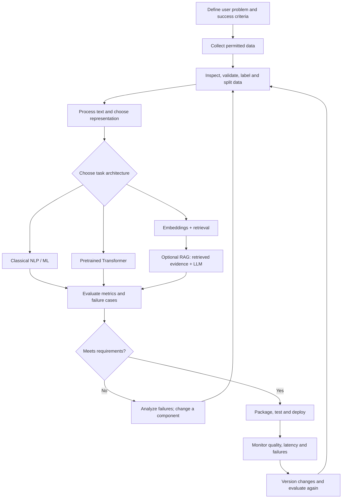
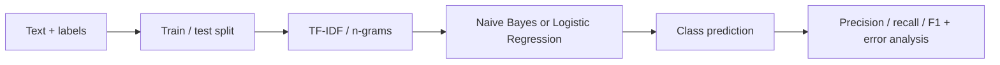
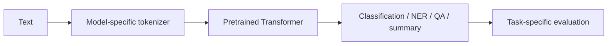
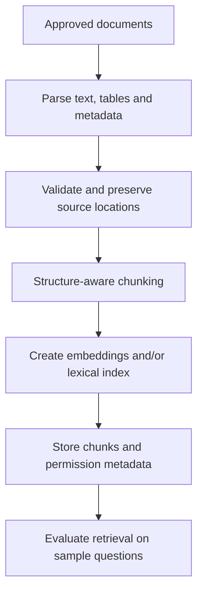
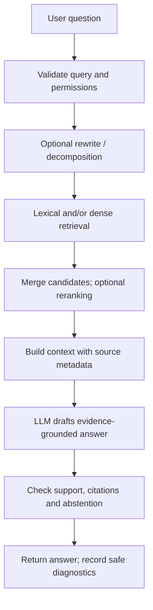

# NLP Pipeline — Traditional NLP to Modern AI Systems

**Purpose:** A reference guide for designing NLP systems from raw text to a monitored application. The classic CampusX pipeline is the foundation; this version also covers Transformers, RAG evaluation, security and deployment.

## Start here: plain-language meaning

An NLP pipeline is a repeatable set of steps that turns language into an output: a category, extracted fields, search results or an answer. Think of a factory line: each stage has a specific job, and the output is checked before delivery.

**Not every project needs every stage.** Choose the simplest design that meets accuracy, reliability, security and resource requirements.

## 1. Overview flowchart

## 2. Pipeline stages

| Stage | Layman explanation | Typical output |
|---|---|---|
| Problem definition | Decide what to solve and what “good” means | Task, I/O contract and metrics |
| Data acquisition | Obtain reliable and permitted examples | Dataset and source metadata |
| Data validation | Check and organize the ingredients | Quality report and clean splits |
| Text processing | Standardize and segment language as needed | Preprocessor or tokenizer |
| Representation | Turn text into numerical input | TF-IDF, token IDs or embeddings |
| Model / retrieval | Predict or find relevant context | Label, entities or ranked passages |
| Evaluation | Check whether it works on unseen cases | Metrics and error analysis |
| Application | Make it usable by callers | API/UI, tests, errors and logging |
| Monitoring | Detect when behavior changes | Versioned diagnostics and regression tests |

## 3. Traditional and modern paths

### Classical text classification

Use as a strong, fast baseline for spam, ticket routing, intent classification and sentiment tasks.

### Transformer-based tasks

Use a pretrained model when contextual language understanding helps. It may require more compute and careful versioning than a classical baseline.

### RAG systems

RAG (Retrieval-Augmented Generation) is useful when an answer should rely on external, private or changing knowledge.

**Offline indexing pipeline**

**Online question-answering pipeline**

Example: “What is our reimbursement deadline?” Retrieve the relevant policy section, give that evidence to the model, answer with a source citation, and abstain if no reliable evidence is retrieved.

RAG quality depends on both retrieval and generation. Evaluate those components separately. A citation-looking link is not proof that the claim is supported.

## 4. Alternatives and decisions

| Requirement | Start with | Consider next when |
|---|---|---|
| Ticket classification | TF-IDF + Logistic Regression | Error analysis reveals contextual limitations |
| Predictable IDs/dates | Regex or structured parser | Formats become too diverse |
| Entity extraction | spaCy pipeline or Transformer NER | Domain adaptation demonstrably helps |
| Exact keyword search | BM25 / lexical retrieval | Synonyms/paraphrases are common |
| Meaning-based search | Sentence embeddings | Exact codes matter too; test hybrid retrieval |
| Answer from private docs | RAG with citations and access filters | Multi-step tool actions are genuinely needed |
| Fine-tuning | Baseline + pretrained model evaluation | Data/evaluation show simpler methods are inadequate |

No approach is universally best. Consider quality, maintainability, latency, resources and security.

## 5. Engineering checks

- **Leakage:** split correctly; fit learned transforms on training data only.
- **Data rights/privacy:** document permissions to collect, store and process text.
- **Reproducibility:** version data, model, tokenizer, prompt, index and dependencies.
- **Evaluation:** keep representative held-out cases, including hard examples.
- **RAG security:** enforce document-level permissions before context reaches the model; treat retrieved content as untrusted input.
- **Observability:** record component timings and safe metadata; avoid unnecessary sensitive text logs.
- **Release safety:** rerun regression tests before changing models, prompts or indexes.

## 6. Learning resources

### Video
- [CampusX — End to End NLP Pipeline](https://youtu.be/29qyNyNkLHs)
  - 02:05 pipeline introduction
  - 10:39 data acquisition
  - 26:17 text preparation
  - 42:59 feature engineering
  - 54:28 modelling
  - 01:09:15 deployment
  - This lesson is from 2021; use it for classic foundations. The RAG/LLM details above are complementary additions.

### Official documentation and repositories
- [scikit-learn — Working with Text Data](https://scikit-learn.org/stable/tutorial/text_analytics/working_with_text_data.html) — traditional text models.
- [spaCy 101](https://spacy.io/usage/spacy-101) — linguistic pipeline and NER.
- [Hugging Face Course repository](https://github.com/huggingface/course) — Transformers, datasets and tokenizers.
- [Sentence Transformers semantic search guide](https://www.sbert.net/examples/sentence_transformer/applications/semantic-search/README.html) — semantic retrieval.
- [Hugging Face RAG Evaluation Cookbook](https://huggingface.co/learn/cookbook/rag_evaluation) — evaluation design.
- [The Illustrated Transformer](https://jalammar.github.io/illustrated-transformer/) — visual architecture guide.

## 7. Checkpoint

1. Why decide success metrics before selecting a model?
2. When is TF-IDF a sensible first baseline?
3. How is a Transformer model different from a RAG system?
4. Why does RAG use separate offline indexing and online answering stages?
5. Name two security or reliability checks needed before deployment.

**Next:** discuss terminology stage by stage before Module 03.
