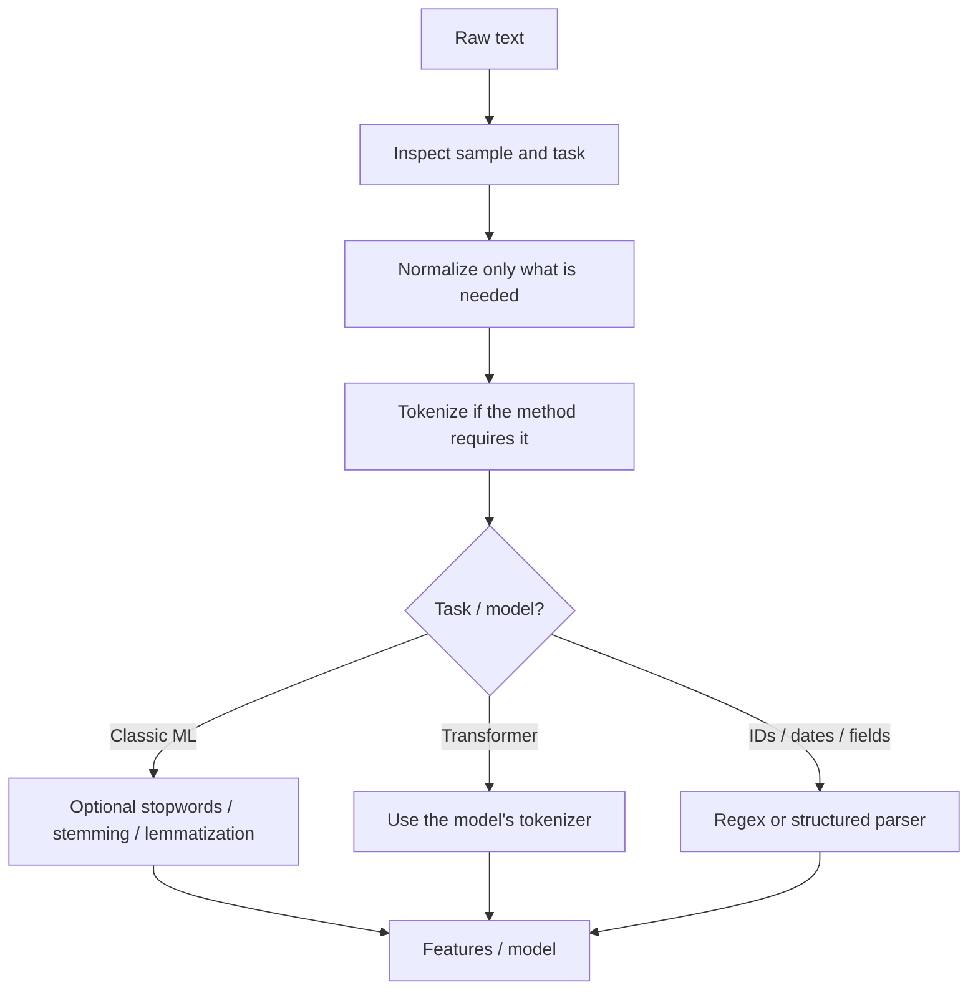

# Module 01 — Text Preprocessing

**Status:** Completed · **Level:** Beginner → practical engineer  
**Goal:** Make text usable without accidentally deleting meaning.

> Layman version: preprocessing is like preparing ingredients before cooking. You wash and sort what is needed, but you do not throw away an ingredient that changes the taste.

## 1. Where this fits



These are possible steps, not mandatory steps. Pretrained Transformers normally expect their own tokenizers; manually removing stopwords can damage meaning.

## 2. Key terms

| Term | Simple meaning | Practical use | Watch out |
|---|---|---|---|
| Normalization | Standardize equivalent-looking text | Whitespace, Unicode consistency | Lowercasing can harm names, acronyms or case-sensitive IDs |
| Tokenization | Split text into units | Words, sentences, or subwords | Tokenizer depends on model and language |
| Regex | Match a text pattern | Ticket IDs, dates, order codes | Patterns can fail on unusual valid formats |
| Stopwords | Frequent words such as “the” | Sometimes useful for classical keyword tasks | “not” is vital for sentiment; don't remove blindly |
| Stemming | Chop a word down using rules | Lightweight classical search | Result may not be a real word |
| Lemmatization | Find a dictionary base form | Linguistic analysis and classical NLP | Language resources may be needed |
| Unicode normalization | Standardize Unicode representations | Text copied from websites, PDFs and apps | NFKC may change compatibility characters; choose deliberately |

## 3. Example: inspectable cleanup

Input: `"  The delivery was NOT good!!! Order #A-123  "`

```python
import re
import unicodedata

raw_text = "  The delivery was NOT good!!! Order #A-123  "

# Standardize compatible Unicode forms when appropriate for this task.
text = unicodedata.normalize("NFKC", raw_text)

# Replace runs of whitespace with one space and remove outer whitespace.
text = re.sub(r"\s+", " ", text).strip()

# Lowercase for a case-insensitive baseline; preserve raw_text for audit/debugging.
lower_text = text.lower()

# Demo tokenizer: words/numbers plus punctuation. Not production-ready for every language.
tokens = re.findall(r"\b\w+\b|[^\w\s]", lower_text)

print("Clean text:", lower_text)
print("Tokens:", tokens)
```

### What each important line does

- `import re`: enables regular-expression operations.
- `unicodedata.normalize("NFKC", ...)`: standardizes some compatibility characters; use deliberately.
- `re.sub(r"\s+", " ", text)`: collapses multiple spaces, tabs and newlines.
- `.strip()`: removes leading/trailing whitespace.
- `.lower()`: makes text case-insensitive. Keep the original when case may matter.
- `re.findall(...)`: returns word-like sequences and punctuation for inspection.
- `print(...)`: reveals intermediate transformations so mistakes are visible.

Illustrative output:

```text
Clean text: the delivery was not good!!! order #a-123
Tokens: ['the', 'delivery', 'was', 'not', 'good', '!', '!', '!', 'order', 'a', '123']
```

Notice that “not” remains. Removing it could reverse the meaning of the complaint. The order ID also gets split by this demo tokenizer; use a dedicated extraction pattern when IDs must stay intact.

## 4. Real-world use case

A support ticket may contain extra whitespace, an order ID and a complaint. Normalize whitespace, extract the identifier separately, keep the raw message, and preserve negation for sentiment/classification. Do not apply identical cleanup rules to every field.

## 5. Alternatives: which tool should I choose?

| Need | Option | Trade-off |
|---|---|---|
| Pattern extraction | Python `re` | Built in and fast, but patterns need testing |
| POS, lemma, entities | [spaCy](https://spacy.io/usage/spacy-101) | Integrated linguistic pipeline; model required |
| Educational classical NLP | [NLTK](https://github.com/nltk/nltk) | Broad toolkit, often more manual setup |
| Text feature extraction | scikit-learn vectorizers | Reproducible feature construction |
| Pretrained Transformer input | Model-specific Hugging Face tokenizer | Correct subword vocabulary and special tokens |

**Rule:** choose the smallest set of transformations that demonstrably helps the task.

## 6. Practical exercise

For each change, decide whether it is safe:
1. `"US" → "us"`
2. Remove `"not"` from `"not safe"`
3. Split `"ORD-2048"` on punctuation
4. Remove punctuation from `"Wait... what?"`

Test the examples for sentiment, entity extraction and ID matching.

## 7. Interview checks

**Is more preprocessing always better?** No; transformations can delete useful signals. Evaluate alternatives.  
**Why preserve raw text?** For debugging, auditability and reprocessing.  
**Why not use regex tokenization for every Transformer?** Pretrained models use model-specific subword tokenization.

## 8. Learning resources

- **Video:** [CampusX — End to End NLP Pipeline](https://youtu.be/29qyNyNkLHs) — classic data preparation workflow.
- **Docs:** [spaCy 101](https://spacy.io/usage/spacy-101) — practical NLP pipeline.
- **Docs:** [Hugging Face Tokenizers](https://huggingface.co/docs/tokenizers/index).
- **Official reference:** [Python regular expressions](https://docs.python.org/3/library/re.html).
- **Repository:** [NLTK](https://github.com/nltk/nltk).

## Quick recap

Inspect input, preserve the original, transform only what is justified, check intermediate outputs, and measure the effect on the task.
