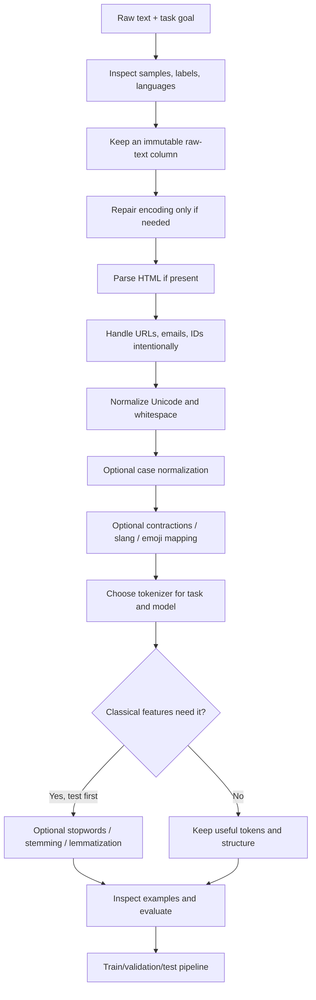

# Module 01 — Text Preprocessing in Python

**Level:** Beginner → practical NLP engineer  
**Main lesson:** [Text Preprocessing | NLP Course Lecture 3](https://youtu.be/6C0sLtw5ctc)  
**Goal:** Learn what each preprocessing step does, which Python library to use, how to implement it, how to verify its output, and when NOT to use it.  
**Estimated time:** 90–150 minutes for the core lesson; optional sections can be studied later.

> **Core principle:** preprocessing is task-dependent. The goal is not to make text look clean; the goal is to preserve the information your model needs.

## Minimum path — start here

If you are short on time, focus on these **Core** steps first:

1. **Core:** inspect raw data, preserve the original text, handle missing values.
2. **Core:** parse HTML only when markup exists; normalize Unicode/whitespace if needed.
3. **Core:** decide whether URLs/IDs should be removed, replaced or extracted.
4. **Core:** choose the correct tokenizer for the downstream model.
5. **Core:** compare preprocessing variants with the same evaluation setup.

Treat lowercasing, punctuation removal, stopword removal, spelling correction, emoji conversion, stemming and lemmatization as **Optional experiments**—not automatic steps. Language detection, PII masking and web/PDF extraction become **Core** when the product's data or compliance requirements need them.

**Industry relevance:** preprocessing is used in support-ticket routing, search and RAG ingestion, moderation, fraud/spam detection, log analytics, multilingual customer feedback and privacy-aware data pipelines. PII masking may be required by policy or regulation, but a simple regex is not a compliance guarantee.

## 0. Setup: use the right libraries

Use a virtual environment in your project. Install only the packages required for the steps you actually use.

```bash
python -m venv .venv
# Windows PowerShell:
.venv\Scripts\Activate.ps1
# macOS/Linux:
# source .venv/bin/activate

python -m pip install --upgrade pip
python -m pip install pandas scikit-learn beautifulsoup4 nltk spacy emoji contractions ftfy
```

**What each package is for**

| Package | Use it for | Important limitation |
|---|---|---|
| `re` (Python standard library) | Patterns such as URLs and whitespace | Regex is not a full HTML parser |
| `unicodedata` (standard library) | Unicode normalization | Choose normalization carefully; it can change character forms |
| `beautifulsoup4` | Parse HTML and extract visible text | Does not decide which page content is meaningful |
| `contractions` | Expand common English contractions | Ambiguous language and domain-specific forms still need review |
| `emoji` | Convert emoji to readable descriptions | Language/model may need special handling |
| `ftfy` | Repair common mojibake / broken Unicode text | Not a general spelling corrector |
| `nltk` | Tokenization, stopwords, stemming, WordNet lemmatization | Some features require downloaded data resources |
| `spacy` | Production-oriented tokenization, POS tags, lemmas, linguistic pipeline | Language model must be installed separately |
| `pandas` | Apply and inspect transformations over a dataset | Keep raw columns and benchmark large workloads |

### Install a spaCy English model (optional)

```bash
python -m spacy download en_core_web_sm
```

Expected: spaCy downloads the small English pipeline. If the command fails, check your active Python environment and network access.

### Imports used in the examples

```python
import re
import string
import unicodedata

import pandas as pd
from bs4 import BeautifulSoup
import contractions
import emoji
import ftfy
import nltk
from nltk.corpus import stopwords
from nltk.stem import PorterStemmer, WordNetLemmatizer
from nltk.tokenize import sent_tokenize, word_tokenize
```

Do not install/import everything in a production script if you do not need it. The standard library is enough for several basic transformations.

## 1. The complete workflow



This is a **decision flow**, not a checklist to run blindly. Keep preprocessing learned from data (for example, vocabulary fitting) inside the training pipeline to avoid data leakage.

## 2. Choose preprocessing for the task

| Task | Usually preserve | Common choices to test |
|---|---|---|
| Sentiment / reviews | Negation, emoji, emphasis, useful punctuation | Whitespace cleanup, URL placeholder, lowercase for classical baseline |
| Spam detection | URL/domain presence, email/phone patterns, repeated symbols | Replace URLs with `URL`, extract domain or pattern features |
| Named Entity Recognition (NER) | Capitalization, punctuation, names, dates | Minimal cleanup; model-specific tokenizer |
| Classical TF-IDF classifier | Terms, negation, useful n-grams | Lowercase, optional token pattern and stopword experiments |
| Social media / Hinglish | Emoji, hashtags, slang, code-mixing | Carefully versioned domain mapping; language-aware tools |
| Transformer / LLM | Original meaning, sentence context, structure | Remove corrupted markup only; use the exact model tokenizer |
| Search / RAG ingestion | Headings, paragraph boundaries, URLs/citations when useful | Extract structured text, normalize whitespace, chunk by structure |

## 3. Start with one raw example

```python
raw_text = """
<div>OMG!!! I can't believe this 😭😭</div>
Visit https://example.com/order?id=123
my package was NOT delivered... #angry
"""
print(raw_text)
```

We will apply transformations one by one so you can see exactly what changed. In a real dataset, first inspect multiple rows, missing values, language mix, labels and representative edge cases.

## 4. Step-by-step techniques

### Step 1 — Repair broken text encoding (only if needed)

Sometimes text arrives as mojibake, for example `Français` instead of `Français`.

```python
import ftfy

broken = "Français"
fixed = ftfy.fix_text(broken)
print(fixed)
# Français
```

**Why ftfy?** It targets common Unicode/encoding glitches. It is not for fixing ordinary typos.

**Use when:** scraped/imported text visibly contains encoding corruption.  
**Skip when:** text is already valid; never alter data just because a repair step exists. Inspect before/after examples.

### Step 2 — Remove HTML with an HTML parser

Do not use a simple regex as the main solution for real HTML. HTML can be nested, malformed or contain `>` inside quoted attributes.

```python
from bs4 import BeautifulSoup

html = "<div><p>Great product</p><p>Fast <b>delivery</b></p></div>"
soup = BeautifulSoup(html, "html.parser")
text = soup.get_text(separator=" ", strip=True)
print(text)
# Great product Fast delivery
```

- `BeautifulSoup(html, "html.parser")` parses markup with Python's built-in HTML parser.
- `get_text(separator=" ", strip=True)` extracts text and inserts spaces between text chunks.
- For large-scale crawling, consider the source's structure and a dedicated content extractor; blindly extracting all page text may include navigation and cookie banners.

### Step 3 — Remove, replace or extract URLs

A URL may be noise, but in spam detection it can be a strong signal. Decide what the model needs.

```python
import re

text = "Visit https://example.com/order?id=123 or www.shop.test now"
url_pattern = r"(?i)\b(?:https?://|www\.)\S+"

removed = re.sub(url_pattern, " ", text)
replaced = re.sub(url_pattern, " URL ", text)
print(removed)
print(replaced)
```

- `(?i)` makes matching case-insensitive.
- `https?://` matches HTTP or HTTPS; `www\.` matches www.
- `\S+` consumes non-whitespace characters. It is a useful baseline, not a complete URL parser; trailing punctuation may be included.
- Use a dedicated URL parser such as `urllib.parse` when you need reliable domain/path extraction.
- Do not silently remove URLs from a security/spam dataset if URL presence or domain is predictive.

### Step 4 — Normalize Unicode and whitespace

```python
import unicodedata
import re

text = "  cafe\u0301\n\n  delivery\tfailed  "
text = unicodedata.normalize("NFC", text)
text = re.sub(r"\s+", " ", text).strip()
print(text)
# café delivery failed
```

- NFC composes equivalent Unicode sequences where possible; NFKC is more aggressive and can merge compatibility characters, so choose it only when appropriate.
- `\s+` matches consecutive whitespace; `strip()` removes whitespace at the ends.
- Preserve paragraph/newline boundaries for summarization, document structure, code, or RAG chunking if those boundaries carry meaning.

### Step 5 — Lowercase or casefold (optional)

```python
text = "The DELIVERY Was LATE"
print(text.lower())
# the delivery was late

print("Straße".casefold())
# strasse
```

- `lower()` lowercases text.
- `casefold()` is intended for more comprehensive Unicode caseless matching.
- Useful for case-insensitive classical text features.
- Avoid blindly lowercasing NER data, case-sensitive product IDs, acronyms, or tasks where capitalization is meaningful.
- Keep the original text in a separate column.

### Step 6 — Handle punctuation deliberately

For a simple ASCII-punctuation deletion baseline:

```python
import string

text = "Wow!!! This product is great, isn't it?"
delete_ascii_punctuation = str.maketrans("", "", string.punctuation)
print(text.translate(delete_ascii_punctuation))
# Wow This product is great isnt it
```

This demonstrates why punctuation deletion can damage contractions and tone. A safer alternative for some classical pipelines is to replace punctuation with spaces:

```python
text = re.sub(r"[^\w\s]", " ", text)
text = re.sub(r"\s+", " ", text).strip()
print(text)
```

Even that regex is not a universal Unicode/language solution. Consider the task:
- Sentiment: preserve `!`, emoji and negation signals until you test their value.
- Code, IDs, URLs and product names: punctuation may be part of the token.
- Sentence segmentation: do not remove sentence-ending punctuation too early.
- Transformers: usually do not manually delete punctuation before the model tokenizer.

### Step 7 — Expand English contractions with a library

```python
import contractions

text = "I can't say this isn't useful."
expanded = contractions.fix(text)
print(expanded)
```

The package handles many common forms more consistently than a tiny hand-written dictionary. Still, contraction interpretation can be ambiguous and package behavior should be tested on your domain.

**Use:** some classical text-classification baselines or noisy chat data.  
**Do not assume:** expansion is required for pretrained Transformer models. Compare validation performance and preserve the original if needed.

### Step 8 — Normalize abbreviations and slang with a controlled mapping

There is no universal library that correctly expands every community's slang. Use a small, reviewed mapping for your dataset.

```python
short_forms = {
    "idk": "i do not know",
    "brb": "be right back",
    "imo": "in my opinion",
}

def expand_chat_terms(text):
    # This baseline maps whitespace-separated tokens.
    tokens = text.split()
    normalized = [short_forms.get(token.lower(), token) for token in tokens]
    return " ".join(normalized)

print(expand_chat_terms("idk if this is good imo"))
# i do not know if this is good in my opinion
```

This simple version does not handle punctuation attached to a token (such as `idk,`) or every Hinglish spelling. For a real project, tokenize first or normalize punctuation carefully, maintain a versioned mapping, and test code-mixed examples. Never translate Hinglish to English automatically unless the task requires it and the translation quality is validated.

### Step 9 — Spelling correction (optional, use cautiously)

```python
# Install separately if you want to experiment:
# python -m pip install textblob
from textblob import TextBlob

text = "The delivary was very late"
corrected = str(TextBlob(text).correct())
print(corrected)
```

Spelling correction predicts likely words; it can also “correct” a person's name, brand, slang or technical term incorrectly. It may be slow on large datasets. Compare before/after examples and downstream metrics. Alternatives include a domain vocabulary, a language-specific spell checker, or no correction.

**Do not confuse:** `ftfy` repairs broken character encoding; a spell checker changes misspelled words.

### Step 10 — Stopword handling with NLTK (optional)

```python
import nltk
from nltk.corpus import stopwords
from nltk.tokenize import wordpunct_tokenize

nltk.download("stopwords", quiet=True)

text = "this product is not good"
tokens = wordpunct_tokenize(text)
stop_words = set(stopwords.words("english"))
filtered = [token for token in tokens if token.lower() not in stop_words]

print("Before:", tokens)
print("After:", filtered)
```

- Stopwords are frequent words, but frequency does not mean irrelevance.
- `set` makes membership checks efficient; the list comprehension keeps tokens not in the stopword set.
- A standard list may remove `not`, changing the meaning of sentiment examples. Inspect the actual list and customize it.
- Test with and without stopword removal. It is often unnecessary for modern Transformer models, NER, syntactic tasks, or semantic retrieval.
- For Hindi/Hinglish, do not apply English stopwords as if they were language-neutral.

If NLTK reports missing data, run the named `nltk.download(...)` resource in the same Python environment. In controlled deployments, provision resources during setup rather than downloading at every application start.

### Step 11 — Emoji handling with the emoji library

```python
import emoji

text = "This is amazing 😍😭"
description = emoji.demojize(text, language="en")
print(description)
# This is amazing :smiling_face_with_heart-eyes::loudly_crying_face:
```

- `demojize` converts emoji to descriptive text labels.
- Preserve emojis for sentiment or social analysis, map them to descriptions, or remove them only after evaluation.
- Emoji meaning can be context-dependent and labels can be language-specific. Check how your selected model/tokenizer handles them.
- Avoid writing a hand-built Unicode-range regex: emoji sequences can include modifiers and joined characters.

### Step 12 — Tokenization: words, sentences and subwords

**Word/sentence tokenization with NLTK**

```python
import nltk
from nltk.tokenize import sent_tokenize, word_tokenize

nltk.download("punkt", quiet=True)
# Some recent NLTK versions may also request punkt_tab:
# nltk.download("punkt_tab", quiet=True)

text = "Delivery was late. Support didn't reply!"
print(sent_tokenize(text))
print(word_tokenize(text))
```

- Sentence tokenization separates sentences; word tokenization applies language-aware tokenization rules.
- A basic `text.split()` is fast but does not handle punctuation and language edge cases robustly.
- NLTK data resources vary by version; follow the missing-resource message if you encounter one.

**spaCy tokenization and lemmas**

```python
import spacy

nlp = spacy.load("en_core_web_sm")
doc = nlp("The cars were running quickly.")

print([token.text for token in doc])
print([(token.text, token.lemma_, token.pos_) for token in doc])
```

- `spacy.load` loads the installed English pipeline.
- Calling `nlp(text)` creates a processed `Doc`.
- `token.text`, `token.lemma_` and `token.pos_` expose token text, lemma and part-of-speech tag.
- spaCy's full pipeline is useful when you need linguistic annotations; for tokenization only, a blank language pipeline can be lighter.

**Transformer subword tokenization**

```python
# Optional: python -m pip install transformers
from transformers import AutoTokenizer

tokenizer = AutoTokenizer.from_pretrained("distilbert-base-uncased")
text = "Preprocessing can be task-dependent."
encoded = tokenizer(text, truncation=True, padding=True)
print(tokenizer.tokenize(text))
print(encoded["input_ids"])
```

Use the tokenizer that matches the exact pretrained model. Subword tokenization may split rare words into smaller pieces; do not substitute NLTK/spaCy tokens for the model's expected token IDs. Downloading a pretrained tokenizer may require network access the first time.

### Step 13 — Stemming with NLTK

```python
from nltk.stem import PorterStemmer

stemmer = PorterStemmer()
words = ["connect", "connected", "connecting", "connection"]
print([stemmer.stem(word) for word in words])
```

Stemming applies heuristic rules and may produce a non-dictionary stem. It can help some classical search/classification tasks but can also merge terms that should remain distinct. NLTK also provides Snowball stemmers for multiple languages.

### Step 14 — Lemmatization with NLTK or spaCy

**NLTK WordNet lemmatizer**

```python
import nltk
from nltk.stem import WordNetLemmatizer

nltk.download("wordnet", quiet=True)
nltk.download("omw-1.4", quiet=True)

lemmatizer = WordNetLemmatizer()
print(lemmatizer.lemmatize("cars"))             # car
print(lemmatizer.lemmatize("running", pos="v")) # run
print(lemmatizer.lemmatize("better", pos="a"))  # good
```

WordNet lemmatization benefits from the correct part of speech. Its default POS is noun, so a word such as `running` may not become `run` without a verb hint.

**spaCy alternative**

```python
import spacy

nlp = spacy.load("en_core_web_sm")
doc = nlp("The cars were running quickly.")
print([(token.text, token.lemma_) for token in doc])
```

Lemmatization returns a dictionary base form when supported by the language resources. It is not the same as stemming. For pretrained Transformer workflows, do not add stemming/lemmatization by default: it can remove information the model expects.

## 5. Build a reusable preprocessing function

This is a conservative baseline for **classical text classification**, not a universal production pipeline. It preserves punctuation, negation, emoji and case; removes simple HTML; replaces URLs with a placeholder; and normalizes whitespace.

```python
import re
import unicodedata
from bs4 import BeautifulSoup

def clean_for_classical_baseline(text):
    if pd.isna(text):
        return ""

    text = str(text)
    text = unicodedata.normalize("NFC", text)

    # Parse HTML only when the input may contain markup.
    text = BeautifulSoup(text, "html.parser").get_text(" ", strip=True)

    # Preserve the fact that a URL existed.
    text = re.sub(r"(?i)\b(?:https?://|www\.)\S+", " URL ", text)

    # Normalize repeated whitespace.
    text = re.sub(r"\s+", " ", text).strip()
    return text

examples = [
    "<p>I do NOT like it 😭</p> https://example.com",
    "Great product!!!",
    None,
]

for item in examples:
    print(repr(clean_for_classical_baseline(item)))
```

**Expected behavior:** HTML text is extracted, a URL becomes `URL`, whitespace is normalized, missing values become an empty string, and negation/emoji/punctuation are preserved.

**Important:** BeautifulSoup on every row has overhead. If your data has no HTML, skip parsing. Add steps only for demonstrated data issues.

## 6. Apply preprocessing to a pandas DataFrame

```python
import pandas as pd

df = pd.DataFrame({
    "review": [
        "<p>GREAT product!!!</p>",
        "Delivery was NOT good...",
        "Visit https://example.com for help",
        None,
    ]
})

# Keep the raw column for audit/debugging.
df["clean_review"] = df["review"].map(clean_for_classical_baseline)
print(df[["review", "clean_review"]].to_string(index=False))
```

- Each row is an example; `review` is the original field and `clean_review` is a derived field.
- `map(function)` applies the function to each value in the Series.
- For simple operations, pandas `.str` methods may be convenient. For multiple conditional/library-based steps, a Python function can be clearer.
- Benchmark both on representative data rather than assuming one is always faster.
- Do not overwrite the original column; it is useful for error analysis and reproducibility.

## 7. Train/test leakage: a crucial ML rule

Split your dataset before fitting data-dependent transformations such as a vocabulary or TF-IDF vectorizer. A scikit-learn `Pipeline` helps ensure that vocabulary fitting happens on training data only.

```python
from sklearn.model_selection import train_test_split
from sklearn.feature_extraction.text import TfidfVectorizer
from sklearn.linear_model import LogisticRegression
from sklearn.pipeline import Pipeline

X = df["clean_review"]
y = [1, 1, 0, 0]  # Example labels only; real labels must come from your dataset.

X_train, X_test, y_train, y_test = train_test_split(
    X, y, test_size=0.5, random_state=42, stratify=y
)

model = Pipeline([
    ("tfidf", TfidfVectorizer()),
    ("classifier", LogisticRegression(max_iter=1000)),
])
model.fit(X_train, y_train)
print(model.score(X_test, y_test))
```

The labels above are only illustrative. The split uses 50% because this toy dataset has only four rows; it is still far too small to evaluate a real model. In a real project, use verified labels, a sufficiently large dataset, and metrics such as precision, recall and F1. The pipeline learns the vocabulary from training data and reuses it for test data.

## 8. Practical comparison experiment

Do not assume a “cleaner” version is better. Compare at least:
1. Raw text with only missing-value handling.
2. Conservative cleanup (HTML/URL/whitespace).
3. Lowercase + optional punctuation strategy.
4. Stopword removal and/or stemming only as separate experiments.

Use the same split and model settings; compare macro-F1 or task-appropriate metrics. Inspect errors and keep a record of the exact transformation configuration.

## 8.1 Runnable preprocessing comparison experiment

This small, self-contained example compares a minimal baseline with a more normalized version using the **same cross-validation folds and classifier**. The text and labels are illustrative only; use a real, representative dataset for conclusions.

```python
import re
import pandas as pd
from bs4 import BeautifulSoup
from sklearn.feature_extraction.text import TfidfVectorizer
from sklearn.linear_model import LogisticRegression
from sklearn.model_selection import StratifiedKFold, cross_val_score
from sklearn.pipeline import Pipeline

texts = [
    "I love this product", "This is excellent", "Really happy with the quality",
    "Amazing service and fast delivery", "Works perfectly", "Very good purchase",
    "I would recommend it", "Fantastic quality", "Loved using this", "Great value",
    "I hate this product", "This is terrible", "Really unhappy with the quality",
    "Awful service and late delivery", "It broke immediately", "Very bad purchase",
    "I would not recommend it", "Horrible quality", "Regret buying this", "Waste of money",
]
labels = [1] * 10 + [0] * 10  # 1 = positive, 0 = negative; toy labels

def minimal_clean(text):
    return str(text)

def conservative_clean(text):
    text = BeautifulSoup(str(text), "html.parser").get_text(" ", strip=True)
    text = re.sub(r"(?i)\b(?:https?://|www\.)\S+", " URL ", text)
    text = re.sub(r"\s+", " ", text).strip()
    return text

configs = {
    "minimal": [minimal_clean(t) for t in texts],
    "conservative": [conservative_clean(t) for t in texts],
    "lowercase": [conservative_clean(t).lower() for t in texts],
}

cv = StratifiedKFold(n_splits=5, shuffle=True, random_state=42)
for name, cleaned_texts in configs.items():
    model = Pipeline([
        ("tfidf", TfidfVectorizer()),
        ("classifier", LogisticRegression(max_iter=1000)),
    ])
    scores = cross_val_score(
        model, cleaned_texts, labels, cv=cv, scoring="f1_macro"
    )
    print(f"{name}: mean macro-F1={scores.mean():.3f}; folds={scores.round(3)}")
```

**How to read it:** each configuration gets the same five folds; TF-IDF vocabulary is fitted inside the scikit-learn pipeline on each training fold, reducing leakage risk. The tiny, deliberately simple dataset is for learning code structure—not for claiming that one configuration is better. On your real dataset, include enough examples, inspect errors, and record the dataset split and random seed. Add punctuation/stopword variants as separate configurations rather than combining all changes at once.

## 8.2 Language detection and Hinglish / Indic text

Language detection can help route text to the right pipeline, but it is unreliable on very short messages, names, emojis and code-mixed Hinglish. Treat the result as a hint, not ground truth.

```bash
python -m pip install langdetect
```

```python
from langdetect import detect, DetectorFactory

# Make langdetect more repeatable for the same input.
DetectorFactory.seed = 0

samples = ["This delivery was late", "यह सामान अच्छा है"]
for text in samples:
    try:
        print(text, "->", detect(text))
    except Exception as error:
        print("Could not detect:", error)
```

For very short text or code-mixed text such as “delivery late hai yaar”, language detection may choose only one language or return unstable results. Consider [Lingua](https://github.com/pemistahl/lingua-py) or a validated fastText language-identification model for your use case; evaluate accuracy on your own language mix.

**Hinglish and Indic tooling**
- [Indic NLP Library](https://github.com/anoopkunchukuttan/indic_nlp_library): Indic-language normalization and other language utilities; check its supported scripts and setup for your task.
- [indic-transliteration](https://github.com/indic-transliteration/indic_transliteration_py): transliteration between supported Indic scripts/schemes; it is not a universal Hinglish spell corrector.
- [AI4Bharat IndicXlit](https://github.com/AI4Bharat/IndicXlit): transliteration for supported Indic languages and scripts; validate model/language support and deployment requirements first.
- Romanized Hindi/Hinglish has no single standard spelling (“hai”, “h”, “he”). Keep original text, use a reviewed mapping only when justified, and test on representative examples.
- Do not assume NLTK's English stopword list is appropriate for Hindi or Hinglish. Verify language-specific resources and avoid stopword removal until its impact is measured.

## 8.3 Mask sensitive information (PII)

When text may contain personal information, masking can reduce exposure in logs, demos and downstream processing. Regex is only a baseline; it does not reliably identify every person, address, account number or phone format.

```python
import re

def mask_basic_pii(text):
    text = re.sub(
        r"[A-Za-z0-9._%+-]+@[A-Za-z0-9.-]+\.[A-Za-z]{2,}",
        "[EMAIL]",
        str(text),
    )
    # Illustrative international/Indian-style phone pattern; validate locally.
    text = re.sub(r"(?<!\w)(?:\+?\d[\d ()-]{7,}\d)(?!\w)", "[PHONE]", text)
    return text

print(mask_basic_pii("Contact me at user@example.com or +91 98765 43210"))
```

For production workflows, assess [Microsoft Presidio](https://github.com/microsoft/presidio), which provides PII detection/anonymization components. Configure recognizers for the countries and data types you handle, evaluate false positives/negatives, restrict access, and follow your organization's retention/security policies. Masking is not a guarantee of anonymization.

## 8.4 Social-media text, hashtags and elongated words

NLTK provides a tokenizer intended for social-media text:

```python
from nltk.tokenize import TweetTokenizer

tokenizer = TweetTokenizer(
    preserve_case=False,
    reduce_len=True,
    strip_handles=False,
)
text = "Soooo good!!! @user #MovieNight"
print(tokenizer.tokenize(text))
```

- `reduce_len=True` reduces very long character repetitions (for example, “sooooo”); inspect whether intensity matters for your task.
- `strip_handles=False` preserves mentions. Set it to `True` only if handles are irrelevant or need removal.
- Hashtags can carry topic/sentiment information. Preserve them, remove only the `#` symbol, or split compound hashtags using a tested method.
- Number/date placeholders (for example, `<PHONE>`, `<DATE>`, `<ORDER_ID>`) can generalize patterns, but do not replace all numbers blindly: dates, prices, ratings and quantities can be important.
- Accent stripping tools such as [Unidecode](https://pypi.org/project/Unidecode/) can help specific matching tasks, but may lose linguistic distinctions. Use only if the target task benefits from it.

## 8.5 Extract clean text from web pages and PDFs

For retrieval-augmented generation (RAG), the extraction stage should preserve headings, sections and page/source metadata—not just flatten everything into one string.

**Web pages:** [Trafilatura](https://trafilatura.readthedocs.io/) is designed to extract main text from web pages while reducing boilerplate.

```bash
python -m pip install trafilatura
```

```python
import trafilatura

downloaded = trafilatura.fetch_url("https://example.com")
if downloaded:
    main_text = trafilatura.extract(downloaded)
    print(main_text[:500] if main_text else "No main text extracted")
```

Use only pages you are permitted to access; handle fetch failures, robots/terms, timeouts and source attribution in a real ingestion job.

**PDF files:** [PyMuPDF](https://pymupdf.readthedocs.io/) can extract text and page information. [pdfplumber](https://github.com/jsvine/pdfplumber) is another option when layout/table inspection matters.

```bash
python -m pip install pymupdf
```

```python
import fitz  # PyMuPDF

with fitz.open("document.pdf") as pdf:
    for page_number, page in enumerate(pdf, start=1):
        page_text = page.get_text("text")
        print(f"--- page {page_number} ---")
        print(page_text[:300])
```

Scanned PDFs may require OCR; ordinary text extraction cannot recover text that exists only as pixels. Keep page number, document ID and source URI as metadata for later citations. Choose chunk boundaries after extraction, preferably using headings/paragraphs before falling back to fixed-size chunks.

## 8.6 spaCy performance for batches

Calling a full spaCy pipeline one text at a time can be slow. For batches, use `nlp.pipe`; disable components you do not need.

```python
import spacy

nlp = spacy.load("en_core_web_sm", disable=["ner", "parser"])
texts = [
    "The cars were running quickly.",
    "The product arrived yesterday.",
    "Support answered the question.",
]

for doc in nlp.pipe(texts, batch_size=64, n_process=1):
    print([(token.text, token.lemma_) for token in doc])
```

- Disable only components you truly do not need; parser/NER output will not be available when disabled.
- Increase `batch_size` after benchmarking.
- `n_process` can use multiprocessing, but overhead and platform constraints may make it slower on small datasets or Windows. Benchmark on your machine.
- If you only need tokenization, use a lighter pipeline rather than loading unnecessary components.

## 8.7 Quick text EDA before and after cleaning

Use these checks to understand whether a transformation removes noise or useful information.

```python
import pandas as pd

def text_eda(series, label):
    texts = series.fillna("").astype(str)
    lengths = texts.str.split().str.len()
    non_empty = texts[texts.str.strip().ne("")]
    vocab = set(" ".join(non_empty).lower().split())

    print(f"\n--- {label} ---")
    print("Rows:", len(texts))
    print("Empty rows:", int(texts.str.strip().eq("").sum()))
    print("Exact duplicate rows:", int(texts.duplicated().sum()))
    print("Token length summary:")
    print(lengths.describe())
    print("Unique whitespace-token vocabulary:", len(vocab))

text_eda(df["review"], "raw")
text_eda(df["clean_review"], "cleaned")
```

This vocabulary count is a quick whitespace-token approximation, not the vocabulary a TF-IDF or Transformer tokenizer will use. OOV rate is model/tokenizer-specific; calculate it with the actual training vocabulary/tokenizer rather than treating this estimate as universal. Also inspect histograms/quantiles, language distribution, label balance, duplicate leakage across splits and a sample of before/after rows.

## 9. Common mistakes

1. Removing `not` or `never` and reversing sentiment.
2. Deleting URLs that contain spam/security signals.
3. Lowercasing names or IDs needed for NER/entity matching.
4. Using regex as a full HTML parser.
5. Running spelling correction on names, brands, Hinglish or technical vocabulary without validation.
6. Applying English stopwords to Hindi/Hinglish.
7. Stemming and lemmatizing together without a measured reason.
8. Manually tokenizing before a Transformer with the wrong tokenizer.
9. Destroying paragraph structure needed for summarization or RAG.
10. Overwriting raw text or fitting TF-IDF on the full dataset before splitting.
11. Downloading NLTK resources inside every request in a deployed service.
12. Reporting model performance without documenting data source, split and metrics.

## 10. Assignment — movie-description dataset

Create a dataset containing movie title, overview/description and genre using an allowed data source (for example, TMDB with its API terms respected). **Decide the label format first:** if each movie is assigned exactly one primary genre, this is single-label classification; if a movie can have multiple genres, it is multi-label classification and needs a multi-label strategy (for example, `OneVsRestClassifier` with indicator labels and a multi-label F1 metric). Do not silently treat multiple genres as one ordinary class.

1. Inspect missing descriptions, duplicates, language and label distribution.
2. Preserve the original overview.
3. Implement conservative cleanup and inspect at least 20 before/after examples.
4. Compare two or more preprocessing configurations.
5. In Module 03, train a TF-IDF baseline classifier.
6. Report precision, recall, F1 and a confusion matrix; inspect incorrect predictions.
7. Document the source, licensing/terms, preprocessing choices and limitations.

**Estimated assignment time:** 2–4 hours for a small dataset and initial baseline; more if you need to obtain API access, resolve licensing questions, clean labels or build a multi-label evaluation.

Do not invent labels or claim improvement without measured results.

## 11. Interview checkpoints

1. Why is preprocessing task-dependent?
2. Why use BeautifulSoup instead of regex for HTML?
3. When should a URL be removed, replaced or parsed?
4. What is Unicode normalization? NFC vs NFKC?
5. Why can stopword removal hurt sentiment classification?
6. Stemming vs lemmatization?
7. NLTK vs spaCy: when would you choose each?
8. Why should a Transformer use its own tokenizer?
9. How can preprocessing cause train/test leakage?
10. How would you test whether a preprocessing step actually helps?

## 12. References

- **Main video:** [Text Preprocessing | NLP Course Lecture 3](https://youtu.be/6C0sLtw5ctc)
- [Beautiful Soup documentation](https://www.crummy.com/software/BeautifulSoup/bs4/doc/)
- [Python regular expressions](https://docs.python.org/3/library/re.html)
- [Python Unicode HOWTO](https://docs.python.org/3/howto/unicode.html)
- [ftfy documentation](https://ftfy.readthedocs.io/)
- [contractions package](https://pypi.org/project/contractions/)
- [emoji package](https://pypi.org/project/emoji/)
- [NLTK book](https://www.nltk.org/book/)
- [NLTK API documentation](https://www.nltk.org/api/nltk.html)
- [spaCy 101](https://spacy.io/usage/spacy-101)
- [spaCy models](https://spacy.io/models/en)
- [Hugging Face Tokenizers documentation](https://huggingface.co/docs/tokenizers/index)
- [Transformers tokenizer documentation](https://huggingface.co/docs/transformers/main_classes/tokenizer)
- [pandas text guide](https://pandas.pydata.org/docs/user_guide/text.html)
- [scikit-learn text feature extraction](https://scikit-learn.org/stable/modules/feature_extraction.html#text-feature-extraction)
- [NLTK repository](https://github.com/nltk/nltk)
- [spaCy repository](https://github.com/explosion/spaCy)
- [Hugging Face Transformers repository](https://github.com/huggingface/transformers)

## Final takeaway

Use the simplest preprocessing that preserves the signals required by your task. Choose libraries intentionally, inspect before/after examples, keep raw text, and measure the downstream effect. A reliable NLP engineer knows not only how to clean text, but when not to clean it.
