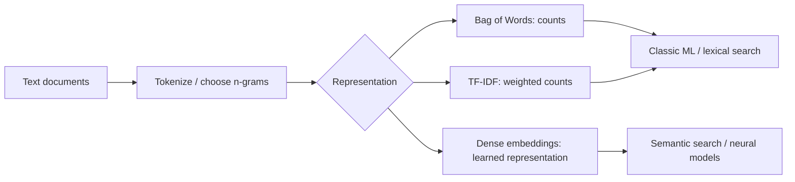
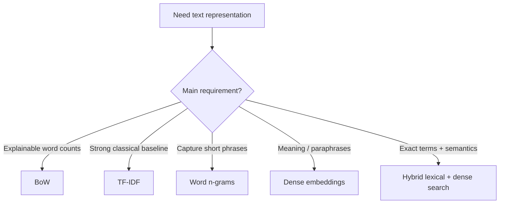

# Module 02 — Text Representation

**Status:** Completed · **Level:** Beginner → practical engineer  
**Goal:** Convert text into numerical features that algorithms can compare or learn from.

> Layman version: turn each sentence into a numeric row, just as a spreadsheet stores useful properties of an item.

## 1. Pipeline view



BoW and TF-IDF are sparse lexical representations; dense embeddings can encode semantic relationships. They solve related but different problems.

## 2. Bag of Words (BoW)

BoW builds a vocabulary and counts its terms in each document. The standard form mostly ignores word order.

Documents:
- D1: `delivery late`
- D2: `delivery good`

Vocabulary: `[delivery, good, late]`

| Document | delivery | good | late |
|---|---:|---:|---:|
| D1 | 1 | 0 | 1 |
| D2 | 1 | 1 | 0 |

Each row = a document; each column = a vocabulary feature; each cell = its count.

## 3. N-grams

An n-gram is a sequence of n adjacent tokens. Unigrams are single words; bigrams are pairs; trigrams are triples. Bigrams can represent phrases such as `not good`, but do not fully understand language.

## 4. TF-IDF formula

```math
TFIDF(t,d) = TF(t,d) × IDF(t)
```

A commonly taught IDF form is:

```math
IDF(t) = log(N / DF(t))
```

- `t`: term; `d`: document.
- `TF(t,d)`: term frequency in a document (definition varies).
- `N`: number of documents.
- `DF(t)`: number of documents containing that term.

**Intuition:** words frequent in one document but rare across the collection can receive more weight. Libraries may smooth IDF and normalize vectors, so exact values differ.

## 5. Code with explanations

```python
from sklearn.feature_extraction.text import CountVectorizer, TfidfVectorizer

documents = [
    "delivery was late",
    "late delivery and poor support",
    "support solved the issue",
]

# Learn vocabulary and create word + two-word phrase counts.
bow = CountVectorizer(ngram_range=(1, 2))
X_bow = bow.fit_transform(documents)

print("BoW matrix shape:", X_bow.shape)
print("Vocabulary/features:", bow.get_feature_names_out())
print("Counts:\n", X_bow.toarray())

# Weight words according to how informative they are across the documents.
tfidf = TfidfVectorizer(ngram_range=(1, 2))
X_tfidf = tfidf.fit_transform(documents)

print("TF-IDF shape:", X_tfidf.shape)
print("TF-IDF values:\n", X_tfidf.toarray().round(2))
```

### Meaning of the important code

- `CountVectorizer`: creates the vocabulary and counts selected features.
- `ngram_range=(1, 2)`: uses both unigrams and bigrams.
- `fit_transform`: learns vocabulary/statistics from the supplied documents and transforms them.
- `get_feature_names_out()`: shows the meaning of each matrix column.
- `toarray()`: makes sparse values dense for demonstration; avoid it on large corpora because memory use can explode.
- `TfidfVectorizer`: produces TF-IDF weighted features.
- `round(2)`: rounds displayed values for readability only.

## 6. Prevent leakage: split before fitting

Fit the vectorizer on training text only. Transform validation/test data with that fitted vectorizer.

```python
from sklearn.model_selection import train_test_split
from sklearn.pipeline import make_pipeline
from sklearn.feature_extraction.text import TfidfVectorizer
from sklearn.linear_model import LogisticRegression

# texts and labels should come from a real labeled dataset.
X_train, X_test, y_train, y_test = train_test_split(
    texts, labels, test_size=0.2, random_state=42, stratify=labels
)

model = make_pipeline(
    TfidfVectorizer(ngram_range=(1, 2)),
    LogisticRegression(max_iter=1000),
)
model.fit(X_train, y_train)   # vectorizer learns only from training examples
predictions = model.predict(X_test)  # transforms test text with the fitted vectorizer
```

## 7. Trade-off graph (conceptual, not measured)



## 8. Which alternative should I choose?

| Method | Strong first use | Limitation |
|---|---|---|
| BoW | Transparent count-based baseline | No inherent semantics |
| TF-IDF | Text classification and lexical search baseline | Synonyms may not match |
| N-grams | Short phrases and negation cues | More sparse features |
| Dense embeddings | Semantic similarity and retrieval | Model choice, compute and similarity quality matter |
| Hybrid retrieval | Exact terms plus paraphrases | More components and tuning |

## 9. Real-world example

Tickets:
- “Payment was taken but the order did not arrive.”
- “They charged me and I never received the parcel.”

TF-IDF may struggle because many words differ. Embeddings may recognize semantic similarity. But an exact error-code search such as `E1042` may favor lexical search. A production search system can combine both.

## 10. Interview checks / mini exercise

1. What do rows, columns and cells represent in BoW?
2. Why can bigrams help with “not useful”?
3. Why must TF-IDF fit only on training data?
4. When can lexical search outperform semantic search?
5. Why is `toarray()` risky on large corpora?

## 11. Learning resources

- **Video:** [CampusX — End to End NLP Pipeline](https://youtu.be/29qyNyNkLHs) — feature engineering section.
- **Tutorial:** [scikit-learn — Working with Text Data](https://scikit-learn.org/stable/tutorial/text_analytics/working_with_text_data.html).
- **API docs:** [CountVectorizer](https://scikit-learn.org/stable/modules/generated/sklearn.feature_extraction.text.CountVectorizer.html).
- **API docs:** [TfidfVectorizer](https://scikit-learn.org/stable/modules/generated/sklearn.feature_extraction.text.TfidfVectorizer.html).
- **Repository:** [scikit-learn](https://github.com/scikit-learn/scikit-learn).
- **Later topic:** [Sentence Transformers semantic search](https://www.sbert.net/examples/sentence_transformer/applications/semantic-search/README.html).

## Quick recap

BoW counts words; TF-IDF reweights counts; embeddings represent learned relationships. Pick based on measured task performance, not trend alone.
