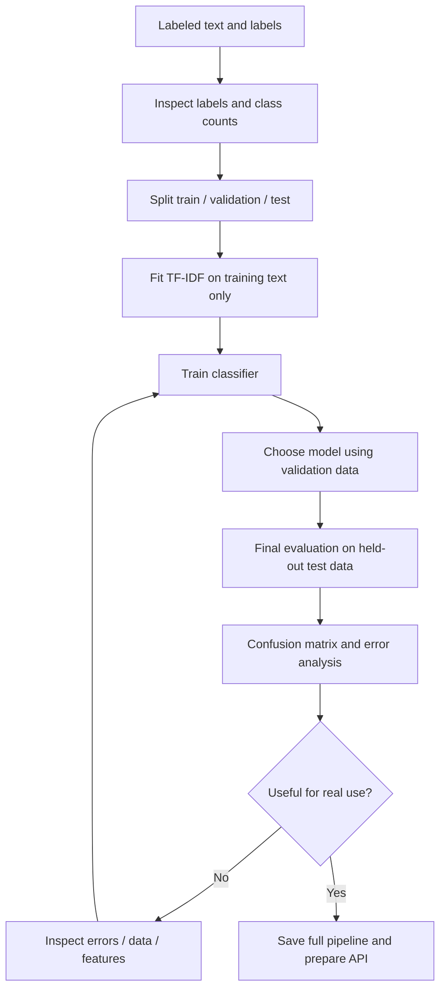

# Module 03 — Classical ML for Text

**Status:** Not started · **Role:** Next learning module  
**Goal:** Build a basic text classifier, understand how the algorithm learns, and evaluate it honestly.

> Layman version: we show a model examples of messages with correct categories. It learns patterns, then predicts categories for messages it has not seen.

## 1. End-to-end flowchart



## 2. Choose the right baseline first

| Model | Intuition | Benefits | Limitations |
|---|---|---|---|
| Majority-class baseline | Always predicts the most common label | Sets a minimum benchmark | Often useless for minority classes |
| Multinomial Naive Bayes | Uses word-feature counts and conditional probabilities | Fast and strong on many sparse text tasks | Conditional-independence assumption is simplistic |
| Logistic Regression | Learns feature weights and predicts class probabilities | Strong TF-IDF baseline, interpretable coefficients | Linear decision boundary in feature space |
| Transformer classifier | Uses contextual representations | Handles language context better for many tasks | More compute and deployment complexity |

## 3. Formula preview

For a binary classifier, precision and recall are:

```text
Precision = TP / (TP + FP)
Recall    = TP / (TP + FN)
F1        = 2 × Precision × Recall / (Precision + Recall)
```

- **TP:** actual positive predicted positive.
- **FP:** actual negative predicted positive.
- **FN:** actual positive predicted negative.
- **Precision:** of everything flagged positive, how much was correct?
- **Recall:** of all actual positives, how many did we find?
- **F1:** a harmonic mean of precision and recall.

If missing an urgent complaint is costly, recall may matter more. If sending too many false alerts overwhelms an operations team, precision may matter more. Select metrics based on business cost, not habit.

## 4. Small runnable example

This tiny dataset only demonstrates the API. It is **not** enough to measure model quality or make a resume claim.

```python
from sklearn.pipeline import Pipeline
from sklearn.feature_extraction.text import TfidfVectorizer
from sklearn.linear_model import LogisticRegression

texts = [
    "refund has not arrived",
    "excellent customer service",
    "my payment failed",
    "great product and fast delivery",
    "cancel my order and refund me",
    "very happy with this purchase",
]
labels = ["complaint", "positive", "complaint", "positive", "complaint", "positive"]

# Keep feature extraction and classifier in one reproducible object.
model = Pipeline([
    ("tfidf", TfidfVectorizer(ngram_range=(1, 2))),
    ("classifier", LogisticRegression(max_iter=1000)),
])

# Fit the vectorizer and classifier from the same training examples.
model.fit(texts, labels)

new_ticket = ["my refund is delayed"]
prediction = model.predict(new_ticket)
print("Predicted category:", prediction[0])
```

### What the key lines mean

- `Pipeline(...)`: joins sequential steps so inference uses the same vectorizer as training.
- `TfidfVectorizer(ngram_range=(1, 2))`: converts messages into weighted unigram/bigram features.
- `LogisticRegression(max_iter=1000)`: learns a linear classifier; the iteration cap gives its optimizer room to converge.
- `model.fit(texts, labels)`: learns vocabulary, TF-IDF weights and classifier parameters.
- `model.predict(new_ticket)`: applies the already-fitted steps to unseen text and returns a label.

Illustrative output: `Predicted category: complaint`. Exact behavior depends on the fitted example and library versions. Since the example is extremely small, predictions are not reliable evidence of performance.

## 5. Real-world use case

An online store gets many messages about refunds, payment failures and delivery delays. A classifier can route likely categories to the correct support queue. Before deployment:
- Evaluate each category, not just accuracy.
- Review confusing examples and minority classes.
- Use a human fallback for low-confidence or high-impact cases.
- Monitor label distribution and changes in incoming language.

## 6. Practical evaluation snippet

Run this only after you have a real, suitably sized dataset with enough examples per class.

```python
from sklearn.model_selection import train_test_split
from sklearn.pipeline import make_pipeline
from sklearn.feature_extraction.text import TfidfVectorizer
from sklearn.linear_model import LogisticRegression
from sklearn.metrics import classification_report, confusion_matrix

X_train, X_test, y_train, y_test = train_test_split(
    texts, labels,
    test_size=0.2,
    random_state=42,
    stratify=labels,
)

model = make_pipeline(
    TfidfVectorizer(ngram_range=(1, 2)),
    LogisticRegression(max_iter=1000),
)
model.fit(X_train, y_train)
predictions = model.predict(X_test)

print(classification_report(y_test, predictions, zero_division=0))
print(confusion_matrix(y_test, predictions))
```

**Caution:** the six-message demo above is too small for a meaningful stratified train/test split. Use a real dataset with sufficient examples; keep the final test set out of model tuning.

## 7. Alternative choices

- Start with TF-IDF + Logistic Regression as a reliable, economical baseline.
- Compare Multinomial Naive Bayes for speed and sparse-text behavior.
- Try character n-grams when spelling variations and typos matter.
- Consider a pretrained Transformer if contextual errors remain after data and baseline analysis.
- Do not choose a more complex model merely because it is newer; compare on held-out data.

## 8. Interview questions and mini exercise

1. Why bundle the vectorizer and classifier in a pipeline?
2. Why should the test set not be used to choose hyperparameters?
3. What situation favors recall over precision?
4. Why can accuracy be misleading for imbalanced labels?
5. Given TP = 36, FP = 9, FN = 4, calculate precision, recall and F1.
6. Compare Naive Bayes and Logistic Regression at a high level.

## 9. Learning resources

- **Video:** [CampusX — End to End NLP Pipeline](https://youtu.be/29qyNyNkLHs) — modelling/deployment portions.
- **Tutorial:** [scikit-learn — Working with Text Data](https://scikit-learn.org/stable/tutorial/text_analytics/working_with_text_data.html).
- **Metrics documentation:** [scikit-learn classification metrics](https://scikit-learn.org/stable/modules/model_evaluation.html#classification-metrics).
- **API reference:** [LogisticRegression](https://scikit-learn.org/stable/modules/generated/sklearn.linear_model.LogisticRegression.html).
- **Repository:** [scikit-learn](https://github.com/scikit-learn/scikit-learn).

**Completion rule:** mark this module complete only after the formula exercise and a proper evaluation run have been reviewed.
