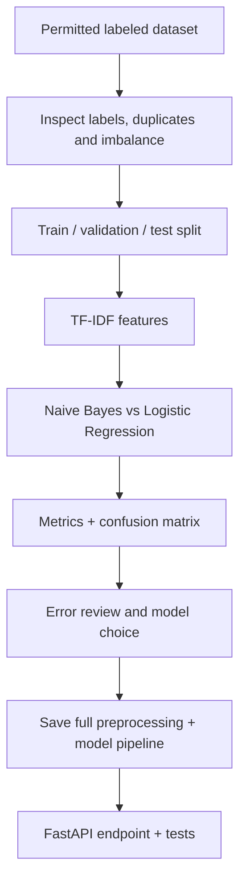

# Project 1 — Support-Ticket / Review Classifier

**Status:** Planned · **Type:** Classical NLP + ML API  
**Goal:** Build a reproducible classifier and demonstrate measured performance, not just a notebook prediction.

## Problem in plain language
A support team receives too many messages to manually sort. This system predicts a category (e.g., billing, delivery, refund) or sentiment so tickets can be routed for review.

## System flow

## Implementation steps
1. Pick a real, appropriately licensed dataset; record source and label meaning.
2. Inspect class balance, missing text, duplicates, language and label noise.
3. Make a majority-class baseline.
4. Compare TF-IDF + Multinomial Naive Bayes with TF-IDF + Logistic Regression.
5. Evaluate with class-wise precision, recall, F1 and confusion matrix.
6. Investigate misclassified examples; do not use the final test set for repeated tuning.
7. Package the fitted vectorizer and model together.
8. Serve predictions through FastAPI, add input validation and tests, document how to run it.
9. Record limitations such as domain shift, slang, ambiguous labels and low confidence.

## Results table
| Model | Dataset/split | Accuracy | Macro F1 | Per-class metrics / observations |
|---|---|---:|---:|---|
| Majority baseline | Pending | — | — | Not measured |
| Naive Bayes | Pending | — | — | Not measured |
| Logistic Regression | Pending | — | — | Not measured |

Only enter measured results after running experiments.

## Practical engineering checklist
- [ ] Dataset license/source documented
- [ ] No train/test leakage
- [ ] Reproducible random seed and dependency versions
- [ ] Baseline and candidate model compared
- [ ] Confusion matrix and misclassifications reviewed
- [ ] API input validation and error responses
- [ ] Unit/smoke tests
- [ ] README includes setup, examples and limitations

## Resume bullets
Drafts only; finalize once the system is implemented and metrics are real:
- Built a reproducible text-classification pipeline using TF-IDF and classical ML, comparing models with class-wise metrics and error analysis.
- Deployed the fitted pipeline through a tested FastAPI endpoint with documented input/output behavior.

## Learning resources
- [scikit-learn — Working with Text Data](https://scikit-learn.org/stable/tutorial/text_analytics/working_with_text_data.html)
- [scikit-learn classification metrics](https://scikit-learn.org/stable/modules/model_evaluation.html#classification-metrics)
- [FastAPI tutorial](https://fastapi.tiangolo.com/tutorial/)
- [scikit-learn repository](https://github.com/scikit-learn/scikit-learn)

## Limitations
To be updated after experiments. No results or resume claims are final until validated.
