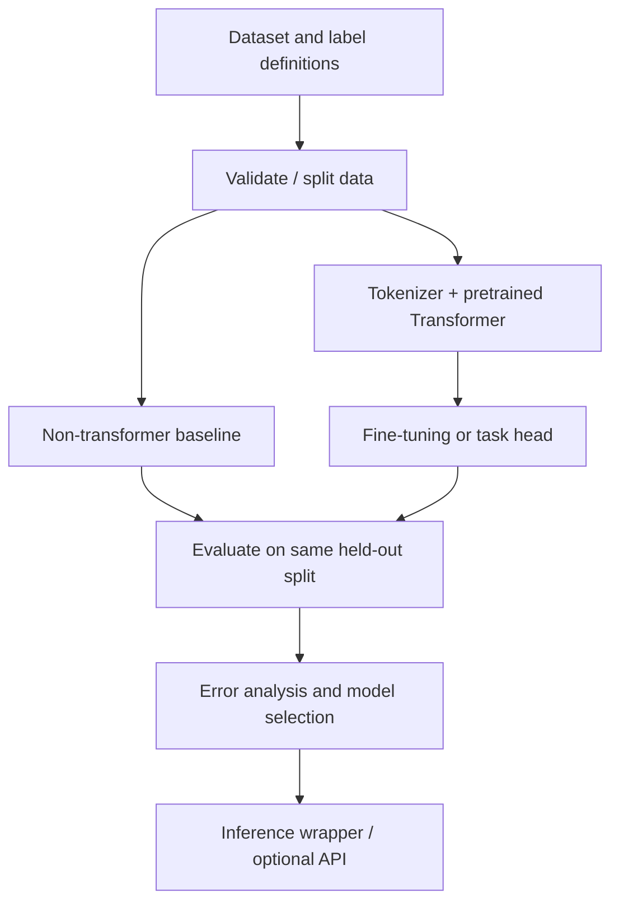

# Project 2 — Transformer Document Intelligence

**Status:** Planned · **Type:** Pretrained Transformer + task evaluation  
**Goal:** Adapt or fine-tune a pretrained Transformer for one clearly scoped document task.

## Choose a narrow task
Pick **one** initial task:
- **NER:** extract names, organizations, dates, locations or defined domain entities.
- **Text classification:** assign a category to each text/document.

Keep the first version small enough to evaluate and explain.

## System flow

## Workflow
1. Choose a licensed, documented dataset and define the labels.
2. Validate annotations and create leakage-resistant train/validation/test splits.
3. Establish a simple baseline.
4. Choose a suitable pretrained model and its matching tokenizer.
5. Fine-tune only when the data, task and compute justify it; consider LoRA/PEFT for suitable models.
6. Evaluate correctly: entity-level precision/recall/F1 for NER; class-wise metrics for classification.
7. Compare baseline vs Transformer; inspect false positives, false negatives and ambiguous cases.
8. Document hardware, time, package versions and inference requirements.
9. Optional: expose inference via FastAPI and add tests.

## Results table
| Model | Split | Metrics | Compute/settings | Notes |
|---|---|---|---|---|
| Baseline | Pending | — | — | Not measured |
| Pretrained/fine-tuned Transformer | Pending | — | — | Not measured |

## Engineering checklist
- [ ] Model and tokenizer compatible
- [ ] Label mapping saved with the model
- [ ] Correct task-level metrics
- [ ] Baseline and held-out test comparison
- [ ] Error examples and limitations
- [ ] Reproducible settings / seed
- [ ] License and dataset source documented
- [ ] Setup and inference command documented

## Resume bullets
Drafts only; finalize after a validated implementation:
- Adapted a pretrained Transformer to a defined document-intelligence task and compared it with a baseline using task-appropriate metrics.
- Documented reproducible data preparation, training settings and error analysis.

## Recommended learning resources
- [Hugging Face course repository](https://github.com/huggingface/course)
- [Hugging Face Transformers docs](https://huggingface.co/docs/transformers)
- [Hugging Face Datasets docs](https://huggingface.co/docs/datasets)
- [PEFT documentation](https://huggingface.co/docs/peft/index)

## Limitations
To be updated after experiments. Do not claim model performance until test evaluation is complete.
