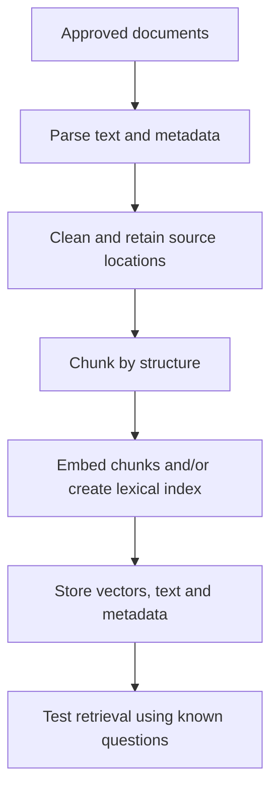
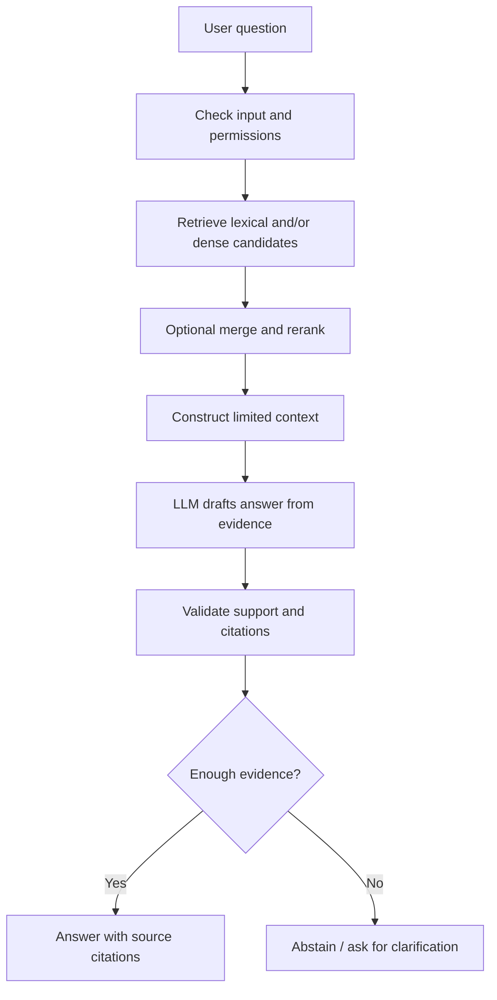

# Project 3 — RAG Knowledge Assistant

**Status:** Planned · **Type:** Retrieval-Augmented Generation  
**Goal:** Answer questions from approved documents, show evidence and abstain when the evidence does not support an answer.

## In plain language
A normal LLM answers from patterns learned during training and the context you supply. RAG first searches a knowledge collection for relevant passages and then asks the LLM to draft an answer using those passages. Retrieval makes evidence available; it does not automatically guarantee truth.

## Architecture

### Offline indexing

### Online answering

## Development plan
1. Pick a small collection of documents that you are allowed to use.
2. Create a small, manually reviewed set of realistic questions and expected source passages.
3. Parse documents and preserve titles, source links, page/section and access metadata.
4. Build a local embedding + vector-search baseline.
5. Compare chunking and retrieval settings using a stable evaluation set.
6. Consider hybrid lexical+dense retrieval for cases needing both exact terms and semantic matches.
7. Add a reranker only if measurements justify its added latency/complexity.
8. Prompt the model to answer from supplied evidence, cite sources and say when evidence is insufficient.
9. Evaluate retrieval separately from generated answers.
10. Test irrelevant questions, conflicting documents and prompt-injection text in the knowledge base.
11. Package a simple UI/API, document local setup and measure latency.

## Evaluation plan

| Component | Candidate metrics | Result |
|---|---|---|
| Retrieval | Recall@k, MRR or nDCG on labeled queries | Pending |
| Answer | Correctness, evidence faithfulness, citation support | Pending |
| Safety | Unauthorized document leakage, injection-resilience tests | Pending |
| Operations | Latency, errors, resource use | Pending |

Pick metrics that fit the task; no numbers should be reported until experiments are run. LLM-as-judge can supplement human review but can also be inconsistent, so calibrate it and retain a manually checked sample.

## Alternatives

| Need | Approach |
|---|---|
| Exact keyword or ID search | BM25 / lexical search |
| Search paraphrases | Dense embeddings |
| Both exact tokens and paraphrases | Evaluate hybrid retrieval |
| Small, stable corpus and exact questions | Consider simple search + deterministic response |
| Need multi-step approved tool actions | Add a bounded workflow/agent only after baseline RAG works |

## Security checklist
- Enforce document permissions before retrieval results enter model context.
- Treat retrieved text as untrusted data, not instructions.
- Avoid placing secrets in prompts or logs.
- Validate citations against returned source metadata.
- Test refusal/abstention when retrieval is weak or irrelevant.

## Resume bullets
Drafts only; finalize after measured evaluation:
- Built a document-grounded RAG assistant with source citations and a labeled retrieval evaluation set.
- Compared retrieval configurations and reported quality, latency and failure modes.

## Learning resources
- [Hugging Face — RAG Evaluation Cookbook](https://huggingface.co/learn/cookbook/rag_evaluation)
- [Sentence Transformers — Semantic Search](https://www.sbert.net/examples/sentence_transformer/applications/semantic-search/README.html)
- [Hugging Face Transformers docs](https://huggingface.co/docs/transformers)
- [LlamaIndex RAG concepts](https://docs.llamaindex.ai/en/stable/understanding/rag/)
- [LangChain retrieval concepts](https://python.langchain.com/docs/concepts/retrieval/)

## Limitations
To be completed after experiments. RAG can still miss key passages, retrieve outdated/conflicting evidence or produce unsupported claims.
